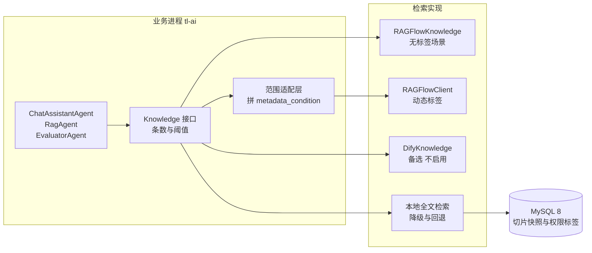

# ADR-001 RAG 与 Agent 选型

状态 已接受　日期 2026-11-01　决策 需求方　记录 设计评审　版本 v1.0

对应 `docs/DESIGN.md` 的 1.6、3.2、3.3、3.5、3.6、4.7、5.1、6.2

## 1 背景与要解决的问题

需求 R9 要求系统内建知识库与检索增强问答，R10 要求一个能提问的会话平台。两条需求带出三个要一起回答的问题：文档怎么变成可检索的片段，会话与工具编排放在哪一层，要不要再引入一个现成的问答应用平台。

约束在评审前已经定了：内网单机部署，单进程分层单体，权限与数据范围留在应用层，模型走火山引擎 Ark 的公网接口，试点两周、三到五名真实用户。

判定方案用五条标准：复杂版式与扫描件的解析质量、权限能否按人收敛、与工单表的集成成本、长期运维成本、换实现的代价。

## 2 决策

| 组件 | 决定 | 理由 | 回退条件 |
|---|---|---|---|
| RAGFlow | 作为知识库检索底座，进主链路 | 版面解析、表格识别、混合检索与重排都是它的强项；自建要自己处理扫描件与合并单元格 | 检索 P95 连续一周超过 800 毫秒，或升级后解析质量明显回退，见第 9 节 |
| AgentScope Java | 保留，作为唯一编排层 | 工具注册、流式输出、结构化校验现成；检索经 `Knowledge` 接口接入，不关心底层是谁 | 试点期若只需固定模板拼提示词，可退化为直调模型 |
| Dify | 本轮不引入 | 应用、会话与工具能力与本系统重叠，权限以应用为身份、越过个人范围 | 需要图形化调提示词时作为离线工坊，不进生产链路 |
| 自建检索 | 降为降级路径与回退方案 | 保留 `kb_chunk` 正文快照与 `ft_chunk` 全文索引，保证 RAGFlow 不可用时仍有东西可查 | 见第 9 节 |
| 知识库分区 | 单库加部门与可见范围标签（对应 Q8 的 A） | 同一份制度只存一次，跨部门共享的文件不出现副本；标签把召回池收窄到"本部门加全员可见" | 标签过滤不可用时回退为公共与部门两类知识库，见第 5 节与第 9 节 |

边界同样属于决策内容：RAGFlow 不进会话链路，不承载工具调用，不认识部门树；AgentScope 不承载解析与向量，不存业务数据；Dify 不进生产链路。三者只在自己的那一层出现。

## 3 被否决的方向

| 方向 | 提议 | 否决点 | 什么条件下重新考虑 |
|---|---|---|---|
| 全自建 | POI 抽文本，自研切片、向量与检索 | 解析是短板：样本里的产量表有合并单元格，制度多为 Word 转出的长文档，部分还是扫描件 | 外部平台不可用，或知识降到只有纯文本的制度 |
| Dify 整套 | 会话、应用、知识库、工具都放 Dify | 与 4.8 的会话平台重叠，且权限以应用为身份 | 需要非技术人员在图形界面调提示词，且只做内部试用 |
| RAGFlow 加 Dify 双层 | RAGFlow 存知识，Dify 做会话 | 两套知识库与两套会话记录，且多一跳 | 不设触发条件，重叠问题不会因为规模变小而消失 |
| 只用 AgentScope 不接外部知识库 | 让 Agent 自己建索引与检索 | 解析与重排要自己实现，工期最长 | 知识只限几十份纯文本制度 |

## 4 本地实证

结论落在代码上。本机 `/Users/zxc/Documents/ai/agentscope-java` 逐文件核对，结果如下。

| 模块 | 核对到的内容 | 对决策的意义 |
|---|---|---|
| `agentscope-core` 的 `rag.Knowledge` | 接口只有 `retrieve(String, RetrieveConfig)` 与 `addDocuments(List<Document>)`；`RetrieveConfig` 只有 `limit`、`scoreThreshold`、`vectorName`、`conversationHistory` 四个字段 | 检索的统一入口存在，但它不承载数据集、文档与标签的过滤条件 |
| `agentscope-extensions-rag-ragflow` 的 `RAGFlowKnowledge` | `retrieve` 把第四个参数 `metadataCondition` 固定传 `null`；`addDocuments` 直接抛 `UnsupportedOperationException` | 只用这个适配器时，带标签的检索与文档上传都得自己补 |
| 同模块的 `RAGFlowClient` | `POST /api/v1/retrieval`，可传 `question`、`dataset_ids`、`document_ids`、`top_k`、`similarity_threshold`、`vector_similarity_weight`、`page`、`page_size`、`use_kg`、`toc_enhance`、`rerank_id`、`keyword`、`highlight`、`cross_languages`、`metadata_condition` | 标签过滤在协议层有位置，缺的是从应用到它的透传 |
| 同模块的 `RAGFlowConfig` | 默认 `top_k` 为 1024、`page_size` 为 30、阈值 0.2、向量权重 0.3、超时 30 秒、重试 3 次；`datasetIds` 与 `documentIds` 都是列表 | 默认召回过于宽松，每次请求都要收窄；`datasetIds` 多值天然支持两类知识库的回退方案 |
| 同模块的 `RAGFlowChunk` | 字段含 `id`、`content`、`documentId`、`documentName`、`datasetId`、`kbId`、`similarity`、`vectorSimilarity`、`termSimilarity`、`metadata` | 后置复核可直接用切片自带的文档与数据集归属，不必额外查一次 |
| `agentscope-extensions-rag-dify` 的 `DifyKnowledge` | `retrieve` 只传 `limit`；`MetadataFilter` 类存在但未接入检索 | 换成 Dify 也要自己补一层过滤，省不下这部分工作 |
| `agentscope-extensions-model-openai` | 根地址可配，可指向 Ark 的 `/api/v3` | 对话侧不需要额外适配 |

两点必须写清楚，否则实现时会踩空。`Knowledge` 接口是检索的正确切面，但它对标签、数据集这类范围条件一无所知，所以"换实现只换一个 Bean"只对不带范围条件的检索成立。RAGFlow 的文档上传与解析状态不在插件能力内，同步管道要在自己的 REST 客户端里实现。

走查这张图有三条关键边。`Port` 只表达"要几条、阈值多少"，它没有能力表达"只看本部门"，因此范围条件必须由 `Scope` 翻译成 `metadata_condition` 再落到 `Rfc`；漏掉这一环，带权限的检索会退化成全库检索。`RF` 与 `Rfc` 都是 HTTP 一跳，返回的片段要经应用层复核才能进提示词，复核用 `RAGFlowChunk` 自带的 `datasetId` 与 `documentId`。`Local` 直连本库，平时不参与主链路，只在 RAGFlow 不可用或检索超时时接管。

## 5 适配器的分层

实证结论落到实现上，就是一个分两层的适配器，而不是一个 Bean。

| 路径 | 用什么 | 适用场景 | 代价 |
|---|---|---|---|
| 检索，无标签 | `RAGFlowKnowledge` 配 `RetrieveConfig` | 全员可见的单一知识库，或回退方案里的公共知识库 | 不能按部门收窄，只能靠后置复核 |
| 检索，带标签 | 自研范围层，用 `RAGFlowClient` 传动态 `metadata_condition`，按范围缓存客户端 | Q8 的单库加标签方案 | 缓存键要含部门与数据范围；标签条件写错会静默放宽召回 |
| 上传与解析状态 | 自研 REST 客户端，按官方接口上传、触发解析、轮询状态 | 全部文档同步 | 要跟着 RAGFlow 的接口版本走，升级前先在本机试 |
| 后置复核 | 比对 `RAGFlowChunk.datasetId`、`documentId` 与本地 `kb_document` | 全部检索 | 无额外成本 |

第二行是这套方案能否成立的关键。`metadata_condition` 支持 `logic` 与 `conditions` 数组，每一项形如 `name`、`comparison_operator`、`value`，协议层可按部门与可见范围拼出"本部门或全员可见"的条件，但条件作用在文档级还是切片级，本地源码看不出，要靠一次真实检索验证，见第 11 节。

## 6 分维对比

`自建` 一列在本轮降为回退方案，保留它是因为降级路径本来就要它。

| 维度 | RAGFlow | Dify | 自建 |
|---|---|---|---|
| 文档解析 | 内置版面分析与表格识别，对扫描件与复杂版式有专门处理 `[Unverified]` | 通用分段，复杂表格与扫描件通常要先预处理 | POI 抽文本，表格靠规则与模型兜底 |
| 切片 | 模板化切片并支持人工干预 | 分段与父子分段可配 | 按结构切，制度按章节，问题与措施按整对切 |
| 检索 | 混合检索加重排；`metadata_condition` 在协议层可用，官方适配器不透传 | 语义、关键词、混合三档，带 `MetadataFilter` 类但未接入适配器 | FULLTEXT ngram 加向量，融合排序 |
| 编排 | 偏知识库，Agent 能力有限 | 强，有工作流与应用编排 | AgentScope |
| 与本系统集成 | 检索两条 HTTP 调用；上传要自研 RAGFlow REST 客户端 | 独立服务，且需绕回调用我们的工具 | 同进程 |
| 权限与数据范围 | 自带租户与团队，与 `dept` 不一致；范围条件要自己透传与复核 | 同上，且应用级 API Key 天然越过个人范围 | 数据范围直接传参 |
| 运维组件 | 一套独立的存储与检索组件 `[Unverified]` | 关系库加缓存加向量库 `[Unverified]` | 一个 MySQL |
| 中文长文档 | 强项 | 中等 | 取决于切片规则 |
| 许可 | Apache-2.0 `[Unverified]` | Apache-2.0 附加条款，含多租户 SaaS 与标识限制 `[Unverified]` | 自有代码 |
| 切换到另一实现 | 换实现，范围条件那一层要跟着改 | 换实现，过滤仍要自己写 | 是基准实现 |

标注 `[Unverified]` 的格子来自既有认知，本轮没有联网检索能力核实，评审时以官方仓库与许可证原文为准。已核实的格子来自第 4 节的本地源码。

## 7 为什么仍不引入 Dify

第一条是重叠，第二条是权限，第三条是多一跳带来的上下文断裂。

权限这条值得展开。Dify 的调用以应用为身份，不是以人为身份。要做到"这个人只能问本部门的事"，就得在每次调用前把范围拼进检索条件，在返回后再复核一次。这套前置与后置过滤写完，等于我们自己已经实现了检索入口，用不用 Dify 都省不下这部分工作；本地源码还显示它的 `DifyKnowledge.retrieve` 只传 `limit`，连现成的 `MetadataFilter` 都没接上。

上下文断裂这条与 4.8 的工具调用直接相关。会话要查工单与统计，这些数据在我们库里。Dify 的自定义工具只能以 HTTP 回环调我们的接口，于是权限上下文要么在服务间再鉴权一次，要么降级成应用级身份，两种都会在审计里留下说不清的记录。

RAGFlow 没有这些问题，因为它不试图承载会话与工具，只做检索。这是选它而不选 Dify 的关键差别。

## 8 引入 RAGFlow 的代价与应对

接受了这个底座，就要接受六条代价，每条都有对应的做法。

| 代价 | 具体表现 | 应对 |
|---|---|---|
| 多一套服务 | 部署、备份、升级、故障排查都多一份，监控要覆盖它 | 与 tl-api 同机部署，检索走内网；备份脚本把它的数据卷一起纳入，升级只在小版本内跟进 |
| 适配层缺口 | 官方适配器不透传标签条件，也不支持上传文档 | 范围层自己拼 `metadata_condition`，上传走自研 REST 客户端；这两块是本系统的代码，写测试覆盖 |
| 权限两套 | 它自带租户与团队概念，与 `dept`、`employee` 不一致 | 不用它的团队配置，权限全在本系统；检索前按范围传数据集与标签条件，检索后按切片归属复核 |
| 召回池稀释 | 单库容纳全员制度与各部门历史问题，纯语义召回会被别的部门挤占 | 标签过滤收窄池子，`top_k` 固定在 8 而不是默认的 1024，阈值不低于 0.2；标签写错由后置复核兜住 |
| 正文双份 | 切片正文在它那里一份、`kb_chunk` 里一份 `[Unverified]` 它的切片 ID 是否稳定 | 以 RAGFlow 为真相源，本地只作快照与降级检索；重新解析按文档整体覆盖，引用生成时把片段正文写入消息，历史引用不依赖切片 ID 存活 |
| 解析排队 | 大批量导入时解析任务会排队，新文档短时间查不到 | 页面显示排队位置；解析状态异步轮询；失败单篇重试，不整批重传 |

第三条与第四条最容易被忽略。稀释看起来只是召回质量问题，实质是权限方案选 A 之后必然要付的成本，抵偿做不到位就会退化成"问什么都召回一堆别的部门的东西"。双份存储看起来只是空间问题，真正的问题是两边的切片编号会随时间分叉，所以引用必须在生成时就固化正文，而不能只存一个外部 ID。

## 9 回退路径与判定阈值

回退不是推倒重来。`Knowledge` 接口后面还有本地全文检索，它平时休眠，需要时接管。

| 情形 | 动作 |
|---|---|
| RAGFlow 短暂不可用，单次检索失败 | 返回本地 `ft_chunk` 结果，回答标明降级，事件流照常结束 |
| 检索 P95 连续一周超过 800 毫秒 | 先扩 RAGFlow 资源并降低单次召回条数；仍不达标则把主链路切回本地检索，RAGFlow 只留解析 |
| 升级后解析质量明显回退，引用命中率下降超过 10 个百分点 | 锁定上一个版本，回退镜像；解析与检索分开评估，允许只回退解析 |
| 法务或采购不允许继续使用 | 切本地全文检索加自研向量，`kb_chunk` 恢复 `embedding` 列，编排层不动 |
| `metadata_condition` 不生效或只作用于文档级以外的层级 | 回退为公共与部门两类知识库，`kb_document.dataset_id` 从一值变成两值，检索传两个知识库 ID；`datasetIds` 是列表，配置层不用改 |
| 适配层维护成本过高 | 收敛为只做检索的范围层，上传改走 RAGFlow 控制台，同步降为人工触发 |

判定用数据，不用印象。需要三个指标连续记录：检索 P95、引用命中率（引用片段确实包含答案）、零命中率。三者放在 8.3 的观测面板上，出问题时先看这三个数。单库标签方案还多一个判据：越权查询的命中数必须为零，只要出现一条跨部门私有切片被召回，就当标签过滤没生效。

## 10 验证与观察期

M4 开工前一周内做完五步，每步留一条可复核的记录。

| 步骤 | 做什么 | 通过标准 |
|---|---|---|
| 一 | 建一个知识库，放一篇制度与两份部门文档，给文档打部门与可见范围两个标签 | 控制台能看到标签，检索返回的切片带 `metadata` |
| 二 | 直接调 `RAGFlowClient.retrieve` 带 `metadata_condition`，问同一个问题 | 命中条数明显少于不带条件的同一次检索，且没有其它部门切片 |
| 三 | 用执行者身份问本部门问题与其它部门问题各三次 | 前者有命中，后者零命中；出现一条跨部门切片即判失败 |
| 四 | 同一文档解析两次 | 记录切片 ID 是否变化、正文是否一致，决定引用回溯的写法 |
| 五 | 停掉 RAGFlow 进程，再问一次 | 返回本地全文检索结果，并标明降级 |

观察期两周，记录四个数：检索 P95、引用命中率、零命中率、解析排队时长中位数；越权命中数单独列一行，同一时间窗内必须为零。观察结束前不做第二次调参，避免把数据调成想要的样子。

## 11 待核实的事项

| 事项 | 为什么要紧 | 怎么核实 |
|---|---|---|
| RAGFlow 的当前版本、部署组件、许可证 | 决定运维成本与法务风险 | 拉官方仓库与 LICENSE 原文 |
| `metadata_condition` 的生效层级与标签写法 | 决定单库加标签方案能否成立；不支持或只支持到某一层就要回退 | 用第 10 节第一步与第二步，记录文档级与切片级的差异 |
| 文档上传与解析状态接口的路径与版本 | 决定自研客户端的工作量与升级风险 | 调官方接口文档，做一次真实上传与状态轮询 |
| 重新解析后切片 ID 是否变化 | 决定引用里固化的切片 ID 重新解析后能否回溯到同一段正文 | 规则见第 10 节第四步 |
| 切片模板的可配置项 | 决定制度按章节、问题按整对切的规则能否配出来 | 用一份制度文件与一份历史日报试配两个模板 |
| 自定义 OpenAI 兼容的 embedding 能否指向 Ark | 决定向量模型是否必须用其内置模型 | 在模型提供商里加一次自定义配置并试跑 |

前四项在 M4 开工前补齐，补齐后本文档与 `docs/LLM-CONFIG.md` 一起升版本。

## 12 对设计文档的影响

`docs/DESIGN.md` 1.6 记了这项决策；3.2 加了外部服务与检索适配器；3.3 的依赖写明检索走 `Knowledge`、上传走自研客户端；3.5 把"同库向量列"换成 RAGFlow 底座并写明不引 Dify；3.6 加了 RAGFlow 节点与模型换代的分界；4.7 按"分工边界、同步管道、两层适配、分区方式、降级"重写；5.1 与 6.2 的 `kb_chunk` 去掉向量列，新增 `kb_document` 与两个标签列；6.4、第 7 章、8.2、8.3、9.2、M4、Q8 同步调整。

接口与表结构以设计文档为准，决策理由、代价与回退条件以本文档为准。两者之间若是接口层面的冲突，以设计文档为准并在本文档补一条变更记录。

## 13 变更记录

| 版本 | 日期 | 变更 |
|---|---|---|
| v0.1 | 2026-11-01 | 初稿：以自建向量检索为主方案，RAGFlow 与 Dify 并列比较 |
| v0.2 | 2026-11-01 | 需求方确认 RAGFlow 作检索底座、Dify 不进生产链路，改写为已接受 |
| v1.0 | 2026-11-01 | 补本地源码实证：`Knowledge` 接口的能力边界、`RAGFlowClient` 可用参数、适配器不支持上传；由此确定适配器分两层，并改写回退判据、验证步骤与待核实项 |

## 14 参考

| 依据 | 位置 |
|---|---|
| `Knowledge` 接口与 `RetrieveConfig` | 本机 `agentscope-java/agentscope-core/src/main/java/io/agentscope/core/rag/` |
| RAGFlow 检索适配器与客户端 | 本机 `agentscope-java/agentscope-extensions/agentscope-extensions-rag/agentscope-extensions-rag-ragflow/` |
| Dify 检索适配器 | 本机 `agentscope-java/agentscope-extensions/agentscope-extensions-rag/agentscope-extensions-rag-dify/` |
| 模型接入与配置 | `docs/LLM-CONFIG.md`、`config/application-ai.yml` |
| 表结构与接口 | `docs/DESIGN.md` 4.7、5.1、6.2 |
