# TraceLink 工单系统设计文档

版本 v0.7　编写日期 2026-11-01　状态 评审稿（Q1–Q12 与 RAG 底座已确认，余 3 项待答；第 6 章含逐表字段说明，第 9 章含页面一览与交互设计）

## 1 文档定位与需求来源

### 1.1 文档分类

| 维度 | 判定 | 判定依据 |
|---|---|---|
| 文档类型 | 组合设计文档，以概要设计（HLD）为主干，合并数据设计与接口设计 | 系统为新建、模块数多，前后端需要同一份表结构与接口契约才能并行开发 |
| 系统阶段 | Greenfield | 仓库除 `.git` 外为空，没有既有系统需要兼容 |
| 读者 | 设计评审人、后端工程师、前端工程师、实施与运维 | 三类角色都在文档里有对应章节：模块与接口给后端，页面与视觉约束给前端，部署与失败处理给运维 |
| 复杂度 | Heavyweight | 9 个功能域、3 类角色、模型服务与 RAGFlow 检索服务依赖，跨组织、任务、对话、智能四层 |
| 上游材料 | 仅口头需求，外加一份真实日报样本 | 没有 PRD。因此需求在第 1.2 节逐条列出并标 `[Hypothesis]`，确认后才可作为设计基线 |

样本文件为 `2026年10月31日工作日志-张厚生.xlsx`，含 10 个工作表（`20261025`、`1026`、`1027`、`1028`、`29`、`30`、`31`、`11月1日`、`2`、`3`）。它不是设计输入的全部，但决定了导入模块的解析规则与工单字段的取值来源，因此第 2 章从它的实测结构出发。

### 1.2 需求条目与假设标记

| ID | 需求 | 来源 | 证据标记 |
|---|---|---|---|
| R1 | 部门管理，支持多级组织与部门负责人 | 用户口头需求 | `[Hypothesis]` |
| R2 | 职位管理，含职级与是否管理岗 | 用户口头需求 | `[Hypothesis]` |
| R3 | 人员管理，含直属上级与在职状态 | 用户口头需求 | `[Hypothesis]` |
| R4 | 任务（工单）管理，含指派、优先级、期限 | 用户口头需求 | `[Hypothesis]` |
| R5 | 任务追踪，过程记录可查、可催办 | 用户口头需求 | `[Hypothesis]` |
| R6 | 完成情况统计与图表 | 用户口头需求 | `[Hypothesis]` |
| R7 | Excel 导入并智能识别字段与结构 | 用户口头需求 + 样本文件 | `[Data-backed]` 结构部分，`[Hypothesis]` 准确率目标 |
| R8 | 按固定格式导出 | 用户口头需求 + 样本文件 | `[Data-backed]` |
| R9 | 知识库与检索增强问答 | 用户口头需求 | `[Hypothesis]` |
| R10 | 系统内会话平台，用自然语言提问并由模型结合知识库回答；人员评价、任务评价与建议由工单数据产出 | 用户口头需求 + 澄清 | `[Data-backed]` 会话形态；`[Hypothesis]` 评价口径 |
| R11 | 三类角色（管理者、负责人、执行者）的差异化视图 | 用户口头需求 | `[Hypothesis]` |
| R12 | 页面视觉参照 `Memory-Observatory/memory-observatory` | 用户指定 | `[Data-backed]` |
| R13 | 技术栈锁定 Spring Boot、AgentScope、Maven、MySQL | 用户指定 | `[Data-backed]` |
| R14 | 完成地图：把"完成"拆成若干可判定的条件，逐份工单显示哪些条件已达成、还差哪些、差的那一项由谁补 | 用户口头追加（2026-11-01） | `[Hypothesis]` 条件集合与阈值 |

R4 与 R5 的边界需要在评审时确认：如果把"追踪"理解为独立对象，它是工单下的记录流；如果理解为独立模块，它需要有独立的查询与提醒入口。本设计取后者，把追踪做成工单模块内的一等对象 `task_checkin`，并为它单独开查询与提醒接口（见 5.1 的 `TRK-*`）。

### 1.3 覆盖与不覆盖

覆盖：组织三件套、工单与追踪、完成地图与缺口提醒、统计与图表、Excel 导入、固定格式导出、知识库问答、会话平台、三角色权限、视觉约束。

不覆盖：薪资与考勤核算、采购与库存、财务凭证、原生移动 App、多租户（单企业部署）、工作流引擎式审批建模。这些在后续版本再评估，本设计不为它们预留耦合。

### 1.4 术语

| 术语 | 含义 |
|---|---|
| 工单 task | 一件需要有人负责、有期限、能追踪到结果的工作单元 |
| 负责人 owner | 对结果负责并可验收的人，通常是分管领导或部门经理；一份工单只有一个 |
| 主责执行人 primary assignee | 实际推进的人；一份工单只有一个，其余协办人走 `task_assignee` |
| 追踪记录 checkin | 一次带进度、说明、证据的过程记录 |
| 问题项 issue | 工单内部的一个具体问题点，可独立关闭 |
| 措施项 action | 针对某个问题项的动作，带执行人与期限 |
| 数据范围 data scope | 角色可见数据的边界：本人、本部门、本部门及下级、全公司 |
| 智能识别 | 把不规整的单元格内容解析成结构化字段的过程 |
| 待确认队列 | AI 产出先进这里，人确认后才写入正式表 |
| 会话 session | 用户与模型的一段连续对话，含多轮提问与回答 |
| 引用 citation | 回答里指向知识切片、工单或统计结果的定位，可点击回溯 |
| 完成条件 gate | 判定一份工单"是否可以算完成"的一条二值条件，例如问题项全关、证据已附、验收已过 |
| 缺口 gap | 尚未达成的完成条件，连同该由谁补、已经卡了多少天 |
| 完成地图 | 以工单为行、完成条件为列派生的只读视图，用于看已达成什么、还差什么 |

### 1.5 需求到章节的对应

| 需求 | 主要章节 |
|---|---|
| R1–R3 | 4.1 组织模块，6.2 表结构，5.1 契约 `ORG-*` |
| R4–R5 | 4.2 工单模块，4.3 追踪模块，3.4 时序，5.2 契约 `TSK-*`、`TRK-*` |
| R6 | 4.4 统计模块，6.3 表与字段说明，6.4 索引与预聚合 |
| R7 | 4.5 导入模块，3.4 导入时序 |
| R8 | 4.6 导出模块 |
| R9 | 4.7 知识库模块 |
| R10 | 4.8 会话平台模块，4.9 AI 编排，5.1 契约 `CHT-*`、`EVL-*` |
| R11 | 8.1 权限设计，9.2 页面地图与页面一览 |
| R12 | 9.1 视觉 token，9.3 通用交互规则，9.8 组件规范 |
| R14 | 4.10 完成地图模块，5.1 契约 `CMP-*`，6.2 条件规则与快照表，9.2 完成地图页 |

### 1.6 已确认的决策

以下十三项已在 2026-11-01 的评审对话中由需求方确认，不再作为待定项留在第 11 章。第 11 章只留这一轮新产生的问题。

| 编号 | 决策 | 确认内容 | 影响章节 |
|---|---|---|---|
| Q1 | 工单粒度 | 一件事一份工单；同一件事在多天的推进写成多条追踪记录；日报行只能新建一件或并入已有工单 | 4.2、4.5、6.2 |
| Q2 | 主责唯一 | 一份工单只有一个主责执行人；源数据里的多人格或群体格不进主责，落待认领，由负责人指定唯一一人后工单才离开草稿 | 4.2、4.5、6.2 |
| Q3 | 会话形态 | 系统内建会话平台，用户在其中提问，由模型结合知识库回答；不接企业微信、钉钉、飞书的会话存档。模型能碰多少业务数据仍待答，见第 11 章 | 4.8、4.9、5.1、6.2 |
| Q4 | 评价可见 | 人员评价只对管理者显示，带置信度与申诉入口；本人与其他角色都看不到分数 | 4.8、8.1、9.2 |
| Q5 | 导出格式 | 严格复刻样本版式，导出的日报可以再次导入，不做易读化重排 | 4.6、5.2 |
| Q6 | 移动端 | 响应式 H5，打卡与拍照可用；不做原生 App | 9.2、10 |
| Q7 | 部署与模型 | 内网单机跑 tl-api、MySQL 与 RAGFlow；对话与向量模型走火山引擎 Ark 的公网接口 | 3.6、4.7 |
| Q8 | 知识库分区 | 全部知识放一个 RAGFlow 知识库，切片带部门与可见范围标签，检索时按标签过滤 | 4.7、6.2 |
| Q9 | 审批流 | 只做验收与改期理由，不引工作流引擎 | 4.2 |
| Q10 | 主数据来源 | 花名册导入、手工维护与别名表；不做通讯录定时同步 | 4.1、5.1 |
| Q11 | 试点范围 | 生产部与质量部，三到五名真实用户，两周 | 10 |
| Q12 | 模型数据边界 | A+B：问答、知识检索、工单与统计的只读查询；分析建议先做（两类评价与五类建议），结果只进待确认队列，由应用服务执行确定性动作；模型不持有写接口，建单起草推迟到试点之后 | 4.8、4.9、5.1、10 |
| RAG 底座 | 检索实现 | 用 RAGFlow 承担解析、切片、向量、混合检索与重排；AgentScope 串流程；本轮不引入 Dify | 3.2、3.5、3.6、4.7、6.2 |

Q1 把 2.2 的 C2 从观察升级为约束：`task_checkin` 是唯一承载多天进展的表，`task` 与 `daily_report` 之间不设一一对应，`source_ref` 用数组记录这件事引用过的所有日报位置。这条约束的直接后果在 4.5 的归并规则里，同一标题、同一主责、同一部门的多天行默认合并到一件工单。

Q2 把 2.2 的 C1 从"允许多个参与人"收紧为"主责只有一个"。源数据里 `许伟，王先兵，曹长坤` 这样的多人格与 `各个部门`、`车间各班组` 这样的群体格都不解析成多个主责，也不建部门级工单：整行落待认领，工单停在草稿，直到有人被指定。这样逾期归属、验收人与人员指标都只有一个落点；协办人只记参与，不承担验收与逾期。

Q8 定的是知识库如何分区，不是检索怎么做。RAGFlow 的检索协议里有按元数据过滤的 `metadata_condition`，但 AgentScope 的检索适配器把这个参数固定传空，所以单库加标签要把范围层自己接出来；条件生效在文档级还是切片级尚未核实，因此它是 M4 开工的前置条件：不成立时回退为公共知识与部门知识两类知识库（`datasetIds` 本身是列表，配置层不用改），回退方式写在 4.7 与 `docs/ADR-001-RAG与Agent选型.md`。选单库的理由是同一份制度只存一次，跨部门共享的文件不会出现多个副本。

Q3 使 2.1 观察到的"证据沉淀在群里"变成一个仍需处理但不由系统对接的问题。会话平台本身不产出执行证据：它承载的是提问、回答与引用，证据仍由执行人上传附件或在追踪记录里写明。外部群聊的内容若要进入系统，走 4.3 的人工记录或 4.5 的导入，不做接口层面的对接。会话平台的价值在于把"问一句要翻三个页面"的事变成一句话，并且回答带得回原文的引用。

Q12 取 A 加 B，不取 C，边界落在「模型只读、建议可写」。A 是问答与知识检索，B 是在调用人数据范围内查工单与统计，两者都不改任何业务表。分析建议先做：两类评价与五类建议由工单与追踪记录算出，结论连同证据写进待确认队列，人点了采纳之后由应用服务执行与该建议对应的确定性动作，模型手上没有写接口。这样即使模型给出错误建议，最坏的结果是一条被忽略的记录，不会写成一张内容错的工单。代价是少了一个「描述一句话就建单」的入口，建单仍要走 4.2 的五项必填。起草放到试点之后重启，触发条件是试点期里「用自然语言描述新事项」的提问占比超过两成，且人工建单的平均耗时没有下降。

RAG 底座的确认改写了 4.7 的实现分界。解析、切片、向量与混合检索交给 RAGFlow，本系统不再自算向量，`kb_chunk` 从"向量存储"退为"正文快照与引用元数据"。代价是多一个需要部署与备份的服务，收益是表格与扫描件的解析质量不必自己实现。权限仍然留在应用层，因为 RAGFlow 不认识我们的部门树。取舍与切换条件记在 `docs/ADR-001-RAG与Agent选型.md`。

## 2 样本结构决定的设计约束

### 2.1 实测结构

样本的每一页都是同一种形态：表头写"汇报人、职务、日期"，正文是 10 列固定结构，表尾挂一块车间生产数据。逐列实测结果如下。

| 列 | 实测内容 | 结构特征 |
|---|---|---|
| 序号 | `1`、`2`、`3`，带纵向合并单元格 | 一个序号对应一件工作，下面可挂多条问题 |
| 工作内容 | `现场巡查及整改`、`2027年经营计划`、`加快新喷粉线建设` | 偏事项标题，粒度粗，无编号规则 |
| 时间安排 | `7:30-8:00`、`7:10-7:30`，多数为空 | 有则可用，无则缺 |
| 负责人 | `张厚生`、`许伟`、`沈桦，王源森` | 逗号分隔，多为督办角色 |
| 责任人 | `许伟，王先兵，曹长坤`、`各个部门`、`人事`、`车间各班组` | 人名、部门名、群体名混用 |
| 参与人 | `王先兵具体落实`、`喷粉车间` | 自由文本，不是实体引用 |
| 遇到的问题 | `1、二车间门歪了  2、施工现场施工垃圾` | 单格内含 1 至 4 个编号问题 |
| 解决方案 | `加强清洗，提前喷环氧底漆`、`1、先清理现场5S…2、…` | 措施带编号，多数无执行人与期限 |
| 汇报结果（未完成原因/追踪的结果） | 大量空白；`群里已经回复`、`答应今天完成`；`#VALUE!` | 结果填写率低，且混有公式错误值 |
| 备注：具体数据 | `#VALUE!` 与少量文本 | 量化数据没有固定位置 |

表尾生产块的形态是 9 个工序 × 计划与完成两列，日期以 Excel 序列号出现（`46325` 对应 2026-10-27），个别单元格是文本（`折弯20，直缝焊10`）。附件证据以文件路径文本出现（`..\2026年10月27日星期二产量没有完成情况调查20261028.docx`），另有"建立现场改善群""照片发群里了"这类记录，说明执行证据实际沉淀在即时通讯群里。

### 2.2 从结构推导出的设计约束

| 约束 | 依据 | 对设计的直接影响 |
|---|---|---|
| C1 一份工单只能有一个主责人，但源数据常填多人或群体 | `责任人` 列出现 3 个人名或整个部门 | `task.primary_assignee_id` 单值且非空；多出来的名字进 `task_assignee` 只记参与；命中部门名或群体名时不猜人，整行进待认领，工单停在草稿 |
| C2 一件事会跨多天重复出现 | `2027年经营计划` 连续出现在 26 日至 31 日，期限反复顺延 | 工单与日报行是一对多：一行日报并入同部门同主责的相似在办工单，多天进展写成多条追踪记录 |
| C3 结果列允许为空或写非结构化话术 | 半数结果格空白，`群里已经回复` 这类表述无证据 | 状态迁移规则要求提交时至少有一条结果记录；空值与公式错误值在导入阶段被判为脏值 |
| C4 问题与措施是多条，且需要分别指派 | 单格内 `1、2、3` 编号 | 问题与措施各自建表，措施必须带执行人与期限才能离开草稿 |
| C5 期限字段不可靠，需要系统侧强制 | 大量 `时间安排` 为空，期限只在方案文字里出现 | `plan_end` 非空约束；导入时无期限的工单一律进"待补期限"队列 |
| C6 量化数据与文字记录分离 | 生产块独立于明细区 | 指标独立建表 `task_metric`，工单只引用指标，不在工单里塞数字 |
| C7 结构不规整，无法用固定模板映射 | 合并单元格、空工作表、三种日期写法 | 导入走"结构识别 + 字段映射 + 行内拆解"三步，映射结果可复用 |

### 2.3 设计目标

| 目标 | 度量方式 |
|---|---|
| 一条真实事项能从创建走到验收，全过程可查 | M1 验收时用生产部一条真实整改事项走完 |
| 现有日报可导入、可原样导出 | 样本 10 页的明细行识别率不低于 95%，人名匹配率不低于 92% |
| 管理者能在十秒内看到"哪些事没结果、谁在拖" | 驾驶舱首屏包含逾期与未提交结果的集中入口 |
| 每张在办工单都能回答"还差什么" | 详情页一屏看到九条完成条件的状态与承担者；缺口不超过三项时能当场补完 |
| 每条 AI 结论可点回原始证据 | 评价与建议的输出都带证据 ID，页面可跳转 |
| 不增加填报负担 | 日报的 10 列与系统字段一一对应，导出件可继续手填再导回 |

## 3 系统架构

### 3.1 架构风格与驱动因素

系统采用分层单体加模块化工程：一个 Spring Boot 进程，内部按 Maven 模块切出组织、工单、追踪、统计（含完成地图）、导入导出、知识库、会话平台、AI 编排八块，依赖方向单向。

选择单体的原因有三个。部署侧是单企业内网，并发规模在二百在线上下 `[Hypothesis]`，微服务带来的注册中心、网关、分布式事务与链路治理，对这个规模是净负担。团队侧需要一个人能同时改前后端与表结构，多进程会让本地联调成本翻倍。演进侧留了出口：模块之间只通过应用服务接口调用，不共享 Mapper；将来某一块（最可能是知识库检索或会话平台）要独立部署，把该模块的 `app` 层暴露为 REST 即可，不需要重写业务逻辑。

### 3.2 架构图

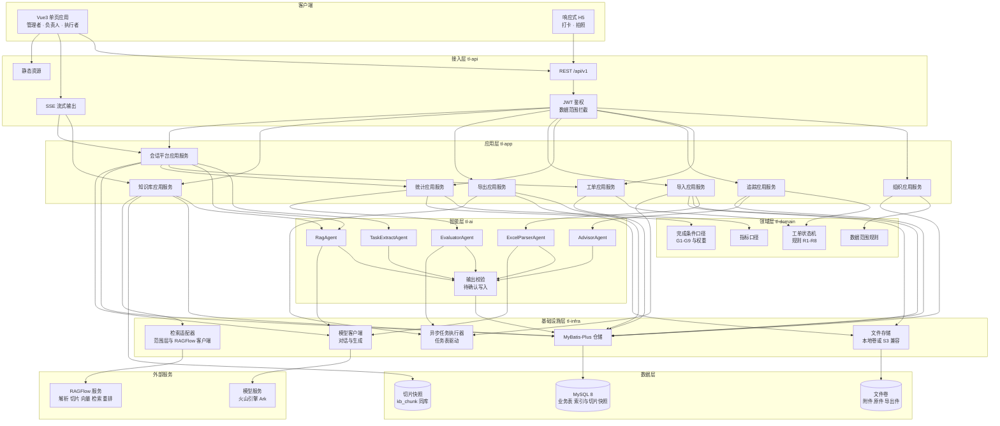

图中五个边界值得单独说明。智能层不直接写业务表，所有 AI 产出先落到待确认表，再由应用服务校验后写入正式表，这条约束由 `Guard` 组件承担，也是第 7 章失败处理的前提。会话平台是唯一同时指向工单、统计与知识库三个应用服务的组件，这三条边就是模型能调的只读工具，入参一律先注入调用人的数据范围。检索只走一条出去的边，从知识库应用服务经适配器到 RAGFlow，业务代码不认识 HTTP 细节，换检索实现只换适配器。基础设施层里模型客户端同样是可替换适配器，换模型只改实现与配置。数据层只有一个 MySQL 库，切片在这里只存正文快照与引用元数据，正文与向量在 RAGFlow 里。

### 3.3 组件职责与边界

| 组件 | 负责 | 不负责 | 依赖 |
|---|---|---|---|
| 组织应用服务 | 部门树、职位、人员、别名表、直属上级链 | 权限判定（由接入层与数据范围规则负责） | 仓储、数据范围规则 |
| 工单应用服务 | 工单生命周期、指派、拆解问题与措施、复发识别 | 过程记录的内容校验（由追踪模块负责） | 状态机、仓储、AI 建议 |
| 追踪应用服务 | 追踪记录写入、阻碍登记、催办、逾期升级 | 统计口径计算 | 状态机、通知、AI 摘要 |
| 统计应用服务 | 指标定义、预聚合、图表数据组装、完成地图派生与缺口统计 | 明细数据修复；完成条件本身的达成动作 | 指标口径、完成条件口径、预聚合表 |
| 导入应用服务 | 上传、结构识别调度、映射确认、逐行校验、入库与撤回 | 单元格视觉样式保留（导出模块负责） | 文件存储、ExcelParserAgent、异步任务 |
| 导出应用服务 | 模板渲染、原格式回写、批量打包 | 数据口径计算 | 文件存储、异步任务 |
| 知识库应用服务 | 文档同步到 RAGFlow、切片快照回写、检索前后两道权限过滤、带引用问答、解析失败重试 | 版面解析、切片算法、向量化与重排（由 RAGFlow 承担） | 仓储、检索适配器（含范围层）、上传与解析客户端、模型客户端、RagAgent |
| 会话平台应用服务 | 会话与消息留存、流式回答、引用回溯、只读工具编排、分析建议的产出与采纳 | 自动建单、自动改工单状态、访客与外部平台的聊天记录 | 知识库应用服务、工单与统计查询接口、RagAgent、ChatAssistantAgent |
| AI 编排层 | Agent 与工具编排、输出结构校验、成本记录 | 业务规则判定 | 模型客户端、应用服务端口 |

### 3.4 主流程

工单从建单到验收的时序如下，其中退回分支是必须实现的部分，因为源数据里"做完了但没做对"的争议会直接落到这里。

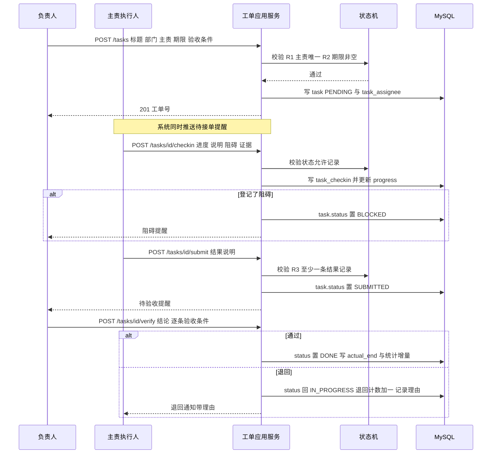

导入流程的时序差异在于"识别与确认分离"：识别阶段只产生草稿与校验报告，不写业务表。

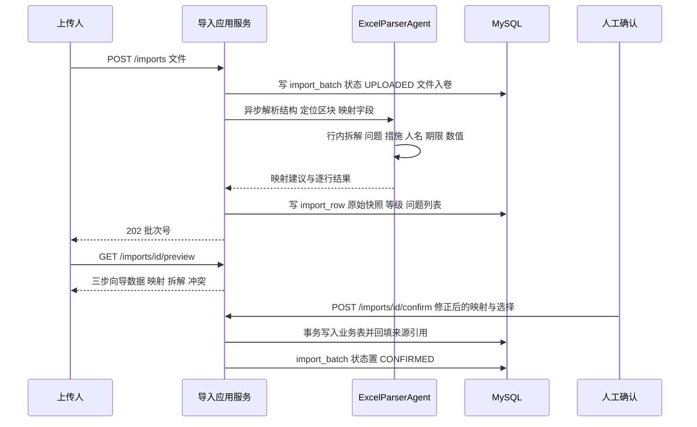

### 3.5 技术选型与理由

| 选择 | 理由 | 服务的约束 | 证据 |
|---|---|---|---|
| Spring Boot 3.x `[To be confirmed]` + JDK 21 | 与参照项目同族，团队可直接复用工程经验；虚拟线程让导入导出这类阻塞任务不必单独堆线程池 | 交付速度与运维熟悉度 | `[Expert judgment]` |
| Maven 多模块，父 POM 统一版本 | 用模块边界强制依赖方向，避免智能层顺手写库这类腐化；比 Gradle 更贴合现有团队习惯 | 3.1 的分层约束 | `[Expert judgment]` |
| MyBatis-Plus + XML 统计查询 | 统计需要手写聚合与索引提示，JPA 的抽象在这类查询上会绕开优化 | 4.4 的图表查询性能 | `[Expert judgment]` |
| 知识库检索底座用 RAGFlow | 版面解析、表格识别、混合检索与重排是它的强项，自建这条路要自己处理扫描件与合并单元格；本系统只留切片快照与引用元数据，权限过滤仍在应用层 | R9 与 C7 的表格结构 | `[Data-backed]` 需求方决定；其部署组件 `[To be confirmed]` |
| Apache POI 直接操作工作簿 | 需要读合并单元格、定位非固定区块、保存原始行快照；注解式映射库假设一张表结构固定，与本样本不符 | C7 | `[Data-backed]` 样本结构 |
| AgentScope Java `[To be confirmed]` | 需要 Agent 与工具的编排、流式输出、结构化输出校验；自研会重复实现工具注册与重试。它还把检索抽象成 `Knowledge` 接口，RAGFlow 与 Dify 都有现成适配器，换检索后端不动编排层（见 `docs/ADR-001-RAG与Agent选型.md`） | R7、R9、R10 | `[Expert judgment]` 加本地源码核对 |
| 模型服务走火山引擎 Ark 的 OpenAI 兼容接口 | 对话模型在应用侧配置，向量与重排模型在 RAGFlow 侧配置，都指向同一组 Ark 接入点；换服务商只改服务地址与模型名 | R9、R10 | `[Data-backed]` 需求方指定火山引擎；接入点与模型名 `[To be confirmed]` |
| 本轮不引入 Dify | 它的应用、会话与工具能力与本系统重叠，权限以应用为身份、越过个人范围；引入等于同一条能力写两遍，且会话历史对不上 | R10 | `[Expert judgment]` 加 `docs/ADR-001-RAG与Agent选型.md` |
| 会话回答用 SSE 而不是 WebSocket | 问答是单向流式，SSE 走普通 HTTP，鉴权、限流、审计复用同一套拦截器；WebSocket 要多一套连接管理与心跳，只在需要双向实时时才划算 | 4.8 的流式输出 | `[Expert judgment]` |
| 异步任务用任务表加调度器，不引消息队列 | 导入、导出、批量评价都是低频长任务，需要可重放、可人工重试、可在页面上看到进度；任务表天然满足这三点 | 4.5、第 7 章 | `[Expert judgment]` |
| 完成地图用派生视图，不新增一套状态 | "完成"由若干可判定条件合成，条件全部从既有表与规则派生，页面、提醒与统计读同一份口径；另建一套状态会让工单状态与完成度两处打架 | R14 | `[Expert judgment]` |
| Vue 3 + Vite + ECharts `[To be confirmed]` | 十五个以上角色化管理页面无法用单文件页面承载；但 CSS 变量与组件形态沿用参照项目，视觉不分裂 | R12 | `[Data-backed]` 用户指定参照 |
| 附件先落本地卷，接口按 S3 语义设计 | 单机部署不需要对象存储服务；接口抽象保证后续换对象存储只改实现 | 部署约束 | `[Expert judgment]` |

### 3.6 部署视图

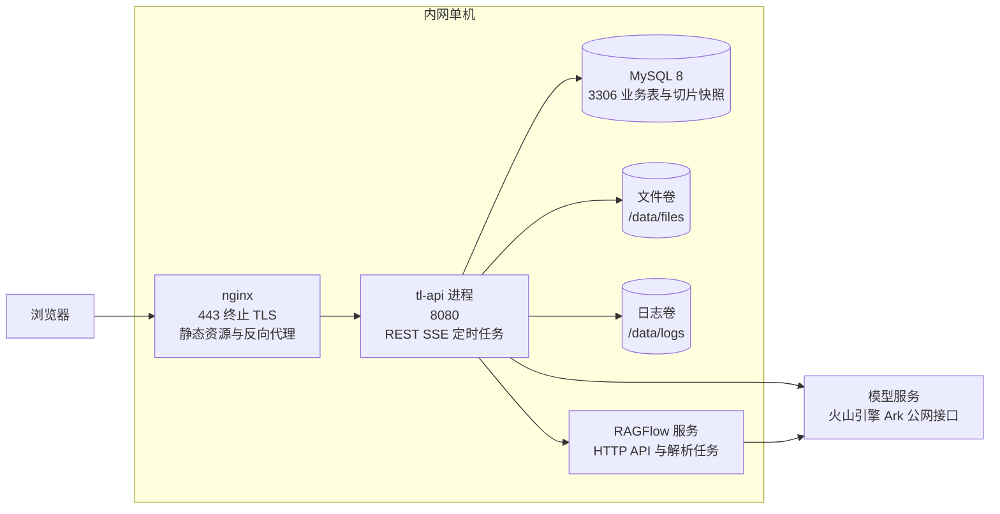

这个拓扑的前提是 tl-api 与 MySQL 同机或同网段低延迟内网。RAGFlow 与 tl-api 同机部署，检索是一次内网 HTTP 调用，不跨公网。RAGFlow 自身还要一套存储与检索组件，具体组件范围以官方部署文档为准 `[To be confirmed]`，备份与升级跟着它走。

模型服务按 Q7 定在火山引擎 Ark，机器在内网、模型在公网，因此 tl-api 与 RAGFlow 各需要一条出网通道。这条通道是直连还是经代理，取决于内网策略 `[To be confirmed]`，代理节点只在确有必要时加进这张图。出网方向是单向的：本系统与 RAGFlow 调 Ark，Ark 不回调本系统。

模型换代的影响现在分两处。对话模型换只需改应用侧配置；向量模型换要在 RAGFlow 侧重建该知识库的索引，本地把 `kb_document.embedding_model` 更新即可对照，不需要在本系统重算任何向量。

会话问答走 SSE，nginx 需要对 `/api/v1/chat/` 这条路径关闭 `proxy_buffering` 并把读超时抬到 60 秒以上，否则增量文本会被攒成整段返回，首字节延迟的设计目标失去意义。

## 4 模块设计

### 4.1 组织模块

职责：维护部门树、职位与人员，并提供姓名到人员的解析能力。

输入：管理端的新增与修改、花名册导入文件。输出：组织树查询结果、可指派人员范围、姓名解析结果。依赖：仓储、数据范围规则。边界：不做权限判定，不存登录凭据以外的账号信息。

主数据来源按 Q10 定在花名册导入加手工维护加别名表，不做通讯录定时同步。理由是通讯录文件里的字段与系统需要的字段并不一致，同步要写一套字段映射与冲突处理，而花名册一年只变几次，一次性导入足够。

人员解析是本模块最容易被低估的部分。导入与建议里的人名匹配都靠它，而样本里同一个人有 `张厚生` 与 `张总`、`沈桦` 与 `老沈` 两种写法，因此单独建 `employee_alias` 表存别名，命中别名与命中本名的处理一致。解析返回三种结果：唯一命中、多个同名人需人工选、未命中进待认领队列。解析不猜测，这是 C1 在实现层的具体形式。

部门树用物化路径 `path`（形如 `/1/5/12/`），子树查询一条前缀匹配即可，避免递归查询在 MySQL 上的深度限制。

### 4.2 工单模块

职责：工单从建立到验收的全部状态与规则。

输入：建单请求、指派变更、状态操作、AI 建议采纳。输出：工单详情、列表与看板数据、状态变更事件（驱动提醒与统计）。依赖：状态机、仓储、组织模块的人员解析、AI 建议接口。边界：不负责过程记录内容、不做统计计算。

状态机如下，其中"逾期"是标记而不是状态，因为逾期工单仍然需要保留它原本处于哪个阶段。

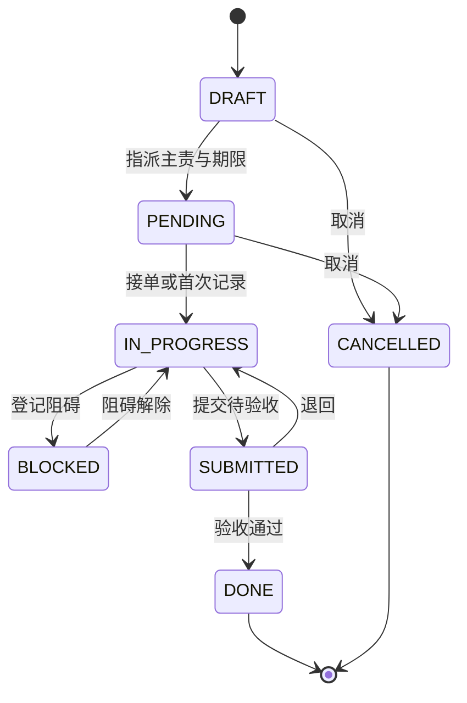

规则写在后端，不依赖前端约束。R1 主责唯一且非空，多人格与群体格不自动拆成多个主责，整行落待认领；协办人由 `task_assignee` 记录，只记参与，不承担验收与逾期归属。R2 期限非空，无期限的工单不能离开草稿。R3 提交前必须至少一条结果类追踪记录。R4 验收通过必须填写结果说明，这一条对应源数据里大量空白的"汇报结果"列。R5 逾期按天升级：当日提醒主责，次日提醒负责人，第三日提醒负责人上级，第七日进管理者逾期池。R6 每次改期累加 `delay_count`，超过三次要求填写根因与新措施。R7 新工单与该部门近 180 天已验收工单的标题相似度超过阈值时标记 `recurrence_of`。R8 工单与追踪记录只做逻辑删除，写入审计。

审批按 Q9 只做到验收与改期理由：退回必须写理由，改期必须写原因，超出三次改期才多一道管理者确认。不引工作流引擎，因为状态机已经表达完整生命周期，再加一套流程状态会让同一个工单有两个进度。

复发识别用标题与问题文本的组合相似度，阈值初值取 0.85 `[Hypothesis]`，用样本里"现场巡查及整改"这类反复出现的标题做校准。这个阈值会随试点数据调整，因此放在配置表 `sys_config` 而不是硬编码。

### 4.3 追踪模块

职责：把每一次进展变成可查、可催、可升级的记录。

输入：执行人的打卡请求、负责人的催办请求、系统的定时扫描。输出：时间线、阻碍看板、逾期池、催办通知。依赖：工单状态机、通知通道、AI 摘要接口。边界：不改工单的期限与主责，这两个字段只有负责人能改，走工单模块。

追踪记录字段的设计直接对应源数据的两列：`content` 承接"这次做了什么"，`result_type` 区分进展与结果，`closure_level` 记录这次记录属于强证据（有附件或验收确认）、弱证据（只有一句话）、无证据（空）。导入时"群里已经回复"这类内容落为弱证据，并在页面上提示补证。

阻碍看板按"卡在谁"和"卡在什么事"两个维度归组。样本里"空压机房搬迁"停在"施工方周一过来看现场做方案"，这类事如果没有阻碍登记，会在表格里静默消失几周。

### 4.4 统计模块

职责：定义指标口径，并把明细聚合成图表可用的形状。

输入：工单与追踪的状态变更、每日批处理、指标明细。输出：驾驶舱、趋势、部门对比、人员分析、工序达成率。依赖：预聚合表、指标口径。边界：不修原始明细。

指标口径写成一条公式存一处，页面与导出引用同一份定义，避免"完成率"在不同页面上算得不一样。完成地图的派生口径与缺口统计单列在 4.10，本节只放指标与图表。

| 指标 | 定义 | 维度 |
|---|---|---|
| 完成率 | 期内验收通过数 ÷ 期内应完成数 | 部门、人、类型、月 |
| 按时完成率 | 验收通过且实际完成时间不晚于计划时间的单数 ÷ 验收通过数 | 同上 |
| 平均完成时长 | 验收时间与创建时间之差的小时均值 | 同上 |
| 逾期率 | 期末逾期单数 ÷ 期末未完成单数 | 同上 |
| 一次通过率 | 未被退回的单数 ÷ 验收通过数 | 人、部门 |
| 结果留痕率 | 存在结果类追踪记录的单数 ÷ 全部单数 | 人、部门 |
| 复发率 | 带复发标记的新增单数 ÷ 新增单数 | 部门、问题类型 |
| 工序达成率 | 实际产量 ÷ 计划产量 | 工序、车间、日 |

图表的分配按角色走，驾驶舱给管理者，部门看板给负责人，我的待办给执行者。

| 图表 | 位置 | 目的 |
|---|---|---|
| 新增与完成趋势 | 驾驶舱 | 看整体节奏是否失衡 |
| 部门完成率横条 | 驾驶舱 | 横向比较，带基准线 |
| 状态分布环 | 驾驶舱 | 看积压在哪个阶段 |
| 逾期时长直方 | 驾驶舱 | 判断是偶发还是系统性拖延 |
| 逾期工单前十 | 驾驶舱 | 直接可点的攻坚入口 |
| 复发事项榜 | 驾驶舱 | 找制度缺口 |
| 计划与完成对比 | 部门看板 | 对应样本表尾生产块 |
| 问题类型前十 | 部门看板 | 找主要矛盾 |
| 人员产出散点 | 人员分析 | 量、质、逾期同时看 |
| 人员能力雷达 | 人员分析 | 六维画像 |
| 完成漏斗 | 任务评价 | 卡在哪一步流失 |
| 部门周热力 | 总览 | 逾期密度的时间分布 |

### 4.5 导入模块

职责：把不规整的工作簿变成可入库的工单草稿，并留下可回溯的原始行。

输入：`.xlsx` 文件、映射修正、确认提交。输出：校验报告、工单草稿、导入批次状态。依赖：文件存储、ExcelParserAgent、异步任务、工单模块。边界：不做业务规则判定（状态机在工单模块），不保证视觉样式。

管线分七步，每一步都可回退到上一步重跑。


区块定位不用固定行号。样本里明细表头在第 3 行或第 4 行，空页有三张，因此用"列名特征 + 相对位置"双判定：先按关键词找到含"序号""工作内容""责任人"的行作为明细表头，再取表头之上最近的键值区作为元信息，取明细之下带"计划""完成"的行作为附加块。找不到明细表头时整页判为错误行，进报告而不是静默跳过。

字段映射分三级：精确列名命中、同义词表命中、模型推断。推断结果必须带置信度并落 `import_mapping`，同一模板第二次导入直接复用，不再调用模型。这既是成本控制，也让映射行为可审计。

行内拆解是准确率的真正难点，规则先做、模型兜底：编号切分处理 `1、`、`①`、换行；人名切分按逗号、顿号、斜杠；命中部门名表的串不进人员表；期限抽取把 `10月28` 补全为当年日期；数值抽取识别"数值加单位"与"计划与完成成对出现"的形态。模型只在规则无命中时介入，输出同样要过结构校验。

多人格与群体格按 2.2 的 C1 处理：切出来的人名逐个走解析，只有唯一命中的人才进主责候选，第一个命中的落主责、其余落参与人；一个都命中不了、或整格只有部门名与班组名时，主责留空、整行进待认领队列。导入不替人猜"这些事该由谁负责"，猜错一次的代价是逾期提醒发给了不相干的人。

逐行校验分三档，错误阻断该行，警告允许导入但要在报告里列出，通过直接入库。报告可下载，列名包含行号、原始值、原因、建议动作。要求的识别率是明细行 95%、人名匹配 92% `[Hypothesis]`，验收时用样本 10 页作为固定测试集。

幂等键取文件哈希加工作表名加行指纹（标题、时间安排、责任人拼接）。同一批次重跑命中已有行时默认增量更新，不重复建单。`import_row.raw` 保存原始行快照，用于重新识别与溯源；撤回时按批次撤销该批写入的工单。

归并的判据是"同一件事"，不是"同一行"。确认页默认给出的动作按三条规则算：同一部门、同一主责、标题相似度超过 0.85 且已有工单仍在办时取 `MERGE`，这一行变成一条追踪记录并带上原始行快照；已有工单已验收时取 `CREATE`，新工单的 `recurrence_of` 指向旧单；两条都不满足时取 `SKIP` 并留给人决定。这是 Q1 在导入侧的具体形式，判错了人可以在确认页改，改完再入库。

### 4.6 导出模块

职责：按固定模板渲染文件，并保证导出的日报能被再次导入。

输入：模板、查询条件、批次参数。输出：`.xlsx` 文件、PDF 图表报告、打包产物。依赖：文件存储、异步任务。边界：不做数据修复。

五个模板：单日单人日报（与源文件一比一，含表头、10 列表格、生产块）、部门周报、工单台账、人员绩效明细、图表报告。日报模板是导出与再次导入能互相对上的关键，占位符渲染后仍需保留可编辑性，因此用 POI 在模板文件上填充而不用拼接新工作簿。

格式取舍按 Q5 定在复刻：列序、列宽、表头位置与表尾生产块都与样本一致，不做易读化重排。代价是导出件的信息密度不高，收益是下游按这个版式做的汇总不用改，导出的日报也能原样导回系统。

模板文件进版本管理，模板变更要走评审，因为下游有人按这个格式做汇总。

### 4.7 知识库模块

职责：把文档与历史问题措施变成可检索、可引用回答的知识；解析与检索交给 RAGFlow，本模块负责同步、权限与引用。

输入：文档上传、重新解析指令、检索请求、问答请求。输出：检索结果、带引用的回答、同步状态。依赖：文件存储、检索适配器（无标签走 `RAGFlowKnowledge`，带标签走 `RAGFlowClient` 的范围层）、上传与解析状态的自研 REST 客户端、RagAgent、仓储。边界：不自己算向量、不实现切片算法、不维护重排策略；不决定谁能看哪份文档的正文，统一走数据范围。

知识域按使用价值排序，第一是历史问题与措施的配对，第二是制度与流程，第三是客户与项目资料，第四是会议与汇报沉淀。第一类不需要额外录入，从已入库的工单里把问题项与措施项配对就能生成文档，这是本模块与业务表直接相连的地方。

分工的边界要写在纸上，否则同一个能力会在两处实现，两处都会有人改。

| 环节 | 由谁做 | 说明 |
|---|---|---|
| 版面解析、表格识别、切片 | RAGFlow | 调其解析接口，按知识库配置的切片模板走 |
| 向量化与索引 | RAGFlow | 向量模型在 RAGFlow 侧配置，指向 Ark 的向量接入点 |
| 混合检索与重排 | RAGFlow | 语义与关键词融合、相似度阈值、重排都在其内部完成 |
| 切片正文快照与引用元数据 | 本系统 | 解析完成后拉回写 `kb_chunk`，供引用展示与降级检索 |
| 文档上传与解析状态 | 本系统 | 自研 REST 客户端按官方接口上传、触发解析、轮询状态，官方适配器不提供这两项 |
| 权限与数据范围 | 本系统 | 检索前算出范围标签与知识库 ID，检索后复核切片归属 |
| 问答生成与引用组装 | 本系统 | RagAgent 只拿到通过复核的片段 |

同步是一条单向管道，本地不反向修改 RAGFlow 的切片。

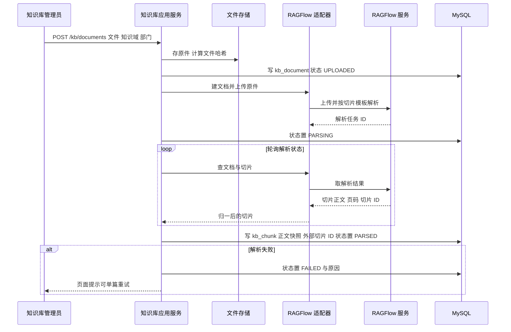

走查三点。本地只在解析成功后一次性回写切片，解析中的文档不参与检索，避免半截知识被召回。`kb_chunk` 存的是快照，真相源在 RAGFlow，两者不一致时以重新解析覆盖本地。解析失败不阻塞其它文档，原因写进 `sync_msg`，人可以改完格式再重试同一篇。

重新解析按文档整体覆盖，先按 `doc_id` 清空旧快照再写新的一批。这样做是因为 RAGFlow 重新解析后切片标识可能变化，按单个切片增量对齐会对不上 `[To be confirmed]`。引用在生成时就把片段正文写进 `chat_message.citations`，所以切片重建不会让历史引用变成空引用，受影响的只有"跳到 RAGFlow 原文"这一个动作。

检索链路是两段过滤加一次生成。

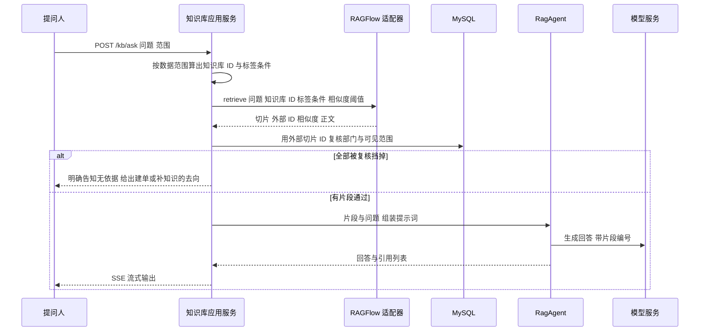

前置过滤决定召回池，后置过滤决定哪条能进提示词。前置是为了不让无权内容进入上下文，后置是为了防止标签写错时泄露。两道都做，代价是每次多一次本地查询，在这个规模上可以接受。

权限怎么落到 RAGFlow，有三种做法，Q8 取第一种。

| 做法 | 优点 | 缺点 | 结论 |
|---|---|---|---|
| 全部放一个知识库，切片带部门与可见范围标签 | 配置简单，一份文档只存一次，跨部门共享的文件不会出现副本 | 召回池被稀释；依赖 RAGFlow 的标签过滤能力 `[To be confirmed]` | 采用 |
| 每个部门一个知识库 | 天然隔离，检索时只传该部门的 ID | 共享制度要复制多份，更新要同步多处 | 不采用 |
| 公共知识与部门知识分成两类知识库 | 全员可见的制度只存一份 | 要维护"哪类知识属于谁"的映射，部门调整后映射跟着改 | 标签过滤不可用时的回退 |

取第一种的代价是召回池被稀释：一个车间的历史问题与全员制度混在同一池里检索，纯语义召回会被其它部门的相似文本挤占。抵偿办法有三条：标签过滤把池收窄到"本部门加全员可见"，`top_k` 固定在 8 而不是客户端默认的 1024，相似度阈值不低于 0.2。标签写什么由 `kb_document` 决定，文档同步时把部门编码与可见范围写进 RAGFlow 的元数据，解析出的每一条切片都继承这两个标签，本地 `kb_chunk.meta` 存同一份，供后置复核比对。标签条件由范围层拼成 `metadata_condition` 再发给 RAGFlow，因为官方适配器的检索方法不透传这个参数。

标签过滤是这一方案的前置条件，不是可选优化，但它要自己接出来：RAGFlow 的检索协议里有 `metadata_condition`，AgentScope 的 `RAGFlowKnowledge` 却把这一参数固定传空，所以在知识库应用服务与客户端之间要加一层范围层，按调用人的数据范围拼条件并按范围缓存客户端。M4 开工前先用一份制度文档与两份部门文档试跑一次越权查询：一个执行者查其它部门的私有文档应当直接零命中。若条件只作用于文档级、切片级不继承，回退到第三种做法，即公共与部门分成两类知识库，此时 `dataset_id` 从一值变成两值，检索传两个知识库 ID（`datasetIds` 本身就是列表），4.7 其余设计与本地表结构不变。判据与回退顺序记在 `docs/ADR-001-RAG与Agent选型.md`。

引用要能回到原文。每条引用存三样：外部切片 ID、本地快照序号、文档标题与页码。RAGFlow 可用时点开跳到它的文档预览，不可用时用本地快照渲染，两条路径都保证引用不会变成死链。

切片规则按结构走，不按固定长度硬切：制度文档按章节，问题与措施按整对切，目的是不切断因果。每片目标 400 至 600 字 `[Hypothesis]`，重叠 15%。这条规则在 RAGFlow 侧以切片模板配置，模板标识记在 `kb_document` 上，同类文档复用同一模板，便于横向对比解析效果。

RAGFlow 不可用时按三种情况降级。服务不可达时检索直接失败，页面提示稍后重试并允许走本地关键词检索；解析队列积压只影响新文档，已有切片照常可查；检索超时按降级路径返回本地关键词结果，并在回答里标明这是降级结果。本地保留 `ft_chunk` 全文索引就是为了这条路径，它不追求召回率，只保证最坏情况下仍有东西可查。

检索实现挂在 `io.agentscope.core.rag.Knowledge` 接口后面，本系统只依赖这个接口，不直接写检索的 HTTP 逻辑。接口的边界要说准确：`RetrieveConfig` 只有条数与阈值四项，没有数据集、文档与标签的表达能力，因此"换实现只换一个 Bean"只对不带范围条件的检索成立；带范围条件的检索要经过范围层，由它调 `RAGFlowClient` 的 `retrieve` 并传入 `metadata_condition`。文档上传与解析状态不在这个接口内，官方适配器的 `addDocuments` 直接抛不支持异常，这两件事由自研 REST 客户端承担。Dify 的适配类 `DifyKnowledge` 签名相同但只传条数，本轮不启用，留着这个可能性不影响代码结构。

### 4.8 会话平台模块

职责：提供一个可以提问的地方，把问题、工单、统计与知识连起来回答。

输入：用户提问、会话上下文、可选的范围参数。输出：流式回答、引用列表、待确认的分析建议、会话历史。依赖：知识库应用服务、工单与统计查询接口、RagAgent、ChatAssistantAgent、仓储。边界：只读业务数据，不建单、不改工单状态，不留存任何外部平台的聊天记录。

这一块只有两张业务表。`chat_session` 记会话的归属人、标题、范围与最后活动时间，`chat_message` 记每一轮的角色、内容、引用与工具调用。回答是流式产生的，服务端在生成结束事件前先发一次引用事件，保证页面上先看到依据再看到结论，避免读者读完一段话才发现它没有来源。

会话里能做两件事，按风险从低到高排开。第一件是问答：问题先做改写，再走知识库混合检索，命中则回答并给引用，未命中则明说没有依据，并给出两个去向，补一份知识或就这件事建单。第二件是查询：模型调用只读工具取工单、统计与人员在办负载，工具只返回结构化数据，不做自然语言包装，入参过 schema 校验，越出调用人数据范围的请求直接拒绝。

建议的写回则不在会话里。Q12 把模型的手收在只读，所以会话不产出可直接采纳的建单草稿；提问里描述了一件新事时，会话只给一句「这看起来是一件新事项」并给建单入口的链接，字段仍由人填写。真正需要模型判断的写回发生在建议队列：评价与建议由工单数据算出，写进 `ai_suggestion` 并带证据，人点采纳之后由应用服务执行确定性动作。建单起草放在试点之后评估，见 1.6 的 Q12 段。

允许模型调用的工具是固定的，不给它生成 SQL 的能力。这样每次查询都能被审计、限流与统计，模型换代也不会改变数据出口。

| 工具 | 作用 | 入参 | 约束 |
|---|---|---|---|
| 查工单 | 按标题、部门、状态、期限取工单与时间线 | 过滤条件与分页游标 | 强制注入调用人数据范围 |
| 查统计 | 取指标口径表里的指标值 | 指标码、维度、期间 | 只返回已聚合结果，不返回明细 |
| 查人员 | 姓名解析与在办负载 | 姓名或部门 | 返回前五条，避免整表泄露 |
| 检索知识 | 混合检索切片 | 问题、范围、条数 | 与知识库模块同一实现 |

四个工具都是只读的，没有写工具，也没有起草工具。建议不是工具，它由 `AdvisorAgent` 在会话之外产出并落 `ai_suggestion`，采纳动作由应用服务执行；把它做成工具就等于绕过了待确认队列，这也是 Q12 不取 C 的原因。

一次提问的时序如下，工具调用与检索都在服务端完成，客户端只接收增量文本。

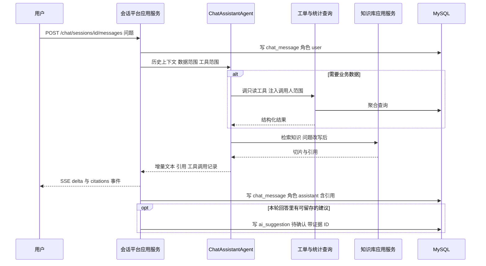

走查这条时序有三处值得注意。用户消息先落库再编排，即使生成失败也留下提问记录，便于复盘提示词。工具调用在检索之前，因为工具拿到的事实常常决定检索词，例如先查到某工单编号，再用它检索相关制度。回答落库时把引用与工具调用一起存下来，页面重开时不需要重跑一次模型就能还原当时的依据。

会话的留存要写清楚，否则它会变成第二个聊天工具。默认保留六个月，按角色限制可见范围：管理者可读本部门会话，负责人与执行者只读自己的。会话内容可以作为评价的辅助线索，但不作为评分的唯一来源，分数仍从工单与追踪记录算，理由是人会为了让对话好看而在里面修饰表述。

评价与建议不再依赖任何外部消息，数据来源是工单、追踪记录与知识库。人员评价取六个维度，每维都给证据 ID：

| 维度 | 数据来源 | 初值权重 |
|---|---|---|
| 交付力 | 工单量、按时完成率、一次通过率 | 30 |
| 结果留痕 | 结果记录率、验收一次通过、证据完整度 | 20 |
| 响应力 | 接单时长、催办后响应时长、阻碍解除时长 | 15 |
| 解决力 | 关闭问题数、复发率（负向） | 20 |
| 协办力 | 参与他人工单数、跨部门协作次数 | 10 |
| 规范性 | 日报按时提交率、证据留痕 | 5 |

分数必须带样本量与置信度，因为一个只经手 10 条记录的人和一个经手 200 条的人不能放在同一尺度上比。可见范围按 Q4 只对管理者开放，并提供申诉入口，申诉记录写进评价表；本人与负责人既看不到自己的分数，也看不到下属的分数，评价入口不出现在他们的页面导航里。这些权重是初值 `[Hypothesis]`，试点后按实际分布调整，因此存 `sys_config`。

任务评价取四个维度：重要度（优先级与客户关联）、复杂度（跨部门、问题项数、涉及人数）、健康度（改期次数、阻碍时长、催办次数）、结果质量（验收条件达成与是否复发）。输出是一张复盘卡，回答这件事难在哪、卡在哪、下次怎么更快。

建议分五类：派工建议（新工单无主责时给三个候选，按部门、负载、历史同类成功率排序）、措施建议（报同类问题时召回历史措施并给出历史耗时）、期限建议（按同类工单时长的中位数与八成位给建议期限）、升级建议（逾期或反复改期时按上级链给升级对象）、制度缺口建议（同类问题三十天内出现三次以上时提出）。

### 4.9 AI 编排模块

职责：把模型能力组织成可复用、可校验、可计费追踪的 Agent。

输入：应用服务的任务请求。输出：结构化结果、置信度、证据引用、成本记录。依赖：模型客户端、应用服务端口。边界：不写业务表，不判定状态迁移。

七个 Agent 的职责与工具：

| Agent | 职责 | 工具 | 产出校验 |
|---|---|---|---|
| ExcelParserAgent | 结构识别、字段映射、行内拆解 | 读工作表、定位区块、提议映射、切分条目、校验行 | 映射置信度阈值、切分结果可人工改 |
| TaskExtractAgent | 从会话里识别可执行事项并产出待确认建议 | 查在办工单、匹配人员、写建议、写来源 | 只产出建议，不建单；必须带原始会话与消息 ID |
| ChatAssistantAgent | 会话内的问答编排与工具调用 | 四类只读工具、检索、引用组装 | 工具入参过 schema；回答须带引用或明说无依据 |
| TrackerAgent | 过程摘要、催办话术、逾期风险 | 读时间线、摘要、起草提醒 | 摘要不得引入记录外的事实 |
| EvaluatorAgent | 人员与任务评分 | 读指标、读证据、按维度打分 | 分数与证据 ID 一起返回 |
| AdvisorAgent | 五类建议 | 知识检索、历史统计、建议生成 | 建议必须附依据或历史案例 |
| RagAgent | 带引用的问答与片段取舍 | 检索（经 RAGFlow 适配器）、片段筛选、引用组装 | 无召回时必须说无依据；引用只能来自通过权限复核的片段 |

检索类工具统一走知识库应用服务，不直连 RAGFlow 的 HTTP 接口，因为权限过滤在那个模块里。

所有 Agent 输出走同一套结构校验：JSON Schema 校验、失败重试一次、仍失败则降级为规则结果并标记 `degraded`。每次调用记录模型名、提示词版本、token 数、耗时与人工采纳结果，采集采纳率是为了后续调提示词，不是为了展示。

### 4.10 完成地图模块

职责：把"完成"拆成一组可判定的条件，逐份工单算出哪些条件已达成、哪些还差，并说清差的那一项由谁补、已经卡了多少天。

输入：工单、问题项、措施项、追踪记录、指标与验收结果的只读查询。输出：单工单完成地图、部门缺口矩阵、事项完成地图、缺口提醒。依赖：完成条件口径、统计日快照、工单与追踪的查询接口。边界：不改工单状态，不代填缺失数据，不维护第二套进度。

九条完成条件按现有表能直接判定，不新增业务字段。

| 编号 | 条件 | 判定依据 | 缺口默认承担者 | 权重 |
|---|---|---|---|---|
| G1 | 已接单 | 工单已离开 `PENDING` | 主责执行人 | 10 |
| G2 | 期限确定 | `plan_end` 非空且不早于创建日 | 负责人 | 5 |
| G3 | 问题关闭 | 该单全部问题项处于关闭态 | 主责执行人 | 15 |
| G4 | 措施执行 | 每条措施有执行人、期限与完成时间 | 措施执行人 | 15 |
| G5 | 结果留痕 | 至少一条结果类追踪记录 | 主责执行人 | 15 |
| G6 | 证据齐备 | 至少一个附件，或结果记录被判为强证据 | 主责执行人 | 10 |
| G7 | 阻碍解除 | 不存在未解除的阻碍 | 负责人 | 10 |
| G8 | 指标达成 | 该单名下指标实际值不低于目标 | 主责执行人 | 10 |
| G9 | 验收通过 | 状态已为 `DONE` 且验收说明非空 | 负责人 | 10 |

权重合计一百。条件集合按工单类型配置：巡查类不看 G8，制度类不看 G6，外部依赖类把 G7 的权重抬高。配置落 `gate_rule`，页面、提醒与统计读同一份，改口径不改代码。缺口的承担者也是配置项，因为"谁该补期限"在不同部门是不同的人。

三种视图解决三个不同的问题。

| 视图 | 回答的问题 | 读什么 |
|---|---|---|
| 单工单完成地图 | 这张单还差什么，现在该做什么 | 实时算式，一次按工单组装 |
| 部门缺口矩阵 | 全部门都卡在同一类缺口上吗 | 当日快照，横列聚合 |
| 事项完成地图 | 这件事反复卡在哪一步 | 同一事项下多张工单的达成顺序 |

单工单视图放在工单详情右栏，纵向九条条件，每条三档状态：达成、未达成、不适用。未达成的行显示缺口说明、承担者、已滞留天数与一个直达动作，例如"去补证据"跳到追踪记录编辑。这一栏是执行者打开工单先看的东西，比时间线更能回答"我今天要做什么"。

部门矩阵以在办工单为行、条件为列，格子三色。横看一列是一类缺口在全部门的积压量，纵看一行是一张单缺几项。负责人按列排序，就能发现"全部门都卡在证据"这类靠催办解决不了的问题。

事项视图把父子拆解的工单与复发链上的工单合成一件事，按时间轴画条件达成顺序。它回答的是"这件事每次都在同一处停下"，这类结论落到制度缺口建议里。

完成度只是矩阵的副产物：达成条件权重之和除以适用条件权重之和，取整显示。主视图始终是缺口，因为"做了什么"一眼能看到，"还差什么"才会被追问。

快照与提醒在每日凌晨跑，详情页不等快照。

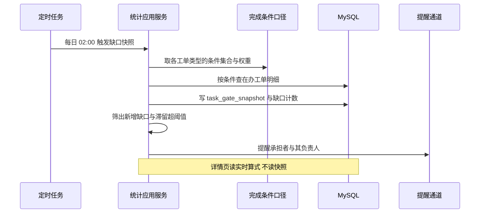

走查三点。快照是当日的静态截面，用于趋势与横向比较；详情页用实时算式，因为人刚补完证据就希望看到缺口消失，等一天会以为没生效。提醒只对新增缺口与滞留超阈值的缺口发，每日全量重发会让人屏蔽通知。快照表保留一百八十天，更早的只留按日按部门按条件的聚合计数，否则九条条件乘百万工单乘每天会压垮单表。

口径与状态机的关系要写清楚：完成地图只读，不改状态。G9 与 `SUBMITTED` 不等价，提交待验收不是通过；被退回的工单 G9 重新变未达成，缺口行显示"退回待改"并带上退回理由。G2 与 R2 共用同一份判定，不在两处重复实现。

滞留阈值默认三日提醒承担者、七日提醒负责人，进逾期池的工单无论缺口是否超阈值都在矩阵里标红。阈值存 `sys_config`，试点期按实际节奏调。完成地图不产生新的逾期口径，逾期的定义仍在 4.2 与 4.3。

## 5 接口设计

### 5.1 接口总览

统一前缀 `/api/v1`，请求与响应均为 JSON，鉴权走 `Authorization: Bearer`，写操作支持幂等键头。

| ID | 方法 路径 | 用途 | 最低权限 | 幂等 |
|---|---|---|---|---|
| ORG-1 | `GET /depts/tree` | 部门树 | 任意登录用户 | — |
| ORG-2 | `POST /employees/import` | 花名册导入 | 系统管理员 | 文件哈希 |
| ORG-3 | `GET /employees/resolve?name=` | 姓名解析 | 任意登录用户 | — |
| TSK-1 | `POST /tasks` | 建单 | 负责人及以上 | 支持幂等键 |
| TSK-2 | `GET /tasks` | 工单列表 | 按数据范围 | — |
| TSK-3 | `POST /tasks/{id}/dispatch` | 指派主责与期限 | 负责人 | — |
| TSK-4 | `POST /tasks/{id}/submit` | 提交待验收 | 主责执行人 | — |
| TSK-5 | `POST /tasks/{id}/verify` | 验收通过或退回 | 负责人 | — |
| TSK-6 | `GET /tasks/overdue` | 逾期池 | 负责人及以上 | — |
| TRK-1 | `POST /tasks/{id}/checkin` | 写追踪记录 | 主责执行人、协办 | 支持幂等键 |
| TRK-2 | `GET /tasks/{id}/timeline` | 时间线 | 按数据范围 | — |
| TRK-3 | `POST /tasks/{id}/urge` | 催办 | 负责人及以上 | 二十四小时内限一次 |
| TRK-4 | `GET /tasks/blocked` | 阻碍看板 | 负责人及以上 | — |
| STA-1 | `GET /stats/overview` | 驾驶舱指标 | 管理者 | — |
| STA-2 | `GET /stats/trend` | 趋势 | 负责人及以上 | — |
| STA-3 | `GET /stats/process` | 工序计划与完成 | 负责人及以上 | — |
| STA-4 | `GET /stats/person` | 人员指标 | 管理者 | — |
| CMP-1 | `GET /tasks/{id}/completion-map` | 单工单完成地图与缺口 | 按数据范围 | — |
| CMP-2 | `GET /completion-map/matrix` | 部门缺口矩阵 | 负责人及以上 | — |
| CMP-3 | `GET /completion-map/gaps` | 缺口聚合与滞留排行 | 负责人及以上 | — |
| CMP-4 | `GET /completion-map/matter/{taskId}` | 事项完成地图 | 负责人及以上 | — |
| IMP-1 | `POST /imports` | 上传工作簿 | 负责人及以上 | 文件哈希 |
| IMP-2 | `GET /imports/{id}/preview` | 三步向导数据 | 上传人或管理者 | — |
| IMP-3 | `POST /imports/{id}/confirm` | 确认入库 | 上传人或管理者 | 批次状态 |
| IMP-4 | `GET /imports/{id}/report.xlsx` | 校验报告 | 上传人或管理者 | — |
| EXP-1 | `POST /exports` | 生成导出件 | 负责人及以上 | 支持幂等键 |
| EXP-2 | `GET /exports/{id}/download` | 下载 | 发起人或管理者 | — |
| KB-1 | `POST /kb/documents` | 上传文档并触发 RAGFlow 解析 | 知识库管理员 | 文件哈希 |
| KB-2 | `POST /kb/search` | 检索 | 任意登录用户 | — |
| KB-3 | `POST /kb/ask` | 带引用问答 | 任意登录用户 | — |
| KB-4 | `GET /kb/documents/{id}/sync` | 解析与切片同步状态 | 知识库管理员 | — |
| KB-5 | `POST /kb/documents/{id}/sync` | 重新解析并回写切片 | 知识库管理员 | 文档状态 |
| CHT-1 | `POST /chat/sessions` | 新建会话 | 任意登录用户 | — |
| CHT-2 | `GET /chat/sessions` | 我的会话列表 | 本人 | — |
| CHT-3 | `POST /chat/sessions/{id}/messages` | 提问并以事件流接收回答 | 会话归属人 | 支持幂等键 |
| CHT-4 | `GET /chat/sessions/{id}/messages` | 会话历史与引用 | 归属人或本部门管理者 | — |
| EVL-1 | `POST /evaluations/run` | 触发人员与任务评价 | 管理者 | 周期唯一 |
| EVL-2 | `GET /evaluations` | 评价列表与证据下钻 | 管理者 | — |
| AI-1 | `GET /ai/suggestions` | 建议列表 | 按类型 | — |
| AI-2 | `POST /ai/suggestions/{id}/accept` | 采纳建议 | 按类型 | — |
| SYS-1 | `POST /auth/login` | 登录 | 公开 | — |
| SYS-2 | `GET /audit-logs` | 审计 | 系统管理员 | — |

会话侧不设采纳建单草稿的接口。Q12 取 A 加 B 之后模型不产出可直接采纳的草稿，建单统一走 `TSK-1`；会话里提到的内容由人复制进建单表单，来源记为手工，避免出现「这张单是模型填的，不知道谁负责」的争议。建议的采纳走 `AI-2`，与建单是两条不同的路径，前者执行确定性动作，后者要求人填齐五项必填。

### 5.2 关键接口契约

| 字段 | 内容 |
|---|---|
| 操作 | `POST /api/v1/tasks` |
| 用途 | 建单。由负责人或管理者发起，导入确认走同一用例；会话不产出建单草稿，见 5.1 末尾的说明 |
| 鉴权 | Bearer；需 `task:create`；数据范围须覆盖 `deptId` |
| 请求体 | `title` 字符串 必填 2–120 字；`type` 枚举 必填；`deptId` 长整 必填 须为可见部门；`ownerId` 长整 必填；`primaryAssigneeId` 长整 必填 且不得与 `ownerId` 相同；`priority` 整数 0–3 默认 2；`planEnd` 时间 必填 不得早于当前时间；`acceptCriteria` 字符串数组 可选 每项不超过 200 字；`issueList` 数组 可选 每项含 `content`；`sourceType` 枚举 默认 MANUAL |
| 成功响应 | `201`；体 `{ taskNo, taskId, status:"PENDING", createdAt }` |
| 失败响应 | `400 TL-4001` 参数校验失败并返回字段级明细；`403 TL-4032` 部门超出数据范围；`409 TL-4093` 主责与负责人重复或同部门存在同标题在建工单；`422 TL-4221` 期限缺失或早于当前时间 |
| 幂等 | 支持 `Idempotency-Key`，同键二十四小时内返回首次结果 |

| 字段 | 内容 |
|---|---|
| 操作 | `POST /api/v1/tasks/{id}/checkin` |
| 用途 | 写一条追踪记录，可同时登记阻碍 |
| 鉴权 | Bearer；需 `task:checkin`；调用人须为主责执行人或协办人；工单状态须为 `PENDING`、`IN_PROGRESS`、`BLOCKED` |
| 请求体 | `progress` 整数 必填 0–100 且不小于上一次记录；`content` 字符串 必填 1–2000 字；`blockerText` 字符串 可选 不超过 500 字；`nextStep` 字符串 可选；`planEndSnapshot` 时间 可选 仅负责人在改期时填写；`resultType` 枚举 必填 取 `PROGRESS`、`RESULT`、`ISSUE`、`REVIEW`；`attachments` 字符串数组 可选 每项为已上传文件 ID |
| 成功响应 | `200`；体 `{ checkinId, taskStatus, progress, closureLevel }` |
| 失败响应 | `403 TL-4031` 非本单责任人；`409 TL-4091` 当前状态不允许记录；`422 TL-4222` 进度回退；`422 TL-4223` 结果类型缺附件且内容过短 |
| 幂等 | 支持 `Idempotency-Key`；同一时刻同人重复提交合并为一条 |

| 字段 | 内容 |
|---|---|
| 操作 | `POST /api/v1/tasks/{id}/verify` |
| 用途 | 验收通过或退回，是统计口径的唯一入口 |
| 鉴权 | Bearer；需 `task:verify`；调用人须为负责人；工单状态须为 `SUBMITTED` |
| 请求体 | `decision` 枚举 必填 取 `PASS` 或 `REJECT`；`resultSummary` 字符串 必填 1–2000 字；`criteriaResult` 数组 可选 每项含条件 ID 与布尔值；`rejectReason` 字符串 条件必填 当 `decision=REJECT` |
| 成功响应 | `200`；体 `{ taskStatus, actualEnd, rejectCount, delayCount }` |
| 失败响应 | `409 TL-4091` 状态不是待验收；`422 TL-4224` 退回未填理由；`422 TL-4225` 验收条件存在未判定项 |
| 幂等 | 同一工单同一状态重复调用返回首次结果 |

| 字段 | 内容 |
|---|---|
| 操作 | `POST /api/v1/imports` 与 `POST /api/v1/imports/{id}/confirm` |
| 用途 | 上传工作簿并确认入库 |
| 鉴权 | 上传需 `import:create`；确认需 `import:confirm` 且为上传人或管理者 |
| 上传请求 | `multipart/form-data`，`file` 必填 限 `.xlsx` 且不超过 20 MB `[To be confirmed]`，`mode` 枚举 必填 取 `SINGLE_DAY_ONE_PERSON` 或 `MULTI_DAY_SAME_PERSON` |
| 上传响应 | `202`；体 `{ batchId, sheetCount, status:"ANALYZING" }` |
| 确认请求 | `mapping` 对象 必填 列到字段的映射；`rowDecisions` 数组 必填 每行含 `rowNo` 与动作取 `CREATE`、`MERGE`、`SKIP`、`MERGE_TASK_ID` |
| 确认响应 | `200`；体 `{ created, merged, skipped, failed:[] }` |
| 失败响应 | `409 TL-4092` 重复文件已确认；`422 TL-4226` 映射缺少必需字段；`422 TL-4227` 存在错误行未处理 |
| 幂等 | 文件哈希唯一；确认由批次状态机保护，重复确认返回首次结果 |

| 字段 | 内容 |
|---|---|
| 操作 | `POST /api/v1/kb/ask` |
| 用途 | 带引用的知识问答，事件流输出 |
| 鉴权 | Bearer；需 `kb:ask`；检索范围受数据范围限制 |
| 请求体 | `question` 字符串 必填 3–500 字；`domain` 枚举 可选；`deptId` 长整 可选；`topK` 整数 可选 5–8 默认 6 |
| 成功响应 | `200 text/event-stream`；事件序列 `retrieved`（片段 ID 列表）、`delta`（增量文本）、`citations`（引用数组，含文档 ID、切片序号、原文摘要）、`done` |
| 失败响应 | `422 TL-4228` 问题过短；`503 TL-5031` 模型不可用，事件流内先发 `error` 再关闭 |
| 幂等 | 只读，无需幂等 |

| 字段 | 内容 |
|---|---|
| 操作 | `POST /api/v1/chat/sessions/{id}/messages` |
| 用途 | 会话内提问，事件流返回回答、引用与工具调用；描述是新事项时只给建单入口提示，不产出草稿 |
| 鉴权 | Bearer；需 `chat:ask`；调用人须为会话归属人，工具查询自动带上调用人数据范围 |
| 请求体 | `question` 字符串 必填 1–1000 字；`scope` 对象 可选 含 `deptId` 与 `taskTypes`，不传取本部门；`allowTools` 布尔 可选 默认 true，关闭时只走知识检索问答 |
| 成功响应 | `200 text/event-stream`；事件序列 `retrieval`（切片 ID 与工具名）、`tool_call`（工具名 入参摘要 结果条数）、`delta`（增量文本）、`citations`（引用数组）、`hint`（可选 建单入口提示与建议 ID）、`done` |
| 失败响应 | `403 TL-4032` 会话不属于调用人；`409 TL-4091` 会话已归档；`422 TL-4228` 问题为空或超出长度；`503 TL-5031` 模型不可用，事件流内先发 `error` 再关闭 |
| 幂等 | 支持 `Idempotency-Key`，同键重放返回同一轮回答，不重复计费 |

| 字段 | 内容 |
|---|---|
| 操作 | `GET /api/v1/tasks/{id}/completion-map` |
| 用途 | 取单工单的完成地图，逐条给出条件状态、缺口的承担者与滞留天数 |
| 鉴权 | Bearer；需 `task:view`；工单须在调用人数据范围内 |
| 查询参数 | `includeNa` 布尔 可选 默认 true 是否返回不适用的条件；`gateCodes` 字符串 可选 逗号分隔只取指定条件 |
| 成功响应 | `200`；体 `{ taskId, completionRate, gates:[{ code, name, state, weight, holderId, holderName, gapDays, actionUrl, hint }], snapshotAt }` |
| 失败响应 | `403 TL-4032` 工单超出数据范围；`404 TL-4041` 工单不存在或已删除 |
| 口径 | 实时算式，条件集合与权重读 `gate_rule`；被退回的工单 G9 为未达成并带退回理由 |
| 幂等 | 只读，无需幂等 |

| 字段 | 内容 |
|---|---|
| 操作 | `GET /api/v1/completion-map/matrix` |
| 用途 | 部门缺口矩阵，行是工单，列是条件 |
| 鉴权 | Bearer；需 `stats:view`；`deptId` 须在数据范围内 |
| 查询参数 | `deptId` 长整 必填；`status` 枚举 可选 默认取在办状态；`taskType` 字符串 可选；`page` 与 `pageSize` 分页 |
| 成功响应 | `200`；体 `{ snapshotAt, stale, columns:[{ code, name }], rows:[{ taskId, taskNo, title, assigneeName, overdue, completionRate, cells:[{ code, state, gapDays }] }] }` |
| 失败响应 | `403 TL-4032` 部门超出数据范围；`404 TL-4041` 部门不存在 |
| 数据截止 | `snapshotAt` 是当日快照时间，读的是 `task_gate_snapshot`；快照任务失败时返回上一日并把 `stale` 置真，页面标出数据截止时间 |
| 幂等 | 只读，无需幂等 |

### 5.3 错误码

| 码 | HTTP | 含义 | 处理建议 |
|---|---|---|---|
| TL-4001 | 400 | 参数校验失败 | 返回字段级明细，前端定位到控件 |
| TL-4011 | 401 | 未登录或令牌失效 | 清本地令牌并回登录页，保留原页面地址以便回跳 |
| TL-4031 | 403 | 无该操作权限 | 页面隐藏入口，接口仍拦截 |
| TL-4032 | 403 | 超出数据范围 | 提示当前范围，不给数据 |
| TL-4041 | 404 | 对象不存在或已删除 | 列表刷新 |
| TL-4091 | 409 | 当前状态不允许该操作 | 返回当前可执行的操作 |
| TL-4092 | 409 | 幂等键冲突或重复提交 | 返回首次结果 |
| TL-4093 | 409 | 唯一性冲突 | 给出冲突对象，允许并入 |
| TL-4221 | 422 | 业务规则不满足 | 返回未满足的规则编号 |
| TL-4291 | 429 | 触发限流 | 带 `Retry-After` |
| TL-5001 | 500 | 内部错误 | 返回 traceId，不返回堆栈 |
| TL-5031 | 503 | 外部依赖不可用 | 前端提示稍后重试或走规则结果 |

### 5.4 鉴权与数据范围

登录发 JWT，载荷只放人员标识与登录名，不放角色、部门与范围，因为范围与角色会变而令牌不会实时失效。每次请求由拦截器按人员标识现取角色与范围，注入到调用上下文；读取结果进缓存，组织调整时按人员清缓存。

数据范围的过滤由应用服务把范围参数明确传给查询，不拼 SQL 字符串。理由有两个：拼接式过滤容易在复杂查询里漏掉子查询，造成越权；把范围作为参数传下去，每个查询的权限意图写在代码里，评审时看得见。代价是每个查询要带范围参数，这个成本可以接受。

### 5.5 版本与兼容

前缀带 `/v1`，破坏性变更升 `/v2` 并保留 `/v1` 至少两个版本周期。字段只增不删，废弃字段标 `deprecated` 并在响应头提示。导出模板单独版本化，模板版本号写进文件名，便于下游识别。

## 6 数据设计

### 6.1 实体关系

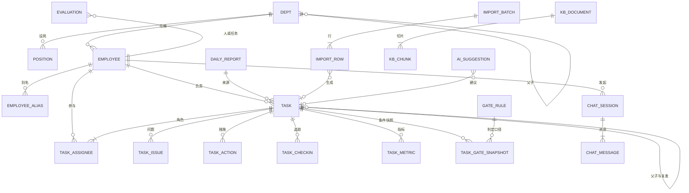

实体之间有三条容易看错的边。`TASK` 到自身有两条关系，一条是父子拆解，一条是复发指向，用 `parent_id` 与 `recurrence_of` 分开，不能合并成一个字段。`CHAT_MESSAGE` 与 `TASK` 之间不连边：Q12 取只读边界之后会话不催生工单，两者只在人复制文本时发生关系，因此不建关联列。`EVALUATION` 的目标既可能是人也可能是任务，用 `target_type` 加 `target_id` 表示，不建两张表是因为两者的评分结构与证据结构一致。

### 6.2 核心表结构

```sql
CREATE TABLE dept (
  id                 BIGINT PRIMARY KEY AUTO_INCREMENT,
  parent_id          BIGINT NOT NULL DEFAULT 0,
  code               VARCHAR(32)  NOT NULL COMMENT '部门编码',
  name               VARCHAR(64)  NOT NULL COMMENT '部门名称',
  path               VARCHAR(255) NOT NULL COMMENT '物化路径 /1/5/12/',
  level              TINYINT      NOT NULL DEFAULT 1,
  leader_employee_id BIGINT       NULL COMMENT '部门负责人',
  headcount          INT          NULL COMMENT '编制人数',
  sort_no            INT          NOT NULL DEFAULT 0,
  status             TINYINT      NOT NULL DEFAULT 1 COMMENT '1 启用 0 停用',
  created_at         DATETIME     NOT NULL DEFAULT CURRENT_TIMESTAMP,
  updated_at         DATETIME     NULL ON UPDATE CURRENT_TIMESTAMP,
  UNIQUE KEY uk_dept_code (code),
  KEY idx_dept_path (path),
  KEY idx_dept_parent (parent_id)
) ENGINE=InnoDB DEFAULT CHARSET=utf8mb4 COMMENT='部门';

CREATE TABLE employee (
  id          BIGINT PRIMARY KEY AUTO_INCREMENT,
  emp_no      VARCHAR(32) NOT NULL COMMENT '工号',
  name        VARCHAR(32) NOT NULL,
  dept_id     BIGINT      NOT NULL,
  position_id BIGINT      NULL,
  manager_id  BIGINT      NULL COMMENT '直属上级 用于逾期升级链',
  phone       VARCHAR(32) NULL,
  email       VARCHAR(64) NULL,
  status      TINYINT     NOT NULL DEFAULT 1 COMMENT '1 在职 2 离职 3 试用',
  join_date   DATE        NULL,
  leave_date  DATE        NULL,
  created_at  DATETIME    NOT NULL DEFAULT CURRENT_TIMESTAMP,
  UNIQUE KEY uk_emp_no (emp_no),
  KEY idx_emp_name (name),
  KEY idx_emp_dept (dept_id),
  KEY idx_emp_manager (manager_id)
) ENGINE=InnoDB DEFAULT CHARSET=utf8mb4 COMMENT='人员';

CREATE TABLE employee_alias (
  id          BIGINT PRIMARY KEY AUTO_INCREMENT,
  employee_id BIGINT      NOT NULL,
  alias       VARCHAR(32) NOT NULL COMMENT '别名 如 张总 老沈',
  source      VARCHAR(16) NOT NULL DEFAULT 'MANUAL',
  UNIQUE KEY uk_alias (alias)
) ENGINE=InnoDB DEFAULT CHARSET=utf8mb4 COMMENT='姓名别名';

CREATE TABLE task (
  id                  BIGINT PRIMARY KEY AUTO_INCREMENT,
  task_no             VARCHAR(32)  NOT NULL COMMENT 'T-20261101-001',
  title               VARCHAR(255) NOT NULL,
  description         TEXT         NULL,
  type                VARCHAR(32)  NOT NULL COMMENT 'PATROL QUALITY PLAN EQUIP CUSTOMER SAFETY OTHER',
  source_type         VARCHAR(16)  NOT NULL COMMENT 'MANUAL REPORT CHAT',
  source_ref          JSON         NULL COMMENT '日报定位或会话消息 ID 列表',
  dept_id             BIGINT       NOT NULL,
  owner_id            BIGINT       NOT NULL,
  primary_assignee_id BIGINT       NULL,
  assignee_text       VARCHAR(128) NULL COMMENT '源数据里的群体名或部门名',
  priority            TINYINT      NOT NULL DEFAULT 2,
  status              VARCHAR(16)  NOT NULL DEFAULT 'DRAFT',
  plan_start          DATETIME     NULL,
  plan_end            DATETIME     NOT NULL,
  actual_end          DATETIME     NULL,
  progress            TINYINT      NOT NULL DEFAULT 0,
  accept_criteria     JSON         NULL COMMENT '验收条件数组',
  result_summary      TEXT         NULL COMMENT '结果说明',
  delay_count         INT          NOT NULL DEFAULT 0,
  reject_count        INT          NOT NULL DEFAULT 0,
  urge_count          INT          NOT NULL DEFAULT 0,
  closure_level       VARCHAR(16)  NULL COMMENT 'STRONG WEAK NONE',
  recurrence_of       BIGINT       NULL COMMENT '复发来源工单',
  parent_id           BIGINT       NULL COMMENT '父工单',
  tags                VARCHAR(255) NULL,
  deleted             TINYINT      NOT NULL DEFAULT 0,
  created_by          BIGINT       NOT NULL,
  created_at          DATETIME     NOT NULL DEFAULT CURRENT_TIMESTAMP,
  updated_at          DATETIME     NULL ON UPDATE CURRENT_TIMESTAMP,
  UNIQUE KEY uk_task_no (task_no),
  KEY idx_task_status_end (status, plan_end),
  KEY idx_task_dept_status (dept_id, status),
  KEY idx_task_owner (owner_id),
  KEY idx_task_assignee (primary_assignee_id),
  KEY idx_task_recurrence (recurrence_of),
  FULLTEXT KEY ft_task_title (title) WITH PARSER ngram
) ENGINE=InnoDB DEFAULT CHARSET=utf8mb4 COMMENT='工单';

CREATE TABLE task_checkin (
  id                BIGINT PRIMARY KEY AUTO_INCREMENT,
  task_id           BIGINT       NOT NULL,
  employee_id       BIGINT       NOT NULL,
  check_date        DATE         NOT NULL,
  progress          TINYINT      NOT NULL,
  content           TEXT         NOT NULL,
  blocker_text      VARCHAR(500) NULL,
  next_step         VARCHAR(500) NULL,
  plan_end_snapshot DATETIME     NULL,
  result_type       VARCHAR(16)  NOT NULL DEFAULT 'PROGRESS',
  closure_level     VARCHAR(16)  NULL,
  created_at        DATETIME     NOT NULL DEFAULT CURRENT_TIMESTAMP,
  KEY idx_ci_task_date (task_id, check_date),
  KEY idx_ci_emp_date (employee_id, check_date)
) ENGINE=InnoDB DEFAULT CHARSET=utf8mb4 COMMENT='追踪记录';

CREATE TABLE task_issue (
  id        BIGINT PRIMARY KEY AUTO_INCREMENT,
  task_id   BIGINT       NOT NULL,
  seq       INT          NOT NULL,
  content   VARCHAR(500) NOT NULL,
  category  VARCHAR(32)  NULL,
  severity  TINYINT      NOT NULL DEFAULT 2,
  status    VARCHAR(16)  NOT NULL DEFAULT 'OPEN',
  closed_at DATETIME     NULL,
  KEY idx_issue_task (task_id, status)
) ENGINE=InnoDB DEFAULT CHARSET=utf8mb4 COMMENT='问题项';

CREATE TABLE task_action (
  id            BIGINT PRIMARY KEY AUTO_INCREMENT,
  task_id       BIGINT       NOT NULL,
  issue_id      BIGINT       NULL,
  seq           INT          NOT NULL,
  content       VARCHAR(500) NOT NULL,
  owner_id      BIGINT       NULL,
  due_date      DATE         NULL,
  status        VARCHAR(16)  NOT NULL DEFAULT 'OPEN',
  task_child_id BIGINT       NULL COMMENT '升级为子工单',
  KEY idx_action_task (task_id),
  KEY idx_action_owner_due (owner_id, due_date)
) ENGINE=InnoDB DEFAULT CHARSET=utf8mb4 COMMENT='措施项';

CREATE TABLE task_metric (
  id          BIGINT PRIMARY KEY AUTO_INCREMENT,
  task_id     BIGINT        NULL,
  stat_date   DATE          NOT NULL,
  dim_type    VARCHAR(16)   NOT NULL COMMENT 'PROCESS DEPT EMPLOYEE',
  dim_code    VARCHAR(32)   NOT NULL,
  metric_code VARCHAR(32)   NOT NULL COMMENT 'PLAN_QTY ACT_QTY RATE',
  value       DECIMAL(14,3) NOT NULL,
  unit        VARCHAR(16)   NULL,
  extra       JSON          NULL,
  UNIQUE KEY uk_metric (stat_date, dim_type, dim_code, metric_code),
  KEY idx_metric_task (task_id)
) ENGINE=InnoDB DEFAULT CHARSET=utf8mb4 COMMENT='指标';

CREATE TABLE import_batch (
  id          BIGINT PRIMARY KEY AUTO_INCREMENT,
  file_hash   CHAR(64)     NOT NULL,
  file_name   VARCHAR(255) NOT NULL,
  file_key    VARCHAR(255) NOT NULL COMMENT '文件卷相对路径',
  mode        VARCHAR(32)  NOT NULL,
  status      VARCHAR(16)  NOT NULL COMMENT 'UPLOADED ANALYZING PREVIEWED CONFIRMED FAILED REVOKED',
  sheet_total INT          NULL,
  row_total   INT          NULL,
  row_ok      INT          NULL,
  row_warn    INT          NULL,
  row_error   INT          NULL,
  mapping     JSON         NULL,
  created_by  BIGINT       NOT NULL,
  created_at  DATETIME     NOT NULL DEFAULT CURRENT_TIMESTAMP,
  UNIQUE KEY uk_batch_hash (file_hash)
) ENGINE=InnoDB DEFAULT CHARSET=utf8mb4 COMMENT='导入批次';

CREATE TABLE import_row (
  id       BIGINT PRIMARY KEY AUTO_INCREMENT,
  batch_id BIGINT      NOT NULL,
  sheet    VARCHAR(64) NOT NULL,
  row_no   INT         NOT NULL,
  raw      JSON        NOT NULL COMMENT '原始行快照',
  parsed   JSON        NULL,
  level    VARCHAR(8)  NOT NULL COMMENT 'OK WARN ERROR',
  issues   JSON        NULL,
  task_id  BIGINT      NULL,
  KEY idx_row_batch (batch_id, level)
) ENGINE=InnoDB DEFAULT CHARSET=utf8mb4 COMMENT='导入行';

CREATE TABLE kb_document (
  id              BIGINT PRIMARY KEY AUTO_INCREMENT,
  title           VARCHAR(255) NOT NULL,
  domain          VARCHAR(32)  NOT NULL COMMENT 'HISTORY POLICY PROCESS CUSTOMER MEETING',
  dept_id         BIGINT       NULL COMMENT '归属部门 空表示全员可见',
  dept_code       VARCHAR(32)  NULL COMMENT '同步到 RAGFlow 的部门标签 空表示全员可见',
  visibility      VARCHAR(16)  NOT NULL DEFAULT 'ALL' COMMENT 'ALL DEPT DEPT_TREE 同步到 RAGFlow 的可见范围标签',
  file_key        VARCHAR(255) NOT NULL COMMENT '原件在文件卷的相对路径',
  file_hash       CHAR(64)     NOT NULL,
  source_type     VARCHAR(16)  NOT NULL COMMENT 'UPLOAD TASK_PAIR',
  dataset_id      VARCHAR(64)  NOT NULL COMMENT 'RAGFlow 知识库标识',
  external_doc_id VARCHAR(64)  NULL COMMENT 'RAGFlow 文档标识',
  parser_id       VARCHAR(64)  NULL COMMENT 'RAGFlow 切片模板标识',
  embedding_model VARCHAR(64)  NULL COMMENT '解析时使用的向量模型 换代对照用',
  chunk_cnt       INT          NOT NULL DEFAULT 0,
  sync_status     VARCHAR(16)  NOT NULL DEFAULT 'UPLOADED' COMMENT 'UPLOADED PARSING PARSED FAILED',
  sync_msg        VARCHAR(500) NULL,
  synced_at       DATETIME     NULL,
  created_by      BIGINT       NOT NULL,
  deleted         TINYINT      NOT NULL DEFAULT 0,
  created_at      DATETIME     NOT NULL DEFAULT CURRENT_TIMESTAMP,
  UNIQUE KEY uk_doc_hash (file_hash),
  KEY idx_doc_domain_dept (domain, dept_id),
  KEY idx_doc_sync (sync_status),
  KEY idx_doc_ext (dataset_id, external_doc_id)
) ENGINE=InnoDB DEFAULT CHARSET=utf8mb4 COMMENT='知识文档';

CREATE TABLE kb_chunk (
  id                BIGINT PRIMARY KEY AUTO_INCREMENT,
  doc_id            BIGINT      NOT NULL,
  seq               INT         NOT NULL,
  external_chunk_id VARCHAR(64) NOT NULL COMMENT 'RAGFlow 切片标识 引用回溯用',
  content           TEXT        NOT NULL COMMENT '正文快照 引用展示与降级检索用',
  page_no           INT         NULL,
  token_cnt         INT         NULL,
  meta              JSON        NULL COMMENT '知识域 部门 来源工单',
  FULLTEXT KEY ft_chunk (content) WITH PARSER ngram,
  UNIQUE KEY uk_chunk_ext (doc_id, external_chunk_id),
  KEY idx_chunk_doc (doc_id)
) ENGINE=InnoDB DEFAULT CHARSET=utf8mb4 COMMENT='知识切片快照';

CREATE TABLE gate_rule (
  id         BIGINT PRIMARY KEY AUTO_INCREMENT,
  task_type  VARCHAR(32) NOT NULL COMMENT '工单类型 ALL 表示默认口径',
  gate_code  VARCHAR(16) NOT NULL COMMENT 'G1 到 G9',
  weight     INT         NOT NULL DEFAULT 0 COMMENT '完成度权重',
  required   TINYINT     NOT NULL DEFAULT 1 COMMENT '1 必须达成 0 仅提示',
  holder_role VARCHAR(16) NULL COMMENT '缺口承担角色 主责 负责人 措施执行人',
  sort_no    INT         NOT NULL DEFAULT 0,
  enabled    TINYINT     NOT NULL DEFAULT 1,
  UNIQUE KEY uk_gate_rule (task_type, gate_code)
) ENGINE=InnoDB DEFAULT CHARSET=utf8mb4 COMMENT='完成条件口径';

CREATE TABLE task_gate_snapshot (
  id         BIGINT PRIMARY KEY AUTO_INCREMENT,
  snap_date  DATE        NOT NULL,
  task_id    BIGINT      NOT NULL,
  dept_id    BIGINT      NOT NULL COMMENT '冗余存部门 供矩阵按部门取整列',
  task_type  VARCHAR(32) NOT NULL,
  gate_code  VARCHAR(16) NOT NULL,
  state      VARCHAR(8)  NOT NULL COMMENT 'DONE TODO NA',
  gap_days   INT         NOT NULL DEFAULT 0 COMMENT '该缺口已持续天数',
  holder_id  BIGINT      NULL COMMENT '缺口承担者',
  UNIQUE KEY uk_snap (snap_date, task_id, gate_code),
  KEY idx_snap_dept (snap_date, dept_id, gate_code)
) ENGINE=InnoDB DEFAULT CHARSET=utf8mb4 COMMENT='完成条件日快照 保留一百八十天';

CREATE TABLE chat_session (
  id          BIGINT PRIMARY KEY AUTO_INCREMENT,
  employee_id BIGINT       NOT NULL COMMENT '归属人',
  title       VARCHAR(120) NOT NULL COMMENT '取首轮提问前四十字',
  scope_type  VARCHAR(16)  NOT NULL DEFAULT 'DEPT' COMMENT 'SELF DEPT DEPT_TREE ALL',
  scope_id    BIGINT       NULL COMMENT '范围对象 通常是部门',
  msg_count   INT          NOT NULL DEFAULT 0,
  last_msg_at DATETIME     NULL,
  status      VARCHAR(16)  NOT NULL DEFAULT 'OPEN' COMMENT 'OPEN ARCHIVED',
  deleted     TINYINT      NOT NULL DEFAULT 0,
  created_at  DATETIME     NOT NULL DEFAULT CURRENT_TIMESTAMP,
  KEY idx_cs_emp_time (employee_id, last_msg_at),
  KEY idx_cs_scope (scope_type, scope_id)
) ENGINE=InnoDB DEFAULT CHARSET=utf8mb4 COMMENT='会话';

CREATE TABLE chat_message (
  id         BIGINT PRIMARY KEY AUTO_INCREMENT,
  session_id BIGINT      NOT NULL,
  role       VARCHAR(16) NOT NULL COMMENT 'USER ASSISTANT TOOL',
  content    TEXT        NULL,
  citations  JSON        NULL COMMENT '引用数组 切片 工单 指标',
  tool_calls JSON        NULL COMMENT '工具名 入参摘要 结果条数 耗时',
  model_name VARCHAR(64) NULL COMMENT '本轮使用的模型',
  prompt_ver VARCHAR(32) NULL COMMENT '提示词版本',
  token_in   INT         NULL,
  token_out  INT         NULL,
  latency_ms INT         NULL,
  created_at DATETIME    NOT NULL DEFAULT CURRENT_TIMESTAMP,
  KEY idx_cm_session (session_id, id)
) ENGINE=InnoDB DEFAULT CHARSET=utf8mb4 COMMENT='会话消息';
CREATE TABLE position (
  id         BIGINT PRIMARY KEY AUTO_INCREMENT,
  dept_id    BIGINT      NOT NULL,
  code       VARCHAR(32) NOT NULL COMMENT '职位编码',
  name       VARCHAR(64) NOT NULL,
  job_level  TINYINT     NOT NULL DEFAULT 1 COMMENT '职级 1 到 9',
  is_manager TINYINT     NOT NULL DEFAULT 0 COMMENT '1 管理岗 可被选为负责人',
  sort_no    INT         NOT NULL DEFAULT 0,
  status     TINYINT     NOT NULL DEFAULT 1 COMMENT '1 启用 0 停用',
  created_at DATETIME    NOT NULL DEFAULT CURRENT_TIMESTAMP,
  UNIQUE KEY uk_position_dept_code (dept_id, code),
  KEY idx_position_dept (dept_id)
) ENGINE=InnoDB DEFAULT CHARSET=utf8mb4 COMMENT='职位';

CREATE TABLE user_account (
  id            BIGINT PRIMARY KEY AUTO_INCREMENT,
  employee_id   BIGINT       NOT NULL,
  username      VARCHAR(64)  NOT NULL,
  password_hash VARCHAR(128) NOT NULL COMMENT 'BCrypt 哈希',
  status        TINYINT      NOT NULL DEFAULT 1 COMMENT '1 启用 0 停用',
  last_login_at DATETIME     NULL,
  created_at    DATETIME     NOT NULL DEFAULT CURRENT_TIMESTAMP,
  UNIQUE KEY uk_account_emp (employee_id),
  UNIQUE KEY uk_account_username (username)
) ENGINE=InnoDB DEFAULT CHARSET=utf8mb4 COMMENT='登录账号';

CREATE TABLE role (
  id              BIGINT PRIMARY KEY AUTO_INCREMENT,
  code            VARCHAR(32) NOT NULL,
  name            VARCHAR(64) NOT NULL,
  data_scope_type VARCHAR(16) NOT NULL COMMENT 'SELF DEPT DEPT_TREE ALL',
  remark          VARCHAR(255) NULL,
  created_at      DATETIME    NOT NULL DEFAULT CURRENT_TIMESTAMP,
  UNIQUE KEY uk_role_code (code)
) ENGINE=InnoDB DEFAULT CHARSET=utf8mb4 COMMENT='角色';

CREATE TABLE permission (
  id      BIGINT PRIMARY KEY AUTO_INCREMENT,
  code    VARCHAR(64) NOT NULL COMMENT '如 task:edit stats:view eval:view',
  name    VARCHAR(64) NOT NULL,
  module  VARCHAR(32) NOT NULL COMMENT 'ORG TASK TRK STAT KB CHAT SET',
  UNIQUE KEY uk_perm_code (code)
) ENGINE=InnoDB DEFAULT CHARSET=utf8mb4 COMMENT='权限点';

CREATE TABLE role_permission (
  id            BIGINT PRIMARY KEY AUTO_INCREMENT,
  role_id       BIGINT NOT NULL,
  permission_id BIGINT NOT NULL,
  UNIQUE KEY uk_rp (role_id, permission_id)
) ENGINE=InnoDB DEFAULT CHARSET=utf8mb4 COMMENT='角色权限';

CREATE TABLE user_role (
  id          BIGINT PRIMARY KEY AUTO_INCREMENT,
  employee_id BIGINT      NOT NULL,
  role_id     BIGINT      NOT NULL,
  granted_by  BIGINT      NULL COMMENT '授权操作人 系统初始化时为空',
  created_at  DATETIME    NOT NULL DEFAULT CURRENT_TIMESTAMP,
  UNIQUE KEY uk_user_role (employee_id, role_id),
  KEY idx_user_role_emp (employee_id),
  KEY idx_user_role_role (role_id)
) ENGINE=InnoDB DEFAULT CHARSET=utf8mb4 COMMENT='人员授权 一个人可同时持有多个角色';

CREATE TABLE task_assignee (
  id          BIGINT PRIMARY KEY AUTO_INCREMENT,
  task_id     BIGINT      NOT NULL,
  employee_id BIGINT      NOT NULL,
  role_type   VARCHAR(16) NOT NULL DEFAULT 'ASSIST' COMMENT 'ASSIST COOPERATE',
  created_at  DATETIME    NOT NULL DEFAULT CURRENT_TIMESTAMP,
  UNIQUE KEY uk_assignee (task_id, employee_id),
  KEY idx_assignee_emp (employee_id)
) ENGINE=InnoDB DEFAULT CHARSET=utf8mb4 COMMENT='工单参与人 只记参与不承担验收与逾期';

CREATE TABLE task_attachment (
  id          BIGINT PRIMARY KEY AUTO_INCREMENT,
  biz_type    VARCHAR(16)  NOT NULL COMMENT 'TASK CHECKIN DOC REPORT',
  biz_id      BIGINT       NOT NULL,
  file_key    VARCHAR(255) NOT NULL COMMENT '文件卷相对路径',
  file_name   VARCHAR(255) NOT NULL,
  mime        VARCHAR(128) NULL,
  size        BIGINT       NULL,
  sha256      CHAR(64)     NULL COMMENT '同文件去重与防篡改',
  uploaded_by BIGINT       NOT NULL,
  created_at  DATETIME     NOT NULL DEFAULT CURRENT_TIMESTAMP,
  KEY idx_att_biz (biz_type, biz_id),
  KEY idx_att_hash (sha256)
) ENGINE=InnoDB DEFAULT CHARSET=utf8mb4 COMMENT='附件 统一挂载不按业务分表';

CREATE TABLE daily_report (
  id              BIGINT PRIMARY KEY AUTO_INCREMENT,
  report_date     DATE        NOT NULL,
  reporter_id     BIGINT      NOT NULL,
  source_sheet    VARCHAR(64) NULL COMMENT '工作表名 如 20261025',
  import_batch_id BIGINT      NULL,
  raw             JSON        NULL COMMENT '页级原始快照 复核用',
  created_at      DATETIME    NOT NULL DEFAULT CURRENT_TIMESTAMP,
  UNIQUE KEY uk_report_date_reporter (report_date, reporter_id),
  KEY idx_report_batch (import_batch_id)
) ENGINE=InnoDB DEFAULT CHARSET=utf8mb4 COMMENT='日报页 一次汇报一页';

CREATE TABLE import_mapping (
  id                 BIGINT PRIMARY KEY AUTO_INCREMENT,
  template_signature VARCHAR(128) NOT NULL COMMENT '列名与区块位置拼接的签名',
  mapping            JSON         NOT NULL COMMENT '列到字段的映射与置信度',
  hit_count          INT          NOT NULL DEFAULT 1,
  updated_at         DATETIME     NULL ON UPDATE CURRENT_TIMESTAMP,
  UNIQUE KEY uk_mapping_sig (template_signature)
) ENGINE=InnoDB DEFAULT CHARSET=utf8mb4 COMMENT='导入映射模板复用';

CREATE TABLE export_task (
  id            BIGINT PRIMARY KEY AUTO_INCREMENT,
  template_code VARCHAR(32)  NOT NULL COMMENT 'DAILY WEEKLY LEDGER PERF CHART',
  params        JSON         NULL COMMENT '查询条件与范围',
  status        VARCHAR(16)  NOT NULL COMMENT 'PENDING RUNNING DONE FAILED',
  file_key      VARCHAR(255) NULL,
  row_cnt       INT          NULL,
  error_msg     VARCHAR(500) NULL,
  created_by    BIGINT       NOT NULL,
  created_at    DATETIME     NOT NULL DEFAULT CURRENT_TIMESTAMP,
  KEY idx_export_status (status, created_at)
) ENGINE=InnoDB DEFAULT CHARSET=utf8mb4 COMMENT='导出任务';

CREATE TABLE evaluation (
  id           BIGINT PRIMARY KEY AUTO_INCREMENT,
  target_type  VARCHAR(16)  NOT NULL COMMENT 'EMPLOYEE TASK',
  target_id    BIGINT       NOT NULL,
  period       VARCHAR(16)  NOT NULL COMMENT '如 2026-10 或 2026Q4',
  score        DECIMAL(5,2) NULL,
  scores       JSON         NULL COMMENT '分维度得分',
  evidence     JSON         NULL COMMENT '证据 工单与记录 ID',
  confidence   DECIMAL(4,2) NULL COMMENT '样本量决定的置信度',
  sample_cnt   INT          NULL,
  status       VARCHAR(16)  NOT NULL DEFAULT 'DRAFT' COMMENT 'DRAFT PUBLISHED APPEALED',
  created_at   DATETIME     NOT NULL DEFAULT CURRENT_TIMESTAMP,
  UNIQUE KEY uk_eval (target_type, target_id, period),
  KEY idx_eval_period (period, target_type)
) ENGINE=InnoDB DEFAULT CHARSET=utf8mb4 COMMENT='评价 人与任务共用一张表';

CREATE TABLE ai_suggestion (
  id          BIGINT PRIMARY KEY AUTO_INCREMENT,
  type        VARCHAR(16) NOT NULL COMMENT 'NEXT_STEP URGE RISK TRAINING DUTY',
  target_type VARCHAR(16) NOT NULL,
  target_id   BIGINT      NOT NULL,
  payload     JSON        NOT NULL COMMENT '建议正文与可执行动作',
  evidence    JSON        NULL COMMENT '依据 工单 记录 指标',
  status      VARCHAR(16) NOT NULL DEFAULT 'PENDING' COMMENT 'PENDING ACCEPTED IGNORED',
  model_name  VARCHAR(64) NULL,
  prompt_ver  VARCHAR(32) NULL,
  created_at  DATETIME    NOT NULL DEFAULT CURRENT_TIMESTAMP,
  KEY idx_sug_target (target_type, target_id, status),
  KEY idx_sug_status (status, created_at)
) ENGINE=InnoDB DEFAULT CHARSET=utf8mb4 COMMENT='AI 建议与待确认';

CREATE TABLE stat_daily (
  id          BIGINT PRIMARY KEY AUTO_INCREMENT,
  stat_date   DATE          NOT NULL,
  dim_type    VARCHAR(16)   NOT NULL COMMENT 'DEPT EMPLOYEE TYPE PROCESS',
  dim_code    VARCHAR(32)   NOT NULL,
  metric_code VARCHAR(32)   NOT NULL,
  value       DECIMAL(14,3) NOT NULL,
  updated_at  DATETIME      NULL ON UPDATE CURRENT_TIMESTAMP,
  UNIQUE KEY uk_stat (stat_date, dim_type, dim_code, metric_code),
  KEY idx_stat_metric (metric_code, stat_date)
) ENGINE=InnoDB DEFAULT CHARSET=utf8mb4 COMMENT='统计日预聚合';

CREATE TABLE audit_log (
  id         BIGINT PRIMARY KEY AUTO_INCREMENT,
  actor_id   BIGINT      NOT NULL,
  action     VARCHAR(32) NOT NULL COMMENT 'CREATE UPDATE STATUS DELETE EXPORT',
  biz_type   VARCHAR(16) NOT NULL,
  biz_id     BIGINT      NOT NULL,
  before     JSON        NULL,
  after      JSON        NULL,
  trace_id   VARCHAR(64) NULL,
  created_at DATETIME    NOT NULL DEFAULT CURRENT_TIMESTAMP,
  KEY idx_audit_biz (biz_type, biz_id, created_at),
  KEY idx_audit_actor (actor_id, created_at)
) ENGINE=InnoDB DEFAULT CHARSET=utf8mb4 COMMENT='审计 写操作全部留痕';

CREATE TABLE sys_config (
  id         BIGINT PRIMARY KEY AUTO_INCREMENT,
  cfg_key    VARCHAR(64)  NOT NULL COMMENT '如 similarity.threshold alert.gap.first',
  cfg_value  VARCHAR(255) NOT NULL,
  value_type VARCHAR(16)  NOT NULL COMMENT 'INT DECIMAL STRING BOOLEAN JSON',
  group_code VARCHAR(32)  NOT NULL COMMENT 'SIMILARITY GATE EVAL ALERT EXPORT',
  remark     VARCHAR(255) NULL COMMENT '含义与取值范围',
  updated_by BIGINT       NULL,
  created_at DATETIME     NOT NULL DEFAULT CURRENT_TIMESTAMP,
  updated_at DATETIME     NULL ON UPDATE CURRENT_TIMESTAMP,
  UNIQUE KEY uk_cfg (cfg_key),
  KEY idx_cfg_group (group_code)
) ENGINE=InnoDB DEFAULT CHARSET=utf8mb4 COMMENT='参数配置 阈值与权重';

CREATE TABLE job_task (
  id           BIGINT PRIMARY KEY AUTO_INCREMENT,
  job_type     VARCHAR(32)  NOT NULL COMMENT 'PARSE_IMPORT EXPORT EVAL GATE_SNAPSHOT SYNC_KB',
  payload      JSON         NULL,
  status       VARCHAR(16)  NOT NULL COMMENT 'PENDING RUNNING DONE FAILED',
  attempts     INT          NOT NULL DEFAULT 0,
  max_attempts INT          NOT NULL DEFAULT 3,
  next_retry_at DATETIME    NULL,
  last_error   VARCHAR(500) NULL,
  locked_by    VARCHAR(64)  NULL COMMENT '实例与线程标识 抢占用',
  created_at   DATETIME     NOT NULL DEFAULT CURRENT_TIMESTAMP,
  updated_at   DATETIME     NULL ON UPDATE CURRENT_TIMESTAMP,
  KEY idx_job_status (status, next_retry_at),
  KEY idx_job_type (job_type, created_at)
) ENGINE=InnoDB DEFAULT CHARSET=utf8mb4 COMMENT='异步任务';
```

### 6.3 逐表字段说明

6.2 只给语句，为什么需要某一列从语句里看不出来。本节按表逐列说明三件事：这一列服务哪条规则或哪个页面、缺了它会退化成什么、写入时由谁填。

三个通用列不逐表重复：`id` 是自增主键，供跨表引用与审计定位；`created_at` 默认当前时间，由数据库填，不靠应用传；`updated_at` 由数据库在更新时维护，用于增量同步与「最后改动」排序。其余字段逐条列出。

枚举取值不建字典表：状态、类型、来源这类取值在 Java 侧用枚举常量，在库里用 `COMMENT` 与 `VARCHAR` 组合约束，页面文案由前端集中维护。不建 `dict` 表的原因是这些取值随代码版本一起变，拆成表后改一个取值要写迁移、改文案、清缓存三处，容易出现库里一份、代码里一份的错位。

数值型参数相反，必须可改而不能硬编码：相似度阈值、九条条件的权重、提醒阈值、评价权重这些要在试点期按真实数据调，因此单独一张 `sys_config`（见 6.3.8）。区分的标准是改它要不要重新发版：要发版的是枚举，不发版的是配置。

#### 6.3.1 组织与账号

| 表 | 用途 |
|---|---|
| `dept` | 组织树，同时是数据范围与部门统计的第一维度 |
| `position` | 岗位与职级，决定谁能当负责人、逾期时向上找谁 |
| `employee` | 人员主数据，负责人、主责、措施执行人都指向它 |
| `employee_alias` | 姓名别名，只服务导入解析的人名匹配 |
| `user_account` | 登录凭据，与人员一对一 |
| `role` `permission` `role_permission` `user_role` | 三种角色的权限点、数据范围宽度，以及人到角色的授权 |

`dept`

| 字段 | 为什么要它 | 什么时候用到 |
|---|---|---|
| `parent_id` | 组织树上下级关系的唯一载体，递归展开子树靠它 | 新建设置上级；数据范围算「本部门及下级」；驾驶舱按子树汇总 |
| `code` | 业务编码，改名不影响历史数据与导入模板 | 花名册导入按它匹配部门；导出件里作为部门标识 |
| `name` | 页面与导出件展示的部门名 | 所有列表、详情、矩阵的行列头 |
| `path` | 物化路径 `/1/5/12/`，一次前缀匹配取整个子树 | 部门矩阵按子树取数；范围拦截拼可见部门集合；避免递归查询 |
| `level` | 树深，用于缩进与层级校验 | 组织页缩进显示；限制岗位只能挂在已存在的层级下 |
| `leader_employee_id` | 部门负责人，决定该部门工单的验收人与驾驶舱可见者 | 建单选负责人时作为默认值；负责人空缺时提示由上级指定 |
| `headcount` | 编制人数，与在编人数对比看缺口 | 组织页显示在编与编制；部门对比图的一个指标 |
| `sort_no` | 同层手工排序，不按名称拼音排 | 部门树与下拉选择器的显示顺序 |
| `status` | 停用部门不出现在新选择器，历史数据仍可显示 | 停用时校验无在职人员与在办工单；历史工单详情仍需展示部门名 |

`position`

| 字段 | 为什么要它 | 什么时候用到 |
|---|---|---|
| `dept_id` | 岗位属于部门，同名岗位在不同部门是两行 | 选人时先筛部门再筛岗位；组织页按部门列岗位 |
| `code` | 部门内唯一的岗位编码，改名不动编码 | 花名册导入按部门加编码对齐岗位 |
| `name` | 展示名，如车间主任、质检员 | 人员卡片、导出件的职务列 |
| `job_level` | 职级 1 到 9，用于判断向上找人找几级 | 逾期升级链从主责职级往上找管理岗；统计可分层 |
| `is_manager` | 是否管理岗，作为负责人候选人筛选项 | 建单选择负责人时只列管理岗；非管理岗不能被选为负责人 |
| `sort_no` | 岗位下拉的排列顺序，职级相近的排一起 | 人员维护页与建单抽屉的岗位选择器 |
| `status` | 停用岗位不能再选，在职者保留原引用 | 岗位维护；人员详情仍显示历史岗位 |

`employee`

| 字段 | 为什么要它 | 什么时候用到 |
|---|---|---|
| `emp_no` | 工号，唯一键，重名的人靠它区分 | 花名册导入对齐；导出件的人员标识；账号与人员关联的兜底 |
| `name` | 展示名，同时是导入人名匹配的第一依据 | 所有涉及人的列表与详情；导入解析先按姓名匹配 |
| `dept_id` | 在编部门，工单归属部门与数据范围都从这里派生 | 数据范围计算；按部门统计；建单默认承办部门 |
| `position_id` | 职位，决定是否管理岗、职级与默认审批关系 | 选负责人时判断资格；逾期升级时算职级 |
| `manager_id` | 直属上级，是提醒与升级的接收人，也用于派工范围校验 | 缺口提醒发给承担人的上级；派工校验「只能派给自己线上的人」 |
| `phone` | 提醒的次要通道与紧急联系 | 站内提醒无人读时改短信；H5 登录异常的兜底联系 |
| `email` | 通知备用通道，也用于账号找回 | 导出完成通知；密码重置 |
| `status` | 在职、离职、试用三态，决定是否出现在选择器 | 派工选择器排除离职；试用期人员在人员评价里单列 |
| `join_date` | 入职日期，人员评价的样本起点 | 入职不满三个月不参与排名；部门在编人数按日期口径 |
| `leave_date` | 离职日期，决定在办工单是否必须转派 | 离职当天提示转派他手上的在办工单 |

`employee_alias`

| 字段 | 为什么要它 | 什么时候用到 |
|---|---|---|
| `employee_id` | 别名指向哪个正身人员 | 导入时命中别名后取这个人的 ID 作为主责候选 |
| `alias` | 别名原文，如张总、老沈、小许 | 样本里同一人写法不统一，靠它把匹配率拉到 92% 以上 |
| `source` | 别名来源，人工维护或导入时新增 | 别名冲突时优先信人工维护的那条；可批量清掉导入生成的别名 |
| 唯一键 `uk_alias` | 一个别名只能指向一个人，冲突即报错 | 导入命中重复别名时把该行降为 WARN，让人二选一 |

`user_account`

| 字段 | 为什么要它 | 什么时候用到 |
|---|---|---|
| `employee_id` | 账号与人一一对应，权限判断最终落到人 | 登录后注入数据范围；一人一账号由唯一键保证 |
| `username` | 登录名，唯一 | 登录页；试点期用工号或姓名拼音 |
| `password_hash` | BCrypt 哈希，不存明文 | 登录校验；改密；错误密码次数统计 |
| `status` | 停用账号不影响人员与历史数据 | 离职或临时冻结；停用后登录页给出明确原因 |
| `last_login_at` | 判断账号是否真的被使用 | 试点期看活跃度；长期不登录的账号回收 |

`role`

| 字段 | 为什么要它 | 什么时候用到 |
|---|---|---|
| `code` | 角色标识，鉴权按它判断，改名不影响授权 | 接口鉴权；页面按角色决定入口是否显示 |
| `name` | 展示名，如管理者、部门负责人、执行者 | 账号维护页、角色配置页 |
| `data_scope_type` | 范围宽度：本人、本部门、本部门及下级、全公司 | 每次查询注入可见集合；越权拦截的第一道 |
| `remark` | 说明适用人群，避免建出重复角色 | 角色配置页；评审时核对三角色是否覆盖全部人 |

`permission` 与 `role_permission`

| 字段 | 为什么要它 | 什么时候用到 |
|---|---|---|
| `permission.code` | 权限点标识，如 `task:edit`、`stats:view` | 接口与按钮都按它判权，前端不写角色判断 |
| `permission.name` | 勾选时显示的名字 | 角色配置页 |
| `permission.module` | 所属模块，角色配置页按模块分组 | 避免一屏几十个权限点；按模块看某角色的能力 |
| `role_permission.role_id` 与 `permission_id` | 多对多两端，角色调权限只动这张表 | 授权与收权；鉴权缓存按角色刷新 |
| 唯一键 `uk_rp` | 防止重复授权 | 缓存里不出现重复项；重复提交不报错 |

`user_role`

| 字段 | 为什么要它 | 什么时候用到 |
|---|---|---|
| `employee_id` | 授权落在人身上，而不是账号上，因此换账号不影响权限 | 登录后按 `employee_id` 取角色；人员调岗时只改这张表 |
| `role_id` | 一个人可以有多个角色，如部门负责人同时是执行者 | 三角色并存的人取数据范围较宽的那个；权限点取并集 |
| 唯一键 `uk_user_role` | 同一人同一角色只授权一次 | 重复勾选不报错；批量授权可重复执行 |
| `granted_by` | 记下是谁给的权限，便于回收时确认来源 | 权限审计；系统初始化写空值表示来自种子数据 |
| 索引 `idx_user_role_emp` 与 `idx_user_role_role` | 一个按人取角色，一个按角色取人 | 登录装载角色；角色详情页列出持有者 |

为什么单独一张表而不在 `employee` 上加一列：角色是多值的，一列放不下；有了这张表，增加一种角色不必改人员表结构，回收权限也不动物理数据。

#### 6.3.2 工单主体

工单域五张表分两层：`task` 是主体与状态，`task_issue`、`task_action`、`task_assignee`、`task_attachment` 是它的四个附属。附属表都不写状态机，状态只由 `task` 一处维护，这样「改一张单的状态」永远只有一条更新路径。

| 表 | 用途 |
|---|---|
| `task` | 工单主体，状态机、期限、主责与验收的载体 |
| `task_assignee` | 协办与配合，只记参与，不承担验收与逾期 |
| `task_issue` | 问题项，逐条可关，是 G3 的判定单位 |
| `task_action` | 措施项，带执行人与期限，是 G4 的判定单位 |
| `task_attachment` | 附件统一挂载点，四种业务共用 |

`task`

| 字段 | 为什么要它 | 什么时候用到 |
|---|---|---|
| `task_no` | 对外可读编号 `T-20261101-001` | 导出件、线下沟通、审计；不让人用自增 ID 说话 |
| `title` | 事项标题，同时是相似工单判重的输入 | 列表主列；建单时查在建相似单；沉淀到知识库时作标题 |
| `description` | 放不进结构化字段的整段文字 | 导入时把源表里较长的原文落在这里；详情左栏 |
| `type` | 工单类型，决定用哪套完成条件口径 | 取 `gate_rule`；看板分组；统计按类型分层 |
| `source_type` | 来源是手工、日报导入还是建议采纳 | 来源占比统计；详情页显示「来自日报第几页」；会话不产出草稿，因此没有会话来源 |
| `source_ref` | 来源定位数组：批次与行号、建议 ID | 点开回原文；导入撤回时按它反查；建议采纳时记下是哪条建议促成的 |
| `dept_id` | 承办部门，数据范围与部门矩阵的第一过滤维度 | 范围拦截；部门矩阵取行；选负责人时的部门约束 |
| `owner_id` | 负责人，派工与验收的责任人 | 提交验收转给他；逾期升级到他的层级；驾驶舱「我的部门」 |
| `primary_assignee_id` | 唯一主责执行人 | 我的待办按它查；逾期归属只算他；为空表示待认领、工单停草稿 |
| `assignee_text` | 源数据里的群体名或部门名原文，如各个部门、车间各班组 | 详情页显示「原表写的是这个」，说明为什么没直接派给人 |
| `priority` | 优先级三档，与期限一起决定提醒强度 | 列表与看板排序；逾期池置顶规则 |
| `status` | 状态机当前态，所有列表与统计的第一过滤条件 | 看板列、逾期池、完成度统计；迁移规则见 4.2 |
| `plan_start` | 计划开始日期 | 看板「本周应开工」；判断「说开工了但没记录」 |
| `plan_end` | 计划完成日期，非空约束是 C5 的直接要求 | 逾期计算基准；提醒扫描；导入缺期限的行停在 ERROR 级，补上才允许建单 |
| `actual_end` | 实际完成时间 | 统计口径以它为准；与状态置 DONE 同一事务写入 |
| `progress` | 进度百分比，看板与详情进度条 | 主责打卡后按最近一条记录更新；卡片上显示推进程度 |
| `accept_criteria` | 验收条件数组，验收时逐条判断 | 提交验收时要逐条打勾；为空时只按结果说明验收 |
| `result_summary` | 结果说明，提交验收的必填项 | 导出件的汇报结果列；验收快照的正文 |
| `delay_count` | 累计改期次数 | 改期页显示；超过三次在验收时要求额外说明 |
| `reject_count` | 累计被退回次数 | 详情页显示；第三次退回时提示负责人考虑拆子工单 |
| `urge_count` | 累计催办次数 | 防止对同一人重复催办；管理者的「催了有没有用」观察点 |
| `closure_level` | 关闭强度：强关闭、弱关闭、未关闭 | 验收时选择或从措施结果继承；沉淀知识库时按它筛可用案例 |
| `recurrence_of` | 复发指向的原工单 | 同类问题重复发生的统计；新建时由相似判定或人工指定 |
| `parent_id` | 父工单，拆解后的子工单挂这里 | 列表默认只显示父级；详情页展开子项；工作量按拆解粒度统计 |
| `tags` | 手工标签，跨类型的临时归类 | 专项活动筛选；导出与检索的辅助条件 |
| `deleted` | 逻辑删除，撤回导入与误建走它 | 杜绝物理删除，保证审计与统计可回溯；所有查询默认带 `deleted=0` |
| `created_by` | 建单人 | 审计；驾驶舱看「谁提的这件事多」；权限不依赖它 |
| 索引键 `ft_task_title` | 中文短标题的全文索引 | 相似工单判重；RAGFlow 不可用时的关键词兜底 |

`task_assignee`

| 字段 | 为什么要它 | 什么时候用到 |
|---|---|---|
| `task_id` 与 `employee_id` | 多对多的两端，把「多人格」拆成参与关系而不是多个主责 | 执行者打开「我参与的工单」；详情页协办列表 |
| `role_type` | 区分协办与配合，两类在页面上的排位不同 | 详情页分组显示；催办只发给主责与措施执行人，不打扰配合方 |
| 唯一键 `uk_assignee` | 同一个人在同一张单上只记一条关系 | 重复指派不产生两条；导入重复人名不报错 |
| 索引 `idx_assignee_emp` | 按人查参与关系是高频查询 | 我的工作台的「参与」栏 |

`task_issue`

| 字段 | 为什么要它 | 什么时候用到 |
|---|---|---|
| `task_id` | 问题属于哪张工单 | 详情左栏问题列表；G3 按它统计未关闭条数 |
| `seq` | 单内序号，对应源表格子里的 1、2、3 | 导出件按序号还原原样；页面按序号排序 |
| `content` | 问题描述原文，保留原话不加工 | 详情与导出；问题分类模型的输入 |
| `category` | 问题分类，如现场、质量、计划、人员 | 统计哪类问题多；知识库检索时按分类收窄 |
| `severity` | 严重度三档，决定提醒强度与是否允许先完成后补 | 看板标记；阻碍登记时的默认严重度 |
| `status` | 开启或已关闭，G3 的直接输入 | 关闭要求带结论或措施，避免无声关闭 |
| `closed_at` | 关闭时间 | 滞留天数统计；「关了多久才关」的对比 |
| 索引 `idx_issue_task` | 按工单按状态取问题 | 详情页与缺口抽屉都按未关闭过滤 |

`task_action`

| 字段 | 为什么要它 | 什么时候用到 |
|---|---|---|
| `task_id` | 措施属于哪张工单 | 详情措施列表；G4 按它算执行率 |
| `issue_id` | 措施针对哪个问题，可空表示独立措施 | G4 按有对应关系的措施判定；问题详情里带出关联措施 |
| `seq` | 单内序号，还原源表编号 | 导出与显示顺序 |
| `content` | 措施原文与做法 | 详情；知识库沉淀时成对写入问题与措施 |
| `owner_id` | 措施执行人，可以不是主责 | 催办与提醒发给他；跨部门支持时派给别的部门的人 |
| `due_date` | 措施期限，是 C4 与 G4 的判定依据 | 空值时不允许工单离开草稿；「我这周的措施」按它筛 |
| `status` | 开启或已完成 | G4 按它算执行率；逾期未完成的措施在详情里标红 |
| `task_child_id` | 措施升级为子工单后的 ID | 措施太重时转成工单，两处互链，不重复建两条 |
| 索引 `idx_action_owner_due` | 按人与期限查措施 | 执行者工作台的「本周措施」；负责人巡检 |

`task_attachment`

| 字段 | 为什么要它 | 什么时候用到 |
|---|---|---|
| `biz_type` 与 `biz_id` | 一张表挂四种业务对象，不必每张表各建附件表 | 工单材料、追踪记录证据、文档原件、日报原件 |
| `file_key` | 文件卷相对路径，换存储不改业务代码 | 下载与预览；导出件里证据列表的定位 |
| `file_name` | 原始文件名 | 下载时显示；导出件的证据栏；图片按名称看出是现场照 |
| `mime` | 类型判断，图片走预览、其它走下载 | 上传白名单校验；详情页证据缩略图与图标选择 |
| `size` | 文件大小 | 列表显示；上传上限校验；存储容量估算 |
| `sha256` | 内容哈希 | 相同文件重复上传直接复用；比对原件与导出件是否被改动 |
| `uploaded_by` | 上传人 | G6 判定证据来源是否可信；审计与追责 |
| 索引 `idx_att_biz` 与 `idx_att_hash` | 按对象取附件、按哈希查重 | 详情页一次取全部证据；上传前查重 |

#### 6.3.3 追踪与日报

追踪记录与日报页是两种粒度的过程证据：`task_checkin` 挂在工单上，回答「这件事推进到哪」；`daily_report` 挂在人与日期上，回答「这个人那天汇报了什么」。两者不设一一对应，一张日报会引用多张工单，一张工单也会出现在多张日报里，对应关系记在 `task.source_ref`。

| 表 | 用途 |
|---|---|
| `task_checkin` | 时间线的唯一来源，多天进展都落这里 |
| `daily_report` | 日报页级记录，导入的定位单位与复核依据 |

`task_checkin`

| 字段 | 为什么要它 | 什么时候用到 |
|---|---|---|
| `task_id` | 记录挂在哪张工单上 | 详情页时间线按它查；G5 按它统计结果记录条数 |
| `employee_id` | 记录人，通常是主责，负责人也可代记 | 时间线显示谁记的；人员指标里的记录频次 |
| `check_date` | 记录对应的业务日期，不是创建时间 | 补记昨天的事时两者不同；按日统计推进量 |
| `progress` | 本次记录后的进度 | 详情进度条与看板卡片；趋势图取它 |
| `content` | 必填说明，写做了什么 | G5 判定的正文；导出件汇报结果列的候选 |
| `blocker_text` | 阻碍说明 | 填了要求同时置 BLOCKED 或写解除说明；G7 的输入 |
| `next_step` | 下一步计划 | 负责人巡检；生成建议时的输入 |
| `plan_end_snapshot` | 记录当时的期限 | 改期后仍能看出当时承诺的时间；逾期归因用 |
| `result_type` | 区分过程记录、结果记录与问题记录 | G5 只认结果记录；导出与统计按类型筛 |
| `closure_level` | 本条记录当时标的关闭强度 | 与工单最终值分开，看过程里是否一直标为强关闭 |
| 索引 `idx_ci_task_date` 与 `idx_ci_emp_date` | 按工单取时间线、按人取个人日历 | 详情页；执行者本周记录回顾 |

`daily_report`

| 字段 | 为什么要它 | 什么时候用到 |
|---|---|---|
| `report_date` | 汇报日期，与汇报人组成一天一页 | 日报中心按日期列出；导入时定位到哪一页 |
| `reporter_id` | 汇报人，对应样本表头的汇报人 | 按人看历史汇报；导入时匹配人员 |
| `source_sheet` | 工作表原名，如 `1025`、`11月1日` | 复核时回到那一页；页名不规整，不能靠解析 |
| `import_batch_id` | 来源批次 | 撤回与重导时按批次反查页面 |
| `raw` | 页级原始快照 | 解析规则调整后比对原文；导出复刻版式的兜底数据 |
| 唯一键 `uk_report_date_reporter` | 同一人同一天只留一页 | 重复上传覆盖，不产生两页互相矛盾的数据 |

#### 6.3.4 指标与完成条件

指标域回答「数字是多少」，条件域回答「还差什么」。两者都只读业务表派生，不反过来改工单状态：`stat_daily` 是统计的缓存，`task_gate_snapshot` 是完成地图的缓存，缓存失效时都可以整表重算。

| 表 | 用途 |
|---|---|
| `task_metric` | 指标明细，可挂工单也可只挂部门或工序 |
| `stat_daily` | 统计日预聚合，图表与驾驶舱读它 |
| `gate_rule` | 完成条件的口径与权重，按工单类型配置 |
| `task_gate_snapshot` | 完成条件的日快照，矩阵与趋势读它 |

`task_metric`

| 字段 | 为什么要它 | 什么时候用到 |
|---|---|---|
| `task_id` | 指标可挂到工单，也可为空表示纯部门或工序指标 | 详情页显示本单带来的数字变化；G8 按它判定 |
| `stat_date` | 指标的业务日期 | 趋势图横轴；同一天多次导入按日期覆盖 |
| `dim_type` 与 `dim_code` | 维度类型与编码，工序、部门、人员三种 | 同一份数字按三种口径存放与对比 |
| `metric_code` | 指标编码，如计划产量、实际产量、达成率、不良数 | 前端按编码映射中文名与单位，加指标不改表 |
| `value` | 数值，统一 decimal | 图表与导出；避免文本型数字参与比较 |
| `unit` | 单位，件、百分比、千瓦时 | 展示与换算；同一指标换单位时不必改列 |
| `extra` | 附加属性，如班次、产品型号 | 细口径扩展；避免为每种口径加列 |
| 唯一键 `uk_metric` | 四个维度组合唯一 | 重复导入同日同维度同指标时覆盖，不叠加成两倍 |
| 索引 `idx_metric_task` | 按工单取指标 | 详情页与 G8 判定 |

`stat_daily`

| 字段 | 为什么要它 | 什么时候用到 |
|---|---|---|
| `stat_date` | 统计日期，图表横轴 | 驾驶舱与统计页按日取数 |
| `dim_type` 与 `dim_code` | 维度：部门、人员、类型、工序 | 部门对比、人员分析、类型分布三类图表 |
| `metric_code` | 聚合指标编码，如完成数、逾期数、平均滞留天数 | 图表系列与 KPI 卡 |
| `value` | 聚合结果 | 所有图表；小数统一三位 |
| `updated_at` | 最近重算时间 | 页面显示「数据截至」；排查数字不一致 |
| 唯一键 `uk_stat` | 同一天同一维度同一指标只一行 | 重算幂等，重跑不产生重复行 |
| 索引 `idx_stat_metric` | 按指标取时间序列 | 趋势图；环比与同比 |

`gate_rule`

| 字段 | 为什么要它 | 什么时候用到 |
|---|---|---|
| `task_type` | 口径适用的工单类型，`ALL` 表示默认 | 巡检单与计划单条件不同；缺类型配置时回落默认 |
| `gate_code` | 条件编码 G1 到 G9 | 前端按编码取图标与文案；快照按它存 |
| `weight` | 完成度权重，合计一百 | 算完成度百分比；权重缺一条就算不出总数 |
| `required` | 是否必达 | 必达未达成时不允许提交验收；仅提示的条件允许带着缺口完成 |
| `holder_role` | 缺口默认承担角色 | 矩阵里显示「该谁补」；提醒的收件人 |
| `sort_no` | 条件显示顺序 | 详情右栏与矩阵列序按业务严重度排，不按编码排 |
| `enabled` | 关掉某条不再适用 | 没有量化指标的类型可关 G8，不必造数 |
| 唯一键 `uk_gate_rule` | 同一类型同一条件只一行 | 配置冲突在写入时被挡住，避免运行期两套口径 |

`task_gate_snapshot`

| 字段 | 为什么要它 | 什么时候用到 |
|---|---|---|
| `snap_date` | 快照日期 | 矩阵默认读当日；趋势读连续日期 |
| `task_id` | 哪张工单 | 与条件编码一起定位格子；单工单趋势 |
| `dept_id` | 冗余部门，矩阵按部门取整列时少一次大表 JOIN | 部门缺口矩阵；快照任务按部门分片 |
| `task_type` | 冗余类型 | 按类型分组的缺口统计不回表取 |
| `gate_code` | 条件编码 | 矩阵列与条件排行 |
| `state` | 三态：已达成、未达成、不适用 | 三色格子的直接来源；不适用不能与未达成混算 |
| `gap_days` | 该缺口连续未达成的天数 | 滞留排行；三日与七日两级提醒的阈值输入 |
| `holder_id` | 缺口承担者 | 矩阵悬停显示；提醒发给谁 |
| 唯一键 `uk_snap` | 同日同单同条件只一行 | 任务重跑覆盖，不产生重复格子 |
| 索引 `idx_snap_dept` | 一次取某日某部门全部条件列 | 矩阵渲染；部门滞留排行 |

#### 6.3.5 导入导出与异步任务

这五张表服务的是「一次动作可能持续几十秒到几分钟」的场景。它们的共同设计是先把请求落成一条记录再执行，页面拿记录 ID 轮询，因此关掉浏览器不会丢进度。`job_task` 是调度入口，`import_batch`、`export_task` 是业务侧的任务描述，双方通过 `job_task.payload` 里的业务 ID 关联。

| 表 | 用途 |
|---|---|
| `import_batch` | 一次上传的批次，状态机与计数在这里 |
| `import_row` | 逐行解析结果，行级错误与人工修正的载体 |
| `import_mapping` | 版式到字段的映射模板，复用识别结果 |
| `export_task` | 导出任务与产物定位 |
| `job_task` | 所有异步任务的统一调度表 |

`import_batch`

| 字段 | 为什么要它 | 什么时候用到 |
|---|---|---|
| `file_hash` | 文件内容哈希，唯一键 | 同一文件重复上传时直接给上次结果，不重复建批次 |
| `file_name` | 原文件名 | 批次列表识别；导出件再导入时看出是哪一份 |
| `file_key` | 原件在文件卷的路径 | 复核原文；规则调整后重新解析不必再要文件 |
| `mode` | 导入模式：日报明细、花名册、指标 | 决定用哪套解析规则与哪套映射模板 |
| `status` | 六态：已上传、分析中、已预览、已确认、失败、已撤回 | 向导当前步骤与按钮可用性全由它决定 |
| `sheet_total` `row_total` `row_ok` `row_warn` `row_error` | 五类计数 | 预览页顶部一行摘要，省一次临时统计；撤回时对照受影响条数 |
| `mapping` | 本次实际使用的映射快照 | 排查模板漂移；同一版式的下一份文件可比对差异 |
| `created_by` | 上传人 | 撤回权限；审计「谁导的这批」 |
| 唯一键 `uk_batch_hash` | 同一文件只处理一次 | 防止误点两次上传变成两批工单 |

`import_row`

| 字段 | 为什么要它 | 什么时候用到 |
|---|---|---|
| `batch_id` | 属于哪个批次 | 预览页按批次取行；撤回按批次反查 |
| `sheet` | 工作表名 | 样本页名不规整（`1025`、`11月1日`），保留原名才能回到原页 |
| `row_no` | 行号 | 错误定位到「第几页第几行」，人才能去改原件 |
| `raw` | 原始行快照 | 改了解析规则可以重放，不必再要文件；争议时对照原文 |
| `parsed` | 解析后的结构化结果 | 预览页展示「会建成什么」；人工修正直接改这一列 |
| `level` | 三档：可建单、需处理、跳过 | 行颜色与「确认」按钮的可用性；点数字可筛选 |
| `issues` | 逐字段问题说明，如缺期限、人名歧义、公式错误值 | 给人改的依据；也是解析质量的观测数据 |
| `task_id` | 确认后生成的工单 | 撤回时按它反查；并入已有工单时指向那一件 |
| 索引 `idx_row_batch` | 按批次按等级取行 | 预览页筛选与撤回 |

`import_mapping`

| 字段 | 为什么要它 | 什么时候用到 |
|---|---|---|
| `template_signature` | 列名与区块位置拼出的签名 | 识别同一版式的文件；版式变了签名就变，不会误用旧映射 |
| `mapping` | 列到字段的映射及每列的置信度 | 预览页可改；改完存回，下一份同版式文件直接沿用 |
| `hit_count` | 命中次数 | 常用模板排前面；长期不用的模板可清理 |
| 唯一键 `uk_mapping_sig` | 一个签名一份映射 | 两份互相覆盖会让同一文件两次解析结果不同 |

`export_task`

| 字段 | 为什么要它 | 什么时候用到 |
|---|---|---|
| `template_code` | 导出模板：日报、周报、台账、绩效、图表包 | 决定列与版式；Q5 要求日报严格复刻样本 |
| `params` | 查询条件快照：日期、部门、状态 | 重跑同参数得到同结果；导出件过期后可重建 |
| `status` | 四态：排队、执行中、完成、失败 | 批量导出走异步，页面按它显示进度与失败原因 |
| `file_key` | 产物位置 | 下载；保留七天后清理，按参数重建 |
| `row_cnt` | 行数 | 页面显示条数；判断是否被截断 |
| `error_msg` | 失败原因原文 | 运维排查，不必翻日志找 |
| `created_by` | 发起人 | 下载权限；审计数据流向 |
| 索引 `idx_export_status` | 扫待处理任务、看最近导出 | 执行器取任务；导出历史列表 |

`job_task`

| 字段 | 为什么要它 | 什么时候用到 |
|---|---|---|
| `job_type` | 任务种类：导入解析、导出、评价计算、条件快照、知识同步 | 决定用哪个执行器处理 |
| `payload` | 执行参数 JSON，含业务 ID | 一种表服务多种任务，不必每种任务建一张表 |
| `status` | 四态，与抢占配合 | 执行器先把待执行改成执行中再跑，避免多实例重复 |
| `attempts` 与 `max_attempts` | 已试次数与上限 | 指数退避的判断；到顶置失败并等人重放 |
| `next_retry_at` | 下次可执行时间 | 扫描时按它过滤，失败任务不会立刻重试打满 |
| `last_error` | 最后一次错误摘要 | 任务卡上直接显示，不用翻日志 |
| `locked_by` | 抢占标识，实例与线程 | 多实例与多线程下防重复执行；超时可被回收 |
| 索引 `idx_job_status` 与 `idx_job_type` | 取任务、按类型看积压 | 执行器轮询；运维看哪类任务堵住 |

#### 6.3.6 知识库

知识库分区方式按 Q8 定为一库加标签，因此本地两张表同时承担三件事：权限标签的来源、切片的正文快照、RAGFlow 不可用时的降级检索。它们不做向量存储，向量与索引都在 RAGFlow 侧。

| 表 | 用途 |
|---|---|
| `kb_document` | 文档元数据、标签与解析状态 |
| `kb_chunk` | 切片正文快照、引用定位与降级检索 |

`kb_document`

| 字段 | 为什么要它 | 什么时候用到 |
|---|---|---|
| `title` | 文档标题 | 列表主列；引用面板显示来源文档名 |
| `domain` | 知识域：历史问题、制度、工艺、客户、会议 | 检索先按域收窄；知识库页面按域分组 |
| `dept_id` | 归属部门，空表示全员可见 | 权限复核的第二判据；按部门看知识沉淀量 |
| `dept_code` | 同步给 RAGFlow 的部门标签，用编码而不是 ID | 部门改名后标签不用重刷；跨环境 ID 不一致时标签仍可对齐 |
| `visibility` | 可见范围标签：全员、本部门、本部门及下级 | 拼检索条件；召回池收窄到「本部门加全员可见」 |
| `file_key` 与 `file_hash` | 原件位置与内容哈希 | 下载原件；同一文件重复上传被唯一键挡住 |
| `source_type` | 上传，或从历史问题与措施成对生成 | 回答「这类问题以前怎么处理」时优先取成对生成的切片 |
| `dataset_id` | RAGFlow 知识库标识 | 检索时定位；回退为两类知识库时本列存主库，备用库由配置指定 |
| `external_doc_id` | RAGFlow 侧文档标识 | 触发解析、轮询状态、删除同步 |
| `parser_id` | 切片模板标识 | 制度按章节切、问题按整对切；换模板重解析 |
| `embedding_model` | 解析时使用的向量模型 | 模型换代后找出需要重解析的文档 |
| `chunk_cnt` | 切片数 | 页面显示；为 0 时判为解析失败 |
| `sync_status` `sync_msg` `synced_at` | 解析三件套 | 列表显示卡在哪一步；失败原因可读；重试按状态筛选 |
| `created_by` 与 `deleted` | 上传人与逻辑删除 | 删除时同步到 RAGFlow；已固化的引用正文不受影响 |
| 索引 `idx_doc_domain_dept` `idx_doc_sync` `idx_doc_ext` | 按域与部门取、扫待解析、按外部标识回查 | 知识库列表；解析队列；状态回调 |

`kb_chunk`

| 字段 | 为什么要它 | 什么时候用到 |
|---|---|---|
| `doc_id` | 属于哪篇文档 | 重新解析时按文档整体替换，不做逐条增量 |
| `seq` | 切片顺序 | 引用展开时按顺序拼上下文；判断是否缺片 |
| `external_chunk_id` | RAGFlow 切片标识 | 回写去重；引用回溯的外部锚点 |
| `content` | 正文快照 | 引用面板直接显示；降级检索的唯一语料 |
| `page_no` | 原文档页码 | 点开引用跳到原页，减少人工找 |
| `token_cnt` | 长度 | 估算提示词预算；判断切片是否被切碎 |
| `meta` | 知识域、部门、来源工单等 | 降级检索结果的归属复核 |
| 全文索引 `ft_chunk` | 中文关键词检索 | RAGFlow 不可用或超时时的降级路径 |
| 唯一键 `uk_chunk_ext` 与 `idx_chunk_doc` | 回写去重、按文档取片 | 整篇重解析；引用面板取同文档上下文 |

#### 6.3.7 会话与智能

会话两张表记「问过什么、答了什么、依据是什么」，评价与建议两张表记「AI 得出的结论与人怎么处理」。四张表都不被工单表外键引用，它们只读业务数据，写回要走人工确认，这条边界保证 AI 出错时不会污染业务事实。

| 表 | 用途 |
|---|---|
| `chat_session` | 会话与数据范围的绑定 |
| `chat_message` | 消息、引用、工具调用与成本 |
| `evaluation` | 人员与任务评价，含证据与申诉状态 |
| `ai_suggestion` | 建议与待确认队列 |

`chat_session`

| 字段 | 为什么要它 | 什么时候用到 |
|---|---|---|
| `employee_id` | 会话归属人 | 列表只显示自己的；数据范围由这个人派生 |
| `title` | 取首轮提问前四十字 | 会话列表可读，不必再调模型生成标题 |
| `scope_type` 与 `scope_id` | 本次会话固定的数据范围 | 提问与工具调用都按它收窄；中途不切范围，避免同一会话前半段与后半段口径不同 |
| `msg_count` | 消息数 | 列表显示；超长会话提示新开会话 |
| `last_msg_at` | 最近活动时间 | 列表默认排序；试点期看使用频次 |
| `status` | 打开或归档 | 归档相当于移出列表但保留引用与证据 |
| `deleted` | 逻辑删除 | 用户清理自己的会话；引用里的消息 ID 仍可追溯到归档内容 |
| 索引 `idx_cs_emp_time` 与 `idx_cs_scope` | 按人按时间取、按范围统计 | 会话列表；采纳率按范围对比 |

`chat_message`

| 字段 | 为什么要它 | 什么时候用到 |
|---|---|---|
| `session_id` | 属于哪个会话 | 拼上下文与展示；按 ID 递增取最近若干轮 |
| `role` | 用户、助手、工具回包 | 拼提示词要按角色区分；工具轮不显示为气泡 |
| `content` | 正文 | 展示；工具轮可空，失败轮也可空但已记 token |
| `citations` | 引用数组：切片、工单、指标 | 引用角标与侧栏；每条结论可回到证据 |
| `tool_calls` | 工具名、入参摘要、结果条数、耗时 | 排查「回答不对是没查到还是理解错」 |
| `model_name` 与 `prompt_ver` | 本轮模型与提示词版本 | 换代后按版本比对效果；出问题能定位到哪一版提示词 |
| `token_in` `token_out` `latency_ms` | 成本与耗时 | 配额与看板；生成失败也记账，否则成本会漏 |
| 索引 `idx_cm_session` | 按会话取消息、按 ID 排序 | 会话详情；上下文装载 |

`evaluation`

| 字段 | 为什么要它 | 什么时候用到 |
|---|---|---|
| `target_type` 与 `target_id` | 评价对象是人还是工单 | 一张表服务两种对象，评分与证据结构一致 |
| `period` | 评价周期，月或季 | 趋势对比；同一周期只一份 |
| `score` 与 `scores` | 总分与分维度得分 | 评价卡与趋势图；下钻看哪一维偏低 |
| `evidence` | 证据 ID 数组 | 点开可看依据；没有证据的评价不允许发布 |
| `confidence` 与 `sample_cnt` | 样本量决定的置信度 | 低样本只显示区间不给排名，避免用两件事评价一个人 |
| `status` | 草稿、已发布、申诉中 | 申诉期锁定分数；发布前可改分但要留理由 |
| 唯一键 `uk_eval` 与索引 `idx_eval_period` | 一对象一周期一份、按周期取全部 | 生成时幂等；周期对比页 |

`ai_suggestion`

| 字段 | 为什么要它 | 什么时候用到 |
|---|---|---|
| `type` | 建议种类：下一步、催办、风险、培训、派工参考 | 不同种类走不同提示词与不同动作 |
| `target_type` 与 `target_id` | 针对谁或哪张工单 | 详情页右栏按对象取建议 |
| `payload` | 建议正文与可执行动作 | 采纳后由应用服务按动作调用接口，模型不直接写库，所以同一动作可以走人工触发也可以走批量重放 |
| `evidence` | 依据的工单、记录、指标 ID | 建议带依据才可判断；拒绝时也留痕 |
| `status` | 待确认、已采纳、已忽略 | 采纳率是 AI 是否可用的判据之一；待确认队列按它筛 |
| `model_name` 与 `prompt_ver` | 生成来源 | 版本切换后对比采纳率 |
| 索引 `idx_sug_target` 与 `idx_sug_status` | 详情页取待确认、运营页看待处理量 | 建议卡片；待确认队列 |

#### 6.3.8 参数配置与审计

这两张表服务的是「记录与可追溯」，不参与业务查询的主路径。`sys_config` 让阈值与权重不发版也能调，`audit_log` 让每次写操作都能事后回看。

| 表 | 用途 |
|---|---|
| `sys_config` | 阈值、权重与配额，按分组维护 |
| `audit_log` | 写操作留痕，只写不改 |

`sys_config`

| 字段 | 为什么要它 | 什么时候用到 |
|---|---|---|
| `cfg_key` | 参数键，如 `similarity.threshold`、`alert.gap.first`，唯一 | 代码按常量键读取；键名即文档，避免出现「0.85 是什么」的问题 |
| `cfg_value` | 参数值，统一按字符串存，读取时按类型转换 | 试点期调阈值不用发版；改完立即生效，不重启 |
| `value_type` | 值的类型：整数、小数、字符串、布尔、JSON | 读取时做校验，避免把阈值写成文字；页面按类型给不同输入控件 |
| `group_code` | 所属分组：相似度、条件、评价、提醒、导出 | 配置页按分组展示，一次改一组相关参数 |
| `remark` | 含义与取值范围说明 | 页面上显示在输入框旁，防止有人把阈值填成 85 |
| `updated_by` | 最近修改人 | 参数变化影响面大，要知道是谁改的；配合审计回看旧值 |

`audit_log`

| 字段 | 为什么要它 | 什么时候用到 |
|---|---|---|
| `actor_id` | 谁做的 | 追责；按人看操作习惯与异常频次 |
| `action` | 动作类型：新建、修改、状态迁移、删除、导出 | 筛审计时按动作分类；状态迁移与改期必须有 |
| `biz_type` 与 `biz_id` | 对象类型与 ID | 定位到具体工单、文档或账号 |
| `before` 与 `after` | 前后值 JSON | 改了什么不必猜；争议时比对 |
| `trace_id` | 链路标识 | 与日志关联，把一次操作牵扯的接口、SQL、外部调用串起来 |
| 索引 `idx_audit_biz` 与 `idx_audit_actor` | 按对象追历史、按人查操作 | 工单详情的历史标签页；审计页 |

审计写入不阻塞主事务：写操作成功后异步投递一条 `job_task`，由执行器落库。这样审计库出问题时业务仍能提交，但需要在页面上把「审计延迟」作为可观测指标，避免长期漏记而无人发现。

### 6.4 索引策略

索引只建在真实出现的查询上，每条索引对应下面一个具体页面或任务，没有对应查询的索引一律不建，因为写多读少的场景下多余的索引只会拖慢导入。

| 索引 | 服务的查询 | 理由 |
|---|---|---|
| `uk_dept_code` `uk_emp_no` `uk_position_dept_code` `uk_role_code` `uk_perm_code` `uk_account_emp` `uk_account_username` | 组织与账号维护 | 编码类唯一键，导入对齐与改名不改引用都靠它 |
| `uk_user_role` `idx_user_role_emp` `idx_user_role_role` | 登录装载角色、角色详情列持有者 | 授权去重；按人取角色是最热的一次查询，按角色取人只服务配置页 |
| `uk_task_no` | 工单详情与导出 | 编号是对外可读的唯一入口 |
| `idx_dept_path` 与 `idx_dept_parent` | 部门树展开、子树取数 | 前缀匹配一次取整个子树；父键用于建树与移动 |
| `idx_emp_dept` `idx_emp_manager` 与 `idx_emp_name` | 选人、派工范围校验、导入人名匹配 | 按部门取在职人员；按上级取直接下属；按姓名做首次匹配 |
| `idx_task_status_end (status, plan_end)` | 逾期扫描、待办列表 | 先按状态过滤再按时间排序，复合索引一次走完 |
| `idx_task_dept_status (dept_id, status)` | 部门看板、部门统计 | 部门是最常用的过滤维度 |
| `idx_task_assignee` | 我的待办 | 执行者的最高频页面 |
| `idx_task_owner` | 待我验收、我的部门在办 | 负责人的第一入口 |
| `idx_task_recurrence` | 复发溯源 | 从原单列出所有复发单；数据量小但查询集中 |
| `uk_assignee` 与 `idx_assignee_emp` | 参与关系去重、我参与的工单 | 唯一键挡住重复指派，反向索引服务工作台 |
| `idx_issue_task` 与 `idx_action_task` | 详情左栏问题与措施、缺口抽屉 | 按工单取、按未关闭过滤 |
| `idx_action_owner_due` | 我这周的措施 | 执行者按人与期限查措施 |
| `idx_ci_task_date (task_id, check_date)` 与 `idx_ci_emp_date` | 时间线、个人日历 | 按工单查再按日期排序；按人查本周记录 |
| `uk_report_date_reporter` 与 `idx_report_batch` | 日报列表、批次撤回 | 一天一页保证覆盖写入；按批次反查页面 |
| `uk_batch_hash` `idx_row_batch` `uk_mapping_sig` `idx_export_status` | 导入向导与导出历史 | 重复文件挡住；按批次按等级取行；映射复用；按状态扫任务 |
| `idx_job_status` 与 `idx_job_type` | 执行器取任务、运维看积压 | 按状态与下次执行时间扫描；按类型看堵在哪 |
| `uk_metric` | 指标写入与增量更新 | 用唯一键做幂等写入，避免重复聚合 |
| `idx_metric_task` 与 `idx_stat_metric` | 工单指标卡、趋势图 | 详情按工单取；图表按指标取时间序列 |
| `uk_stat` | 预聚合重算 | 重跑覆盖，不产生重复行 |
| `uk_alias` | 姓名解析 | 别名必须唯一，防止一个别名指向两人 |
| `uk_snap` `idx_snap_dept` `uk_gate_rule` | 快照重跑、部门矩阵、口径读取 | 同日同单同条件一行；一次取某部门全部条件列；配置冲突在写入时被挡 |
| `uk_doc_hash` `idx_doc_domain_dept` `idx_doc_sync` `idx_doc_ext` | 知识库列表、解析队列、状态回调 | 同文件只入一次；按域与部门取；按状态扫待解析；按外部标识回查 |
| `uk_chunk_ext` `idx_chunk_doc` | 切片回写去重、引用展开 | 同一篇重复回写不产生重复快照；整篇重解析先按 `doc_id` 清空再写 |
| `idx_cs_emp_time` 与 `idx_cs_scope` | 会话列表、采纳率对比 | 列表默认按最近活动倒序；按范围做统计 |
| `idx_cm_session` | 上下文装载 | 按会话取最近若干轮，按 ID 递增 |
| `uk_eval` 与 `idx_eval_period` | 评价生成幂等、周期对比 | 一对象一周期一份；按周期取全部评价 |
| `idx_sug_target` 与 `idx_sug_status` | 详情建议卡、待确认队列 | 按对象取待确认；按状态看待处理量 |
| `idx_audit_biz` 与 `idx_audit_actor` | 对象历史、按人查操作 | 详情历史标签页；审计页 |
| `uk_cfg` 与 `idx_cfg_group` | 参数读取、配置页按分组展示 | 键唯一避免同键两份值；按分组一次取一组 |
| `ft_task_title` 与 `ft_chunk` | 相似标题检索、RAGFlow 不可用时的关键词兜底 | ngram 分词适配中文短文本；`ft_chunk` 只服务降级路径，不追求召回率 |

不做表分区的理由：按当前估算，工单量五年在百万级 `[Hypothesis]`，单表加上述索引仍可满足查询目标，分区会把统计 SQL 的写法复杂化，收益不成比例。

### 6.5 一致性规则

一次用户动作常牵动多张表，事务边界划在应用服务的方法上。划得不合适就会出现「状态改了但时间线没写」这类半截数据，因此下表逐动作写明边界与重复提交时的行为。

| 动作 | 事务内一起写的表 | 重复提交或失败时 |
|---|---|---|
| 接单 | `task` 的状态与主责、`task_checkin` 一条、`audit_log` 异步 | 用「当前是否为待接单」作条件更新，第二次提交必然失败并提示已接单 |
| 打卡 | `task_checkin`、`task.progress`、可选的问题与附件 | 客户端带一次性请求号，同号重复只落一条 |
| 提交验收 | `task.status`、`task.result_summary` | 已处于提交状态时返回当前状态，不重复写入 |
| 验收通过 | `task.status`、`task.actual_end`、`task.closure_level`、可选评价 | 以提交状态为前提；重复通过不改 `actual_end` |
| 退回 | `task.status`、`task.reject_count` 自增、一条系统追踪记录 | 计数用自增，不读出再写回，避免并发丢数 |
| 改期 | `task.plan_end`、`task.delay_count` 自增、一条改期记录 | 提交时带上旧期限，已被他人改过则拒绝并要求刷新 |
| 问题关闭 | `task_issue` 的状态与关闭时间、关联措施 | 已关闭再关返回成功，不覆盖原关闭时间 |
| 导入确认 | 逐行一个事务：`task` 与其附属表；批次计数在末尾统一更新 | 按 `import_row.task_id` 判断是否已建，重复确认跳过已建行 |
| 导出 | `export_task` 先落库再交给执行器 | 幂等键取发起人、模板与参数哈希，一分钟内重复点击返回同一任务 |
| 条件快照 | 按日按部门批量写 `task_gate_snapshot` | 唯一键覆盖；同日重跑先删该日该部门再写 |
| 知识同步 | `kb_document` 的解析状态、`kb_chunk` 整体替换 | 状态回调重复到达只按顺序前进，不回退到上一状态 |
| 评价生成 | `evaluation` 一份 | 唯一键保证一周期一份；重算覆盖草稿，已发布的不动 |
| 审计 | 不参与业务事务，异步落库 | 失败进重试队列，超过三次记告警并写本地文件兜底 |
| 指标写入 | `task_metric` 单表 | 唯一键覆盖，重复导入不叠加 |

统计口径以 `task.status = DONE` 与 `actual_end` 为准，不依赖追踪记录的进度，避免两套事实。预聚合表每天凌晨重算前一日与当日的增量，日间的图表读预聚合加当日实时补偿，两者相加得到当期数字。

唯一性约束承担三类去重：别名唯一、导入文件哈希唯一、评价周期唯一。业务唯一性（同部门同标题同主责在建）不落数据库约束，因为它需要相似度判断，放在应用服务里并返回 `TL-4093` 让用户选择并入。

完成地图的快照与实时算式是同一份口径的两种读法，快照落后一天是有意为之。两者不一致时以实时为准，快照只补趋势。快照任务连续失败两天时不补数，把 `stale` 标在页面上，因为补出来的数字比没有数字更难判断。

跨表引用一律不加数据库外键：单体内部靠应用服务校验归属，加外键会让导入批量写入与撤回都变成逐条检查，且组织调整与历史数据迁移时容易被外键挡住。代价是可能出现指向已删除对象的 ID，因此详情页对取不到的关联对象统一显示「已删除」并保留 ID，不抛空指针。

### 6.6 容量与数据保留

容量估算按试点两部门的比例外推，全部标 `[Hypothesis]`，用于定保留期与备份策略，不作为采购依据。

| 表 | 增长量级 | 保留与归档 |
|---|---|---|
| `task` 与四张附属表 | 日均几十到百行，五年百万级工单 | 全量保留，逻辑删除不清理 |
| `task_checkin` | 日均千行级 | 保留两年，更早转入同名历史表，时间线默认只查两年内 |
| `task_metric` 与 `stat_daily` | 按维度与日期组合增长 | 明细保留三年；预聚合保留三年，更早按月汇总 |
| `task_gate_snapshot` | 在办工单数乘九条条件乘日期 | 保留一百八十天，更早按部门与条件聚合为月度计数 |
| `import_row` | 按批次行数增长 | 保留九十天；超期清 `raw` 与 `parsed`，保留 `issues` 与 `level` 供质量统计 |
| `audit_log` | 日均万行级 | 保留两年，更早导出归档文件后删除 |
| `chat_message` | 日均数百条 | 保留一年全文，更早只留提问与引用 |
| `kb_chunk` | 随文档量与切片长度增长 | 全文保留，重新解析时整篇替换 |
| `export_task` 与 `job_task` | 按操作频次增长 | 任务记录保留三十天，导出文件保留七天 |

Flyway 迁移写法的五条约定，目的是让升级可回退、可复查。

| 约定 | 做法 | 理由 |
|---|---|---|
| 命名 | `V{版本}__{中文说明}.sql`，一个版本只做一件事 | 出问题时能定位到某一次迁移，回退时也只回退一件事 |
| 只增不改 | 已发布的迁移文件不再编辑，修正靠新版本 | 已执行过的库不会因为改文件而与新库产生差异 |
| 加列 | 新列一律可空或带默认值，回填放独立迁移并用批处理 | 避免一次性锁大表，也避免旧版本代码在新库上报错 |
| 改列 | 新列、双写、回填、切换、删旧列五步分版本走 | 单步改类型在大表上会长时间锁表 |
| 回滚 | 不写撤销脚本，回滚靠备份加前一版本镜像 | 撤销脚本难在数据层面验证，备份更可靠 |

## 7 运行与失败处理

异步任务表结构在 6.2 已列，逐字段说明在 6.3.5。执行器取任务时用抢占式更新，先把状态从 `PENDING` 改成 `RUNNING` 再执行，避免多实例重复跑。失败按指数退避重试三次，第四次置 `FAILED` 并在页面上显示可人工重放。

模型调用有三类失败要分开处理。超时（对话 30 秒、向量由 RAGFlow 侧配置，超时另计 `[Hypothesis]`）按可重试处理，退避一次。限流按 `TL-4291` 返回并提示稍后。返回结构不合法走重试一次，仍不合法降级为规则结果并标记 `degraded`，页面上标注未使用模型结果，避免把降级结果当成模型判断。

RAGFlow 一侧的失败按四类分开。服务不可达时检索返回 `TL-5031`，页面提示稍后重试并提供本地关键词检索入口。检索超时按降级路径返回本地 `ft_chunk` 结果，回答里标明降级。解析失败只影响单篇文档，状态置 `FAILED` 并保留原因，管理员可以改完格式重试。解析排队过久只影响新文档，已有切片照常可查，页面显示排队位置，避免人反复重传。

导入失败的处理粒度到行，不到批次。单行解析失败写 `level=ERROR` 并跳过，批次继续；批次级失败（文件损坏、无明细表头）整体置 `FAILED`。已确认批次的撤回按 `import_row.task_id` 反查逻辑删除，并把批次置 `REVOKED`。

会话平台的失败处理与其它链路不同，因为它在等用户，不能靠重试解决。模型不可用时事件流内先发 `error` 再关闭，页面提示改走知识库检索或稍后重发；检索可用但模型不可用时只返回切片与引用，不生成没有依据的结论；工具调用失败的那一轮回答不落历史，用户可原地重发，避免半截回答被后来的人当成结论。每一轮的 token 与耗时记在 `chat_message`，模型已消耗输入却生成失败时同样记账，否则成本会漏。

催办与提醒的重复抑制：同一工单同一层级提醒二十四小时内只发一次，幂等键记在 `job_task`，避免连续扫描造成轰炸。

完成地图的失败处理只影响批量视图。快照任务失败重试三次，仍失败则保留上一日快照、把 `stale` 置真并在矩阵页标注数据截止时间；单工单详情读实时算式，不受快照影响。条件口径缺少某类型的配置时按 `task_type=ALL` 的默认口径算，并在日志里记一条配置缺口，不因为少配一行就把整个部门算成零缺口。

## 8 非功能设计

### 8.1 安全与权限

| 目标 | 设计 |
|---|---|
| 越权访问不可发生 | 每个查询都传数据范围参数；接口层二次校验对象归属 |
| 凭据不落明文 | 密码 BCrypt；模型密钥与访问凭证用 AES-GCM 加密存库，主密钥走环境变量，配置与轮换见 `docs/LLM-CONFIG.md` |
| 附件不可猜测访问 | 下载走短时签名链接，文件卷不对公网开放 |
| 敏感评价可控 | 人员评价按 Q4 只对管理者显示，带置信度与申诉入口；本人与负责人看不到分数，接口同样拦截 |
| 操作可追责 | 写操作全部写审计，含操作人、前后值、traceId |

### 8.2 性能

| 场景 | 目标 | 设计 |
|---|---|---|
| 工单列表 | 万级数据下 P95 小于 300 毫秒 `[Hypothesis]` | 复合索引加分页游标，避免深分页 |
| 驾驶舱首屏 | 六个图表合计小于 500 毫秒 | 预聚合表加结果缓存一分钟 |
| 导入解析 | 五百行以内 30 秒内出预览 | 规则解析同步完成，模型增强异步补齐 |
| 知识问答 | 首字节小于 2 秒 | 检索与生成都流式，先出命中再出文本 |
| 知识检索 | RAGFlow 内网调用 P95 小于 400 毫秒，含权限复核小于 600 毫秒 `[Hypothesis]` | 传单库 ID 与范围标签条件，不传全集；复核用本地唯一键查询 |
| 文档解析 | 单篇五十页以内五分钟内到 `PARSED` | 走 RAGFlow 的异步解析，页面轮询状态，不阻塞上传 |
| 会话问答 | 首字节小于 2 秒，工具调用额外不超过 1 秒 | 先发 `retrieval` 事件再生成；工具查询走索引与预聚合，不走明细扫描 |
| 导出 | 单日报小于 3 秒，批量千行小于 60 秒 | 单日报同步生成，批量走异步任务 |
| 完成地图 | 单工单详情小于 300 毫秒；部门矩阵小于 500 毫秒 `[Hypothesis]` | 详情读实时算式，一次按工单组装九条条件；矩阵读当日快照，预聚合不扫明细 |
| 缺口快照 | 百万级工单的日快照在凌晨两小时内跑完 | 按部门分片并行，只算在办状态；快照表保留一百八十天，更早转聚合计数 |

### 8.3 可观测

日志按 traceId 串起请求、SQL、模型调用与外部接口；模型调用单独记录 token、耗时、模型名、提示词版本与人工采纳结果。外部接口里 RAGFlow 的检索记录要带上知识库 ID 与标签条件、命中条数、被权限复核挡掉的条数与耗时，这五个数能区分"没召回"与"召回了但不给看"。指标暴露五类：接口耗时、异步任务积压、模型失败率、检索零命中率、缺口积压。五类足够判断慢在哪、堵在哪、AI 是否可用、知识够不够、事情卡在哪一类条件上。缺口积压按部门按条件看新增缺口数与滞留中位数，只看总数会掩盖"某一类条件全部门都过不去"。

### 8.4 备份与恢复

MySQL 每日全备加 binlog，保留三十天；文件卷每日快照；导出产物保留七天可重建。RAGFlow 的数据卷同样每日快照，它不可用时可以用 `kb_chunk` 快照降级运行，但新文档的解析会中断，这条降级路径写在 4.7。恢复演练每季度一次，验证到能查出上周三某工单全部追踪记录这一粒度。

## 9 前端设计约束

### 9.1 视觉基准

参照项目的视觉是浅色单色系，强调色只留给状态语义。设计约束按能被复用为 token 的方式写下来，不描述具体像素。

| 类别 | 取值 | 说明 |
|---|---|---|
| 画布 | `#FAFAFA`，卡片纯白 | 页面底色与卡片底色分两档，不靠阴影分层 |
| 边框 | `rgba(0,0,0,0.12)` 与 `0.07` | 结构用深一档，分隔用浅一档 |
| 文字 | `#1A1A1A`、`#565B62`、`#9AA0A6` | 主、次、弱三档，不引入第四档灰 |
| 语义色 | 绿 `#2E7D32`、橙 `#B26A00`、红 `#C62828`、蓝 `#0A6CFF`、紫 `#6B4FE0` | 只用于状态与图表强调 |
| 圆角 | 8、12、16 | 小控件、卡片、大容器 |
| 侧栏与工具栏 | 220 像素、56 像素 | 固定尺寸，不随内容变化 |
| 阴影 | 卡片单层浅阴影、弹层深阴影 | 不用多层叠加 |
| 字体 | 系统中文字体回退，根字号 14 | 数字用等宽字体 |

三条使用规则：导航激活态用左侧三像素竖条加浅底，不用整块高亮；表格行不用斑马纹，用悬停浅底；图表用单色墨阶加一个语义色，不用多色系与渐变填充。

### 9.2 页面地图与页面一览

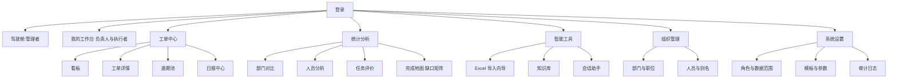

页面按角色的可见范围：管理者可见全部；负责人可见驾驶舱之外的工单、看板、逾期、日报、统计中的部门视角（含完成地图）、导入导出、知识库、会话助手；执行者可见我的工作台、工单详情（含单工单完成地图）、日报提交、知识库检索、会话助手。

工单详情是使用频率最高的页面，布局分三栏：左侧基本信息与问题措施，中间时间线，右侧证据、建议与相关工单。时间线是追踪模块的主要界面，每条记录显示人、时间、进度、说明、证据缩略图，弱证据的记录带补证提示。

知识库页面以"文档、解析状态、切片数"三段式列表为主，解析失败的文档单独一栏并带重试按钮，因为解析是异步的，人需要看到卡在哪一篇而不是整体成功与否。

完成地图页是部门缺口矩阵，行是在办工单，列是完成条件，格子三色，配一个按条件排序的开关与一个按滞留天数排序的开关。它不出现在执行者的导航里，执行者看的是工单详情右栏上的单工单完成地图；两处读同一份口径，只是粒度不同。

页面一览把图上的节点换成可开发的东西：一个路由、一个首屏目标、一个主操作，以及没有数据或出错时用户该走哪一步。最后两列是这张表的重点，因为操作断点绝大多数发生在空数据与异常态，正常态反而最少。

| 页面 | 路由 | 可见角色 | 首屏给什么 | 主操作 | 没有数据或出错时的下一步 |
|---|---|---|---|---|---|
| 登录 | `/login` | 全部 | 账号密码，上次登录时间 | 登录 | 账号被停用时写明原因与联系人；密码错误三次后给找回路径 |
| 驾驶舱 | `/` | 管理者 | 六个 KPI、逾期与未提交结果的集中入口 | 进入逾期池 | 无数据时给「先导入上月日报」，不显示六个空图 |
| 我的工作台 | `/desk` | 负责人、执行者 | 今日待办、待我验收、我的缺口、退回待改 | 打卡 | 无在办工单时列出本部门可接的工单 |
| 看板 | `/tasks/board` | 管理者、负责人 | 按状态分列的在办卡片 | 打开详情 | 列空时提示从草稿派工或从日报导入 |
| 工单详情 | `/tasks/:id` | 三角色 | 三栏布局，右栏九条条件 | 打卡或提交验收 | 看不到的字段写明「仅负责人可见」 |
| 逾期池 | `/tasks/overdue` | 管理者、负责人 | 逾期工单与滞留天数 | 催办 | 为空时写「当前无逾期」，不显示筛选控件 |
| 日报中心 | `/reports` | 管理者、负责人 | 按日期的汇报页列表 | 导入 | 为空时给模板下载与导入入口 |
| 部门对比 | `/stats/dept` | 管理者、负责人 | 部门完成率、逾期与滞留对比 | 下钻部门 | 数据不足时显示样本量，不给排名 |
| 人员分析 | `/stats/person` | 管理者 | 人员产出、滞留、复发 | 查看某人 | 样本不足时显示区间并说明阈值 |
| 任务评价 | `/stats/review` | 管理者 | 评价卡与待处理申诉 | 发布评价 | 无评价时给「生成本期评价」并说明样本要求 |
| 完成地图 | `/stats/gaps` | 管理者、负责人 | 部门缺口矩阵 | 按条件或滞留排序 | 快照失败时条幅写数据截止时间，矩阵只读降级 |
| 导入向导 | `/import` | 管理者、负责人 | 拖拽区与最近批次 | 三步走：识别、修正、确认 | 文件重复时给「查看上次结果」 |
| 知识库 | `/kb` | 三角色 | 按解析状态分段的文档列表 | 上传或检索 | 为空时给上传第一篇与从历史工单沉淀 |
| 会话助手 | `/chat` | 全部 | 会话列表与输入框 | 提问 | 模型不可用时只返回依据并标降级 |
| 部门与职位 | `/org/dept` | 管理者 | 部门树与岗位表 | 新建部门 | 为空时引导先建一级部门 |
| 人员与别名 | `/org/employee` | 管理者 | 人员表与别名维护 | 导入花名册 | 为空时给导入与手工新增两条路 |
| 角色与数据范围 | `/settings/roles` | 管理者 | 三种角色与权限点 | 调整权限 | 无账号时提示先建人员与账号 |
| 模板与参数 | `/settings/templates` | 管理者 | 导入映射、导出模板、阈值与权重 | 编辑并试算 | 为空时用默认模板，改参数前显示当前生效值 |
| 审计日志 | `/settings/audit` | 管理者 | 按对象与按人两个视图 | 筛选或导出 | 为空时说明只记写操作，读操作不入库 |

图上五个节点（工单中心、统计分析、智能工具、组织管理、系统设置）是导航分组，不单独占一页，点开默认落到该组的第一个页面。导出不是独立页面，它在日报中心与台账页里是一个动作，产物进度回填到发起它的那一页。

### 9.3 通用交互规则

同一个异常在不同页面表现不一样，用户就得重新学怎么恢复。下表把这些情形统一写死，所有页面复用同一套组件与文案结构。

| 情形 | 页面表现 | 用户接下来能做什么 |
|---|---|---|
| 加载中 | 骨架屏保留页面骨架，超过八百毫秒追加「仍在加载」 | 可取消，取消后回到上一屏且不丢筛选 |
| 列表为空 | 一句话写清为什么空，加一个主操作与一个次操作 | 主操作直接可用；缺前置条件时按钮禁用并给出跳转链接 |
| 可重试的失败 | 出错卡片给一句原因、错误码与重试按钮 | 原地重试，表单内容不清空 |
| 需要改数据的失败 | 指出哪个字段不合法并定位到该字段 | 改完再提交，不必重填整张表单 |
| 无权限 | 不渲染页面骨架，直接写缺哪个权限、找谁开通 | 给一个可去的替代页面，例如本部门只读视图 |
| 写操作进行中 | 按钮置忙并禁止重复提交，表单仍可见 | 超时后按钮恢复，服务端靠幂等键挡住重复写入 |
| 写操作成功 | 停留当前页就地更新，只有新建类才跳详情 | 详情页顶部给「返回来源」的路径 |
| 不可逆操作 | 二次确认弹层，标题写动作与影响，按钮写具体数量 | 弹层可关闭；确认后仍可在审计里看到原值 |
| 长任务 | 提交后给任务卡，卡片显示阶段、进度与失败原因 | 可离开页面，回到列表能看到同一张卡并可单条重试 |
| 数据过期或降级 | 结论附近标「数据截至某时」「已降级为本地检索」 | 给刷新或重试入口，不靠人自己判断新鲜度 |
| 并发冲突 | 提交时比对版本号，冲突则提示刚被别人改过并列出差异 | 可重新加载后再改，已填内容保留为本地草稿 |
| 表单未保存就离开 | 有改动时提示有未保存内容，草稿存本地二十四小时 | 回来时提示草稿时间，可选择恢复或放弃 |
| 会话流中断 | 该条消息标为未完成，已生成部分不作结论展示 | 可重发，沿用原问题与范围，也可只保留依据 |
| 通知未收到 | 站内列表与逾期池始终是完整入口，提醒只作加速 | 任何提醒里的链接与站内页面的地址相同，不出现只在通知里能做的事 |

三类可恢复性的区分决定按钮长什么样：可重试的给重试，需要改数据的把光标放到出错字段，需要权限的给申请入口。把三类混成一个「操作失败」的红条，用户只能截图找人。

筛选条件、排序与分页一律写进 URL，刷新、分享与从详情返回都不丢。从详情返回列表时回到原来的滚动位置，这是使用频率最高的返回路径，丢一次就要重新勾一遍筛选。

### 9.4 关键流程的逐步交互

下列十个流程覆盖三种角色与最容易卡住的地方。每条都写到具体控件与失败分支，因为断点集中在有人填错、有人没权限、或者任务跑了一半的时候。

#### 9.4.1 建单与派工

1. 两个入口（工单中心右上角新建、日报行的建单）打开同一个抽屉，差别只在预填字段，用户不必学两套表单。会话里不给起草入口，见 9.4.9 的第 5 步。
2. 抽屉第一段是五项必填：标题、类型、承办部门、负责人、计划完成。缺任何一项时保存按钮禁用，按钮上方一行写清缺哪一项，不弹窗也不清空已填内容。
3. 负责人选择器只列在职管理岗，且限定在承办部门及其上级范围内。选中后一行灰字写「他将收到验收与逾期提醒」，避免把非管理岗的人当成验收人。
4. 主责选择器先按承办部门列在职人员，并支持把参与人上移为主责。来源是群体格时这里显示原文「各个部门」并标为待认领，派工按钮不可用，解释写「需指定唯一一人才能开始计时」。
5. 保存后停在工单详情，顶部条幅写「已建为草稿，派工后执行人才能看到」，派工按钮就在条幅右侧，不跳到另一个页面再派。
6. 派工与通知分两步：派工成功即返回，通知失败只提示「已派工，通知未发出」并给重新通知，不让一次通知失败把派工整体回滚。
7. 从日报行进来时，抽屉底部显示「来自第 3 页第 12 行」并可展开原始行，误建时能看出是哪一行导致的。

#### 9.4.2 接单与打卡

1. 执行者进入我的工作台，待办卡按计划完成时间排序，逾期卡置顶并带红色左边条，卡片上直接显示还差几条必达条件。
2. 卡片三个动作：接单、打卡、申请改期。未接单时只有接单可点，卡上写明「接单后开始计时」，不让人误以为没接单也在计时。
3. 接单一次点击完成，不弹确认；成功后卡片进度条从零起，状态从待接单转进行中，第一条完成条件由未达成转为已达成。
4. 打卡是半屏抽屉：进度滑杆、说明、下一步、阻碍勾选、拍照。说明为空时按钮禁用；说明过短时给一行提示但仍允许提交，因为凑字数对判断没有帮助。
5. 拍照直接调相机并可当场重拍。网络差时先存本地队列，抽屉顶部显示「待上传 1 张」，恢复网络自动补传，上传失败不清草稿。
6. 提交后时间线立即插入一条，回到工作台，卡片进度与缺口同步刷新。同日重复打卡允许，进度取最新一条。
7. 这张单已被取消或已验收时，打卡入口置灰并写明原因，历史记录仍可查看，不给一个点了没反应的按钮。

#### 9.4.3 登记阻碍与解除

1. 工作台卡片与详情页都有「报阻碍」入口，点开只问两件事：卡在哪、需要谁支持。不要求填期限，因为阻碍的期限本来就该由负责人定。
2. 提交后状态置为阻碍，第七条完成条件转缺口，承担人默认为负责人，矩阵里对应格子转橙，同时在负责人工作台上出现一条「待处理阻碍」。
3. 提交后页面提示「负责人已收到，超过二十四小时未处理会升级」，把等待变成有期限的等待，而不是提交完就没人管。
4. 负责人处理时两个动作：补支持说明、解除阻碍。解除必须填「怎么解决的」，否则该条件不能转为已达成，避免点一下就把问题抹掉。
5. 执行人自己恢复时，允许在打卡里勾「阻碍已解除」并写说明，同样关闭这条缺口，不必等负责人有空。
6. 阻碍期间逾期照常计算，但逾期池里该行标注「因阻碍」，让管理者区分是执行人拖还是支持没到位。

#### 9.4.4 提交验收与退回

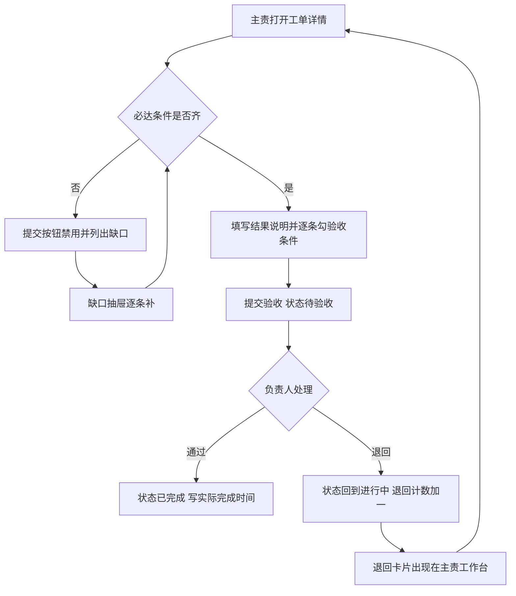

走查四点。判定框只读必达条件，不看进度百分比与说明字数，否则按钮会时开时关，人不知道到底还差什么。缺口与补缺口构成一个回路，任何一格缺口都能直达对应动作，不需要人自己判断去哪个页面补。退回那一支把结果送回主责工作台，这是最容易漏的一条边，漏了退回就成了单向操作，主责只看到状态变了却不知道要改什么。通过那一支要写实际完成时间，统计口径依赖它，写不进去就会出现状态已完成但报表里没有完成数。

1. 提交按钮的可用性由必达条件决定，不满足时按钮旁直接列出「问题 2 条未关、证据 0 条」，每一项都是链接，点开就是缺口抽屉。
2. 提交时必填结果说明，并按验收条件逐条勾选。勾选结果随提交写入，负责人看到的就是提交那一刻的样子，之后的数据变化不会改它。
3. 提交后主责端变只读，仍可补证据。补证据不改变待验收状态，避免为了补一张照片又把单子打回去。
4. 负责人的待验收卡显示提交快照：结果说明、证据缩略图、九条条件的状态、提交时间与逾期情况。
5. 通过一次点击完成，可选填任务评价；系统写实际完成时间、关闭强度，矩阵里这张单移出在办。
6. 退回必须选原因分类并写说明，状态回到进行中，退回计数加一，退回理由写进时间线。同一单第三次退回时提示「是否改为拆子工单」，把反复返工变成可分解的动作。

#### 9.4.5 改期

1. 主责与负责人都能发起改期，但改到更晚的日期需要负责人确认，提前则可以直接改，因为提前不需要谁批准。
2. 抽屉要求新期限与改期原因，原因分四类（等外部支持、需求变更、人手不足、估算偏差）加一段说明，说明少于二十字不允许提交。
3. 提交后改期计数加一，旧期限写进该条记录，逾期池按新期限重算，矩阵里滞留天数从新期限起算但不抹掉历史。
4. 原期限已过时，抽屉顶部提示「本单已逾期，改期会同时记录一次逾期」，避免有人以为改期能把逾期洗掉。
5. 改期累计三次后，详情页显示一条提示，并要求负责人在验收时额外说明；管理者的逾期池里这类单单独成一列。

#### 9.4.6 日报导入的冲突与错误行

1. 拖入文件后先算哈希。命中已有批次时给两条路：查看上次结果、以我的身份重新解析，默认不重复建批次。
2. 识别完成后预览页顶部给三个数：可建单、需处理、跳过，三个数都能点，点了就筛选出对应行，避免只看见一个总数。
3. 需处理的行展开为左右对照：左边原始单元格，右边解析结果。缺期限的行给日期选择器；人名歧义的行给候选下拉并带「新建人员」入口；群体格的行要求在人员里选一人，或改判为并入已有工单。
4. 每改一行立即存回该行的解析结果，离开页面再回来不丢。多次修改都留在同一批次，不产生多个草稿批次。
5. 确认按批次提交，逐行建单，单行失败不影响其它行。完成后给「成功 N、失败 M」，失败行可下载，允许线下补完再单独重导。
6. 撤回在批次列表里，二次确认要写明「将删除 37 张工单」，并显示受影响条数；撤回后该文件哈希仍占用，重新导入时按新批次处理。

#### 9.4.7 补缺口

1. 三个入口都落到同一张缺口抽屉：详情右栏的条件卡、驾驶舱的缺口最多部门、矩阵里的格子。入口多但界面一套，人不用记路径。
2. 抽屉按条件列出未达成项，每条给一个直达动作：接单、补期限、关问题、执行措施、写结果、传证据、报解除、填指标、提交验收。
3. 不能一键补的（例如指标要来自生产数据）标明「去指标页」，并在回来时保留抽屉状态，不必重新打开。
4. 抽屉内动作完成即刷新该条状态，抽屉不关闭，让人一次补完三到四条，而不是补一条关一次。
5. 没有权限补的缺口不显示灰按钮，显示承担人姓名与「已通知」，并给「催一下」按钮，避免出现点了没反应的控件。
6. 提醒消息里的链接与抽屉使用同一套地址参数，点进去直接停在对应条件那一行。

#### 9.4.8 知识文档解析失败与重试

1. 上传后文档立刻出现在列表，状态为已上传；解析开始后转解析中并显示排队位置，允许离开页面。
2. 解析中超过预期时长时，行上写「排队中，前面还有 4 篇」，同时给取消解析，避免人以为卡死而反复重传。
3. 失败的行展开显示原因原文，并给三个动作：重新解析、换切片模板、下载原件。重新解析只重这一篇，不影响同批其它文档。
4. 解析完成但切片数为零时按失败处理，提示可能是扫描件且未开文字识别，给「按图片模式重解析」。
5. 删除文档二次确认，写清会同时删除外部知识库里的文档与本地切片，已生成引用里的正文不受影响。

#### 9.4.9 会话断流与引用回溯

1. 输入框上方有范围选择器（我的、本部门、全公司），可选项随权限变化；范围选定后写进会话，后续几轮沿用，不因中途切换而出现口径漂移。
2. 发送后先出检索条「已找到 3 条依据」，再流式出文本。首字节超过两秒显示「正在检索」，超过十秒给「只返回依据」按钮。
3. 断流时该条消息标为未完成，给重发与只保留依据两个动作。重发沿用原问题与原范围，已检索过的结果直接复用，不重复计费。
4. 引用角标点开右侧面板，显示片段正文、来源文档或工单、页码或记录时间；无权限的引用只显示「无权限查看」并给申请入口。
5. 回答下方两个动作：复制为建单描述、新建工单。前者只复制文本，字段仍由人填；建单走 9.4.1 的抽屉，来源记为手工，消息 ID 只写进描述末尾作参考。会话不产出草稿，也不在工单上留会话来源标记，避免以后说不清哪张单是谁定的。

#### 9.4.10 评价发布与申诉

1. 评价页只对管理者开放，卡片显示总分、四个维度、证据条数与置信度；置信度低于阈值时只显示区间不给排名。
2. 发布前可以改分，改动必须写理由，理由与原值一并进审计。发布后不可改，只能走申诉流程。
3. 发布后被评价人收到一条「本期评价已发布」的提醒，但看不到分数，只有一个申诉入口与申诉期限。
4. 管理者处理申诉时，左侧是被申诉的评价与证据，右侧是申诉说明，三个动作是维持、调整、撤销。调整要写新值与理由，撤销后该周期不再计分。
5. 申诉期结束自动锁定。超期提交的申诉给「已过申诉期」的说明并指向线下处理，不让表单提交后无回应。

### 9.5 断点检查表

下表按「用户在哪一步会停下来」倒推，每一行都对应上面某条流程或某个页面，开发完成时逐行核对。

| 场景 | 容易断在哪 | 设计怎么接上 |
|---|---|---|
| 系统刚部署，库是空的 | 建工单时没有部门与人员可选 | 空态给出「先建部门再建人员再建账号」的顺序引导，建单抽屉在缺前置时按钮禁用并给跳转 |
| 负责人离职 | 待验收工单无人处理 | 负责人失效时工单回到待指派，管理者的逾期池列出全部「无人验收」的工单 |
| 主责离职 | 手上有在办工单，改派无人接手 | 转派必须选接替人，转派完成前不能提交验收，工作台上给「待转派」卡片 |
| 期限已过仍想补记录 | 补记被拒或记录时间被改 | 允许补记，业务日期照填，记录标「补记」并保留创建时间 |
| 附件太大或格式不支持 | 上传后无提示地失败 | 上传前显示上限与白名单，失败给具体原因与压缩或转换建议 |
| 手机上没有相机权限 | 拍照按钮点了没反应 | 退化为文件选择，文案写「拍照或选择图片」，不写「仅支持相机」 |
| 打卡时网络中断 | 草稿丢失，人以为没提交 | 打卡先落本地队列，恢复网络自动补传，页面显示待上传条数 |
| 通知没收到 | 以为没有待办 | 工作台与逾期池是完整入口，提醒只作加速，两者地址一致 |
| 会话查不到答案 | 只得到一句「没有找到」 | 给换一种说法、只看本部门知识、去知识库检索三个动作 |
| 知识库还没有内容 | 提问一直零命中 | 知识库空态给上传与从历史工单沉淀两个入口，会话里零命中时给同样两个链接 |
| 快照任务失败 | 矩阵空白，没人知道数据旧 | 矩阵读上一日快照并标注截止时间与过期标记，详情页仍走实时算式 |
| 导出文件过期 | 下载链接触发 404 | 下载位置改为「重新生成」，按保存的参数重跑，一分钟内重复点击返回同一任务 |
| 两个人同时导入同一文件 | 前一个人的结果被后一个人覆盖 | 哈希命中时给「查看上次结果」与「以我的身份重新解析」，后者的批次与原批次分列 |
| 一次导入几百行全部失败 | 逐行点开不现实 | 给失败原因分布统计与原件下载，允许整批撤回后改文件重导 |
| 样本不足却要评价 | 排名失真 | 显示区间与所需样本量，不显示排名，评价入口给出补样本的路径 |
| 权限不足进入某页 | 白屏或跳到登录 | 写明缺哪个权限、找谁开通，并给可访问的替代页面 |
| 账号被停用 | 登录只报错 | 登录页直接写原因与联系人，不提示「密码错误」 |
| 模型不可用 | 会话没有回答，也没有解释 | 只返回检索到的依据并标降级，同时给稍后重试与知识库检索两个动作 |

### 9.6 文案与提示规范

| 类别 | 规则 | 示例 |
|---|---|---|
| 错误提示 | 三段式：发生了什么、为什么、下一步 | 「保存失败：计划完成时间早于今天」「改到今天或之后」「重试」 |
| 错误码 | 一律显示并可复制，便于报障 | `TL-4093` 后面跟一句人话，不把错误码当解释 |
| 按钮 | 动词加对象，不用「确定」「提交」这类空动词 | 提交验收、重新解析、撤回批次、指定主责 |
| 危险操作 | 标题写动作与影响，按钮写具体数量 | 「撤回批次」「将删除 37 张工单及其追踪记录」「撤回 37 张工单」 |
| 时间 | 绝对时间加相对时间，跨年写年份 | 2026-11-01 09:20（三天前），不写「昨天」这种过了今天就错的说法 |
| 数字 | 带单位与口径，不写裸数 | 逾期 3 天、完成率 62%（本周）、缺口 4 条（其中 3 条必达） |
| 空态 | 三句话：为什么空、下一步做什么、点了会怎样 | 「本部门还没有在办工单。可以从日报导入，导入后自动按部门归类。」 |
| 语气 | 不用拟人、感叹号与填充词 | 不写「温馨提示」「请务必注意」，直接写要求 |

提示的位置也属于规范：与具体字段有关的错误贴在字段下方，与整个表单有关的放按钮上方，与数据新鲜度有关的放结论旁，只有系统级故障才用页面顶部条幅。把字段级错误也放进条幅，人得来回找是哪一项填错了。

### 9.7 移动端与可访问性

响应式 H5 按 Q6 只做高频动作，不做全功能移植，理由是手机上的表格与矩阵挤不出可读的信息。

| 范围 | 内容 |
|---|---|
| 支持 | 打卡与拍照、工单详情只读、验收通过与退回、报阻碍、会话提问、我的缺口 |
| 不支持 | 导入向导、组织维护、角色权限、缺口矩阵、批量导出，手机上只给「请在电脑上操作」的说明与所指页面 |

1. 触控目标不小于四十四像素；主操作固定在底部，单手可达；列表项整行可点，不要求点到小图标。
2. 拍照后可选择压缩再上传，上传进度分单张与总量两行显示，失败单张可重试。
3. 断网时打卡进本地队列，顶部显示「待上传 2 条」，恢复网络自动补传，不要求人重填。
4. 键盘可访问：所有操作能用 Tab 到达，抽屉可用 Esc 关闭并把焦点还给触发按钮，弹层打开时焦点不落到背景。
5. 颜色不是唯一信号：缺口格子在颜色之外加形状与角标文字，红绿色觉障碍者仍能读出三态。
6. 正文对比度不低于 4.5 比 1；关键结论不用小于十二号的字号承载。
7. 图表配文字摘要，矩阵每格带可读的替代文本，屏幕阅读器能读出「第 12 行的证据齐备条件未达成，已滞留 5 天」。

### 9.8 组件规范

| 组件 | 规范 |
|---|---|
| 状态标签 | 胶囊形，浅底深字，颜色跟语义走；逾期、阻碍、待验收、已完成为四种固定状态色 |
| KPI 卡 | 大号等宽数字加小号灰色标签，不用图标堆叠 |
| 表格 | 表头浅灰、行分隔浅线、悬停浅底；列可自定义但状态列固定在左侧 |
| 图表 | 细网格线、无边框、无阴影；坐标轴标签小号灰；图例只在不只一条系列时出现 |
| 空状态 | 一句话说明加一个主操作，不放插图 |
| 缺口矩阵 | 行高固定、条件列表头竖排；达成绿、未达成橙、滞留超阈值红、不适用浅灰；悬停显示缺口说明与承担者 |
| 抽屉 | 从右侧滑出，宽度固定，不遮住列表的关键列；抽屉内可连续完成多个动作而不关闭；Esc 关闭并把焦点还给触发按钮 |
| 条幅 | 只用于页面级状态：草稿未派工、数据过期、检索降级；可关闭但不自动消失，因为过期信息消失后没人再知道数据是旧的 |
| 任务卡 | 显示任务类型、阶段、进度、失败原因与单条重试；离开页面后仍能在列表找回，卡上的时间取任务创建时间与最近更新时间 |
| 时间线 | 按业务日期倒序，同一天的多条合并显示并标注次数；每条带人、进度、说明、证据缩略图，补记的记录带标记 |
| 缺口抽屉 | 按条件排序，未达成在前，不适用折叠；每条给一个直达动作与承担人；动作完成后就地刷新状态 |
| 危险操作 | 二次确认弹层，确认按钮用红语义色，标题写动作与影响数量，理由是状态迁移与删除都不可逆 |

## 10 实施顺序与验收

先做能让一条真实事项跑完的部分，再做统计与完成地图，最后接智能。这个顺序的理由有三条：导入与导出的解析规则一旦定下，字段与表结构就稳定了，先做统计会返工；完成地图只读既有数据，换的是一种看法，放在统计之后能直接复用预聚合与口径；智能层依赖前两者的数据，提前做只能拿假数据验证。

| 阶段 | 范围 | 验收条件 |
|---|---|---|
| M0 | 多模块骨架、Flyway 迁移、登录与角色、组织三件套、视觉框架与组件 | 能维护部门职位人员；页面与参照项目的视觉规则一致；迁移脚本可在空库一次跑通 |
| M1 | 工单与追踪、状态机与八条规则、看板与时间线、逾期池、审计 | 生产部一条真实整改事项从建单走到验收，含一次退回；逾期升级在测试环境按天触发可见 |
| M2 | 导入三步向导、五种导出模板、十二类图表、预聚合 | 样本 10 页明细行识别率不低于 95%、人名匹配不低于 92%；导出的日报可被再次导入且不产生重复工单 |
| M3 | 完成条件口径、单工单完成地图、部门缺口矩阵、事项完成地图、缺口日快照与两级提醒 | 试点部门在办工单每张都能在详情右栏看到九条条件状态与承担者；矩阵能按条件排出全部门积压；三日与七日两级提醒各实际触发一次；快照任务在两小时窗口内跑完 |
| M4 | RAGFlow 部署与适配器接入、单库标签过滤、文档同步与切片快照、带引用问答、历史问题措施沉淀 | 对同一类历史问题提问能召回至少一条历史措施，引用可点开原文；一个执行者查其它部门的私有文档零命中 |
| M5 | 会话平台（会话与消息、流式回答、引用回溯、四类只读工具）、两类评价、五类建议与建议采纳 | 在会话里提问能得到带引用的回答，引用可点开原文；从建议到采纳的动作跑通且采纳后改动可审计；每条评价可下钻到证据记录 |

试点范围按 Q11 定在生产部与质量部，三到五名真实用户，两周。M3 与 M5 的验收都在这两个部门做，M4 的知识库也先灌这两个部门的材料，不铺全公司。两周结束时看三件事：逾期池里的单是否真的变少、缺口提醒是否有人响应、会话里的提问是否被带引用的回答接住。

## 11 仍待确认的项

Q1 到 Q12 与 RAG 底座已在 1.6 落定，本轮只留三项。第一项影响结构与工期，后两项是配置与命名。

| 编号 | 待确认 | 选项 | 默认 | 影响章节 |
|---|---|---|---|---|
| Q13 | 完成条件的集合与权重 | A 按 4.10 的九条与权重上线；B 先只上 G1、G3、G5、G9 四条；C 各类型先给默认口径，部门自定后覆盖 | A | 4.10、6.2、6.3.4 |
| Q14 | 缺口提醒的阈值 | A 三日提醒承担者、七日提醒负责人；B 统一七日；C 只进矩阵不提醒 | A | 4.10、第 7 章、6.3.8 |
| Q15 | 产品中文名 | 保持 `TraceLink`；或另给一个中文名 | 保持仓库名 | 全文 |

Q12 已在 1.6 定下来：取 A 加 B，模型只读，分析建议先做。这一项从待确认表里移走后共删掉三处内容——4.8 的起草工具与用例、5.1 的 `CHT-5` 接口、M5 里的建单草稿验收项；建议改由 `AI-1` 与 `AI-2` 两条接口承载，采纳之后的动作在应用服务里执行，模型不碰业务表。起草若要在试点后重启，判据写在 1.6 的 Q12 段：自然语言描述新事项的提问占比超过两成，且人工建单耗时没有下降。

Q13 决定 M3 的重量。九条条件一次上线的好处是执行者一次看懂全部缺口，坏处是每个部门的工单类型都要配一份口径，M3 要多留三天做配置与试算 `[Hypothesis]`。先只上四条则相反：能跑通"有没有结果、有没有证据、有没有验收、有没有接单"这四件最要紧的事，权重与 G4、G7、G8 留到试点之后再补。

Q14 的阈值定得太紧会让人屏蔽通知，太松等于没有提醒。三日与七日的初值来自逾期升级节奏（4.2 的 R5），两级都提醒才与催办的力度对得上；只进矩阵不提醒的做法省事，但缺口不会被谁主动看见。

Q15 的产品名沿用仓库名 `TraceLink`。若要中文名，例如"追踪链"，请另给一个。

未标注来源的数值均为初值，包含识别率 95% 与 92%、相似度阈值 0.85、切片长度 400 至 600 字、超时 30 秒与 10 秒、上传上限 20 MB、并发二百在线、五年百万级工单量、完成条件权重合计一百、缺口滞留阈值三日与七日、快照保留一百八十天。这些在试点期用真实数据校准，校准依据写进 `sys_config` 的 `remark` 与对应模块的配置项注释。
